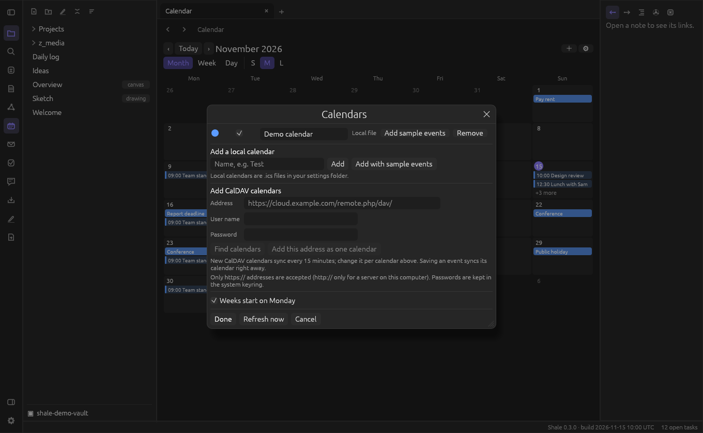
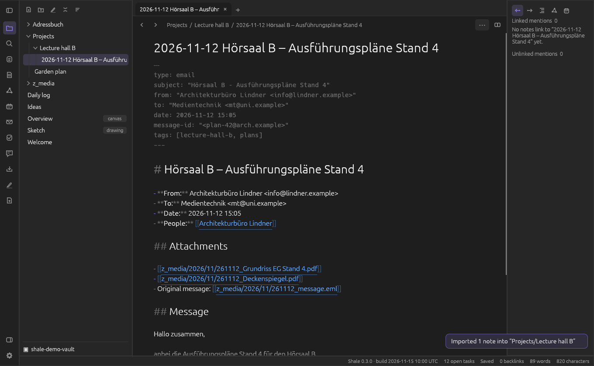
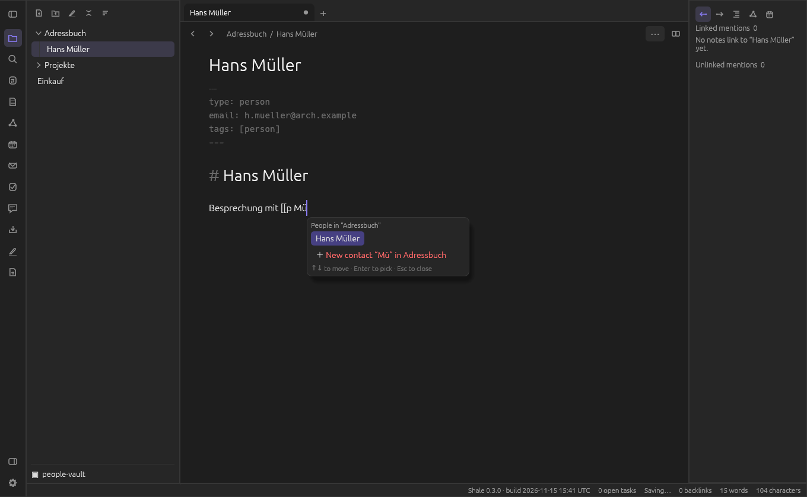

# Shale features

Shale is a notes app for the Linux desktop. Your vault is a plain folder of markdown files,
and notes link to each other with `[[wiki links]]`. The screenshots below come from the app's
built-in demo vault (`shale --screenshot out.png`).

## Notes and links

- `[[Note]]` links are **blue** when the note exists and **red** when it doesn't. Click a blue
  link to open the note, or a red one to create it.
- Pictures (`![[photo.png]]`), drawings (`![[Sketch.excalidraw]]`) and PDFs are shown inside the
  editor.
- Lists continue when you press Enter (also numbered lists and to-dos `- [ ]` / `1. [ ]`).
  Tab and Shift+Tab indent list items or change heading levels, and Alt+↑/↓ move lines.
- Web links (`[text](https://…)`) open in your browser.
- Drag notes, drawings, files and folders in the file list to move them into another folder.
  Links that point to them by path are updated.

- Back and forward with the mouse side buttons or Alt+←/→. You can sort the file list by name,
  date modified or date created.

- Type `[[` to get matching notes; the last entry creates a new note. Esc closes the list.
- Type `[!` to pick a file: `/` starts at the vault, `~/` at your home folder, and Tab completes
  like a shell. Files from outside the vault are copied to `z_media/<year>/<month>/`.

- Ctrl+E switches between editing and the reading view.

- Export notes and drawings to PDF (paper size, margins, fonts and more in a dialog), insert a
  new drawing, rename the note (links in other notes are updated), or move it to the trash.

## Drawings

- Hand-drawn style sketches, saved as standard `.excalidraw` files.
- Tools on keys 1–0: hand, select, rectangle, diamond, ellipse, arrow, line, pen, text, eraser.
- The style panel sets stroke and fill colours, fill style, stroke width, outline pattern,
  sloppiness, corners, label font, size, colour, background and alignment, opacity, and the
  order of shapes.
- Double-click a shape to label it. Arrows snap to shapes and follow them when shapes move.
  Hold Shift to keep lines at 45° steps.
- "Auto arrange" untangles a diagram; "Spread out" and "Pull together" change the spacing.

## To-do list across all notes

- Every `- [ ] task` from every note in one list. Ticking a task off saves it in its note.
- Filter by text or `#tag`, show done tasks, or only tasks with a due date
  (`📅 2026-12-01` or `due:2026-12-01`).

## Linked notes and the graph

- The right sidebar shows backlinks, unlinked mentions, outgoing links, the outline and a local
  graph of the open note.
- The vault graph shows every note. Red dots are missing notes and green ones are drawings.

## Calendar

- A calendar in the right sidebar (small month) and as a big tab, with Month, Week and Day views
  in three sizes.
- Local calendars (`.ics` files, for testing; with sample events) and **CalDAV** calendars
  (for example Nextcloud). Each CalDAV calendar has its own automatic sync interval (15 minutes
  by default).

- Click an event to see its details: when, how it repeats, where, organizer, attendees and
  notes. **Edit** and **Delete** work for local and CalDAV calendars.

- Double-click a day or time to create an event. It starts at the next full or half hour and is
  30 minutes long.
- "Save to" chooses any calendar. When a calendar refuses the save (for example because you have
  no write permission), the error is shown in the dialog and you can pick another calendar.
  Moving an event writes it to the new calendar first and removes it from the old one only after
  that worked, so nothing is lost.

- Settings → Calendars: add local calendars or CalDAV accounts ("Find calendars" asks the
  server), choose colours, show or hide calendars, and set the sync interval per calendar.

## Importing e-mails, events and files (for project tracking)

- Drag e-mails from Thunderbird, events from a calendar (Shale's own or another program), `.eml`
  or `.ics` files, or any other files (plans, PDFs…) onto the window. The ribbon's Import button
  opens the same dialog.
- Choose the folder (one per project, for example) and tags. Small pictures from signatures are
  left out by default, and each attachment can be ticked on or off.
- Drop onto a folder in the file list to import into that folder, or onto a note to also add
  links to the new notes there.
- Messages that were already imported are recognised and left out unless you tick them again.
- On Wayland, Shale reads what Thunderbird hands over. When that is only a link to the message,
  Shale finds the message in Thunderbird's local copy (for IMAP accounts this needs "Keep
  messages for this account on this computer").

- Each e-mail becomes a note named "date subject" with the sender, recipients and date, the tags
  in its properties, links to the attachments and the original message, and the text of the
  message. The tag list counts these tags too.

## People (contact notes)

- Contact notes live in the **people folder** (default `Adressbuch`, changeable in Settings).
- Type `[[p ` and a name to pick a person from that folder. The link that is written is a normal
  `[[Name]]` link, so other markdown tools understand it too. "New contact" makes a contact note
  from a template (e-mail, phone, organization, notes).
- When importing, the sender, recipients, organizer and attendees are found and matched to
  contact notes (by e-mail address anywhere in the note, else by name; "Müller, Hans" = "Hans
  Müller"). Known contacts and new senders are ticked; for ticked people without a note one is
  made. The imported note gets a "People" line with links, so each contact note's backlinks show
  every mail and meeting with that person. Automatic senders like "noreply" are left out.

## Tags found automatically (no server, no AI)

- Tags of the vault that are written in the imported text are set right away
  (`#lecture-hall-b` for "Lecture Hall B", the last part of nested tags too).
- Shale also learns, from the notes in the vault, which words are typical for each tag (words in
  most notes with the tag and rarely elsewhere) and suggests those tags when an import contains
  several of these words. It is plain counting: the same notes always give the same suggestions.
  It is learned again in the background now and then and kept in `.shale/tag-words.json` in the
  vault.

## Keyboard

| Keys | Action |
|---|---|
| Ctrl+N | New note |
| Ctrl+O | Quick switcher (find or create a note) |
| Ctrl+E | Edit / reading view |
| Ctrl+, | Settings |
| Ctrl+Shift+F | Search all notes |
| Ctrl+H / Ctrl+L | Previous / next note in the folder (in the file list's sort order) |
| Alt+← / Alt+→ | Back / forward |
| Alt+↑ / Alt+↓ | Move the current line |
| Tab / Shift+Tab | Indent lists or change heading levels |
