# Shale features

Shale is a notes app for the Linux, macOS and Windows desktop (what differs per system: the README, "Supported systems"). Your vault is a plain folder of markdown files,
and notes link to each other with `[[wiki links]]`. The screenshots below come from the app's
built-in demo vault (`shale --screenshot out.png`); `docs/screenshots/regen.sh` makes them all
again from the recipes in `docs/screenshots/recipes.conf`; the pictures live in the media folder of the
[user guide](userguide/Start%20here.md), a vault you can open in Shale (`docs/userguide`), which explains every feature too.

## Notes and links

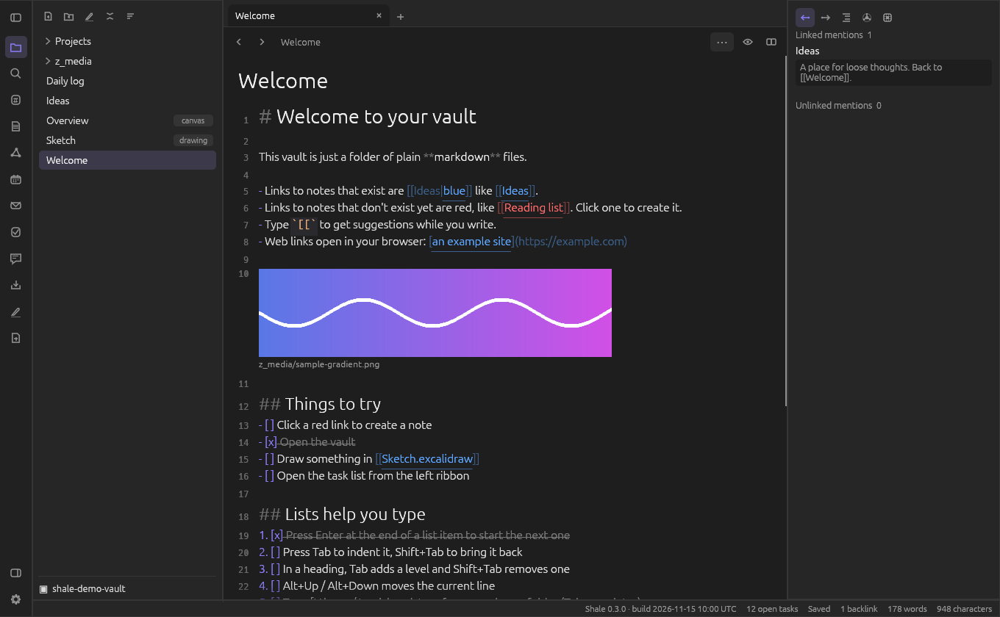

- `[[Note]]` links are **blue** when the note exists and **red** when it doesn't. Click a blue
  link to open the note, or a red one to create it.
- Pictures (`![[photo.png]]`), drawings (`![[Sketch.excalidraw]]`) and PDFs are shown inside the
  editor. Pictures and videos have draggable edges and corners (the width goes into the link,
  `![[photo.png|300]]`), a round **100%** button for the natural size and a round fullscreen button.
  Every shown embed has its link as a one-line caption below it (the words of an alias,
  `![[photo.png|Sea at dusk]]`, else the file's link); a click on the caption opens the file.


- **Syntax highlighting**: a fenced code block is coloured by the language on its opening fence
  (```` ```js ````, ```` ```rust ````, `python`, `ts`, `toml`, `sh`, `json`, `yaml`, `c++`, … about 140 languages, with the usual aliases) in the
  editor and the reading view; a block without a language or with an unknown one stays plain.
  Inline code colours its strings, numbers and called names. The PDF export draws code the same way,
  on the same dark code background (PDF-007).
- Line numbers are shown left of the text (Settings → Editor, on by default); a wrapped
  line keeps one number.
- **Folding.** Headings (up to the next heading of the same or a higher level), quotes, list items and whole lists can be
  folded away: a folded block shows its first line and a muted `… n lines` badge; the rest is hidden (no line
  numbers for it), with the Markdown preview on and off. Hover a line that starts a block and click the ▾ marker left of
  it (a folded block always shows ▸) to fold it; click the marker or the badge to unfold. Keys (Settings →
  Keybindings → Note view): **Ctrl+Shift+K** fold, **Ctrl+Shift+J** unfold, **Ctrl+Shift+O** fold all,
  **Ctrl+Shift+I** unfold all; with Vim-style editing `za` `zc` `zo` `zM` `zR`. The cursor never stays in hidden
  text: moving into a fold (or a link or search jumping there) opens it. Folds are kept per note across restarts (EDIT-079, in the vault's `.shale/state.json`; a fold whose block is gone and a note that is gone are dropped, a renamed or moved note keeps its folds) and
  are never written into the file. Also foldable (EDIT-080 to EDIT-085): **code blocks**, the **front matter** and a
  **signature** (a line `-- ` up to the next heading). A note's front matter starts folded to one muted line
  `▸ Properties · email · Anna Müller · 2026-11-12` (the setting "Properties in the editor": folded or card; raw leaves it
  open); the cursor moving into it opens the YAML and folds it again when it leaves. In a **mail note**
  (`type: email`) the quotes (`… n quoted lines`) and the signature start folded too.
- **Folding in the reading view** (EDIT-095 to EDIT-099, rabalyn/shale#364): the reading view folds the same blocks with
  the same folds as the editor of the note (fold in one, it is folded in the other; kept across restarts, never written into the note).
  Hover a block's first line and click the ▾ marker left of it, or the `… n lines` badge under a folded block (a folded code block is one row with its badge in the box, EDIT-103);
  **Ctrl+Shift+O** / **Ctrl+Shift+I** fold and unfold all there (fold and unfold at the cursor are editor keys). A footnote
  jump or a click in the outline on a heading that a fold hides opens the fold. The front matter card keeps its own toggle.
  Large notes stay quick (EDIT-099 to EDIT-102, rabalyn/shale#369): the folds of an unchanged text are not found again, and
  from 2 000 lines on the reading view draws only what is near the visible part. The editor keeps the laid-out note, the
  parsed tables and footnotes and the counts of the status bar while nothing changes (EDIT-104 to EDIT-107, rabalyn/shale#372),
  so a frame of a 20 000-line note takes a few milliseconds, and the text is formatted block by block, so a typed key or a
  move of the cursor to another line formats one or two blocks instead of the whole note (EDIT-109, rabalyn/shale#375).


- **Code blocks as boxes** (EDIT-080, EDIT-086, rabalyn/shale#356): with the Markdown preview on, a fenced code block is a
  rounded box on the code background with a thin border and a badge at its top right with the language (`code` when there is
  none); the ``` lines are hidden and show again when the cursor is in the block. The reading view draws the same box.
  A small **copy button** (EDIT-090 to EDIT-094, rabalyn/shale#365) at its top right, left of the badge, copies the code
  without the fences and the last newline; it shows on hover (in the editor also with the cursor in the block, and on a
  folded block), in the editor and the reading view. **Ctrl+Shift+C** copies the block at the cursor.


- The **text cursor** (Settings → Editor → Cursor) is one of four shapes: a bar before the character (default), a bar after it,
  a block or an underline; with Vim-style editing the cursor of normal mode has its own choice (default: block).
  "Blinking cursor" (on by default) makes it steady when off. The Vim tab (listed under Editor) holds the Vim settings: the switch, the cursor of normal mode, "Esc from insert mode" (the cursor stays after the typing by default, or steps back like Vim) and the link preview size. Exactly one cursor is drawn in every mode.
- A **formatting toolbar** above the text (Settings → Editor, on by default, button size 80–200 %) has a button for
  everything Shale draws: bold, italic, strikethrough, highlight, inline code, headings (a menu from
  Normal text to H6), bullet and numbered lists, tasks, quotes, code blocks, rules, page breaks, alignment (left, centre, right), tables, `[[note]]`
  and `[text](url)` links, embeds (it opens the `[!` file picker) and "Clear formatting". With a
  selection a button wraps it (or takes the markers off again); with none it puts the markers in and the
  cursor between them; a line button works on every line the selection touches. Each click is one undo
  step and the keyboard stays in the note, also with the Markdown preview and with vim-style editing.
  Every button of the toolbar, the view header (edit / reading view, preview, ⋯ menu), the tab bar (New tab)
  and the ribbon has an Alt key (Alt+B bold, Alt+V reading view, Alt+1 … Alt+0 ribbon items, Alt+, and Alt+.
  sidebars, see Keyboard below), shown as a badge at the button while Alt is held; after a button or key that
  only changes the view, the editor has the keyboard again with the cursor and selection unchanged.
- **Colours.** The toolbar's highlight and font colour buttons are split buttons: a click on the colour applies the
  current colour at once (the colours are remembered in the vault, also after a restart), the ▾ beside it opens a palette (four neon highlights, a
  "No highlight" entry and a colour picker; font colours you set in Settings → Editor) and write plain
  HTML that other markdown apps understand: `<mark style="background: #FFFF00;">text</mark>` and
  `<span style="color: #E53E3E;">text</span>`. They show in the editor (the tags dimmed, or hidden by
  the Markdown preview), the reading view, table cells and the PDF export, and nest with bold and italic.
- **Footnotes, underline, sub and superscript.** A footnote reference `[^1]` with a definition
  `[^1]: text` (continuation lines indented by four spaces or a tab) is a small raised label in the
  link colour, the definition shows its label raised and its text a little smaller; in the reading
  view a click on a reference jumps to its definition and back. `<u>text</u>` underlines,
  `<sub>…</sub>` lowers and `<sup>…</sup>` raises, and `<br>` in a table cell starts a new line.
  All of it shows in the Markdown preview, the reading view, the outline, table cells and the PDF
  export (a reference links to its definition) and is what pandoc writes for a Word document.

  

- **Math.** `$E = mc^2$` is set in the text, and `$$…$$` on lines of its own (or a ```` ```math ```` block) is
  set centred in display style: fractions, roots, scripts, sums and integrals with limits, matrices,
  cases, delimiters that grow and the usual symbols, typeset by Shale itself (pure Rust, no TeX needed)
  with the bundled font STIX Two Math. It shows in the reading view, the editor's Markdown preview (the
  cursor line shows its TeX), table cells, the outline and the PDF export, where it is drawn as sharp
  vector outlines; a formula Shale cannot typeset stays as code, and says why when you point at it.

  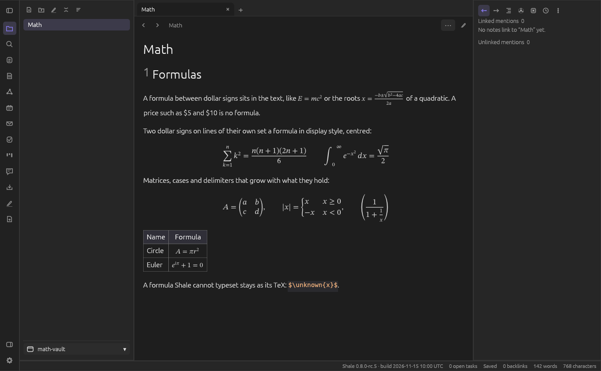
  

- Lists continue when you press Enter (also numbered lists and to-dos `- [ ]` / `1. [ ]`).
  Tab and Shift+Tab indent list items or change heading levels, and Alt+↑/↓ move lines.
- Web links (`[text](https://…)`) open in your browser.
- Drag notes, drawings, files and folders in the file list to move them into another folder.
  Links that point to them by path are updated.

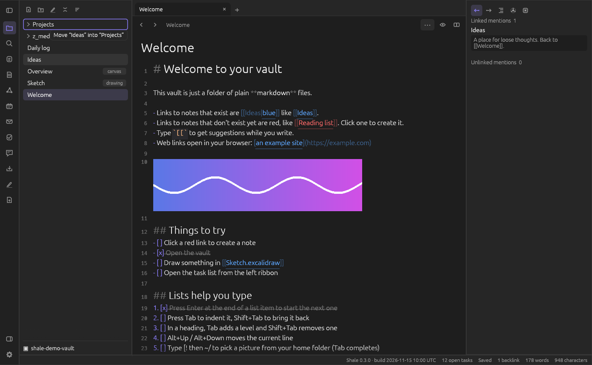

- Back and forward with the mouse side buttons or Alt+←/→ (macOS: Cmd+[ / Cmd+]). You can sort the file list by name,
  date modified or date created.

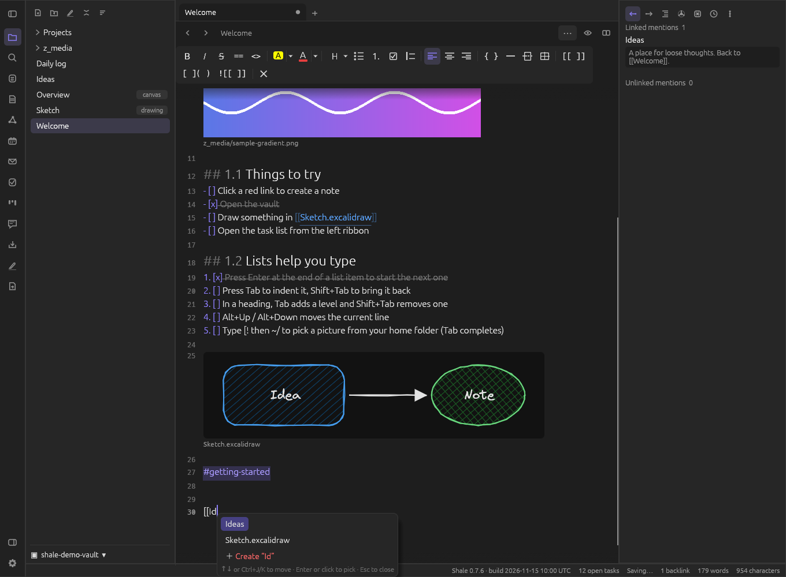

- Type `[[` to get matching notes; ↑/↓ or Ctrl+J/Ctrl+K move through the list, Enter, Tab or a
  click picks an entry, and the last entry creates a new note. Esc closes the list.
- Type `[!` to pick a file: `/` starts at the vault, `~/` at your home folder, and Tab completes
  like a shell; ↑/↓ or Ctrl+J/Ctrl+K choose, Enter or a click picks. Files from outside the vault
  are copied to `z_media/<year>/<month>/`.
- Paste a picture (Ctrl+V, or `p` in vim mode) and it is saved in the media folder as
  `Pasted image.png` with a link at the cursor; paste files copied in a file manager (pictures, PDFs,
  audio, video) and they are copied there and linked, one link per line. Other text pastes as usual.

- **Sound players.** `![[song.mp3]]` shows a small player instead of a link, in the editor, the
  markdown preview and the reading view (mp3, ogg, oga, flac, m4a, aac and wav play; opus files
  are recognised but cannot be played yet). It shows the cover from the file's tags (or a tile
  with the file name), a round play/pause button over it (Space too, while the player has the
  keyboard), a progress bar (click to jump, drag to choose and seek on release) with the time,
  and a mute button and volume slider. Only one file plays at a time; it keeps playing while
  you scroll or switch between the editor, the preview and the reading view, and stops when
  the note's tab is closed or another vault is opened. Nothing ever starts by itself. In Settings →
  Appearance: how opaque the play button is (60 % by default). The volume is one setting for
  all players.

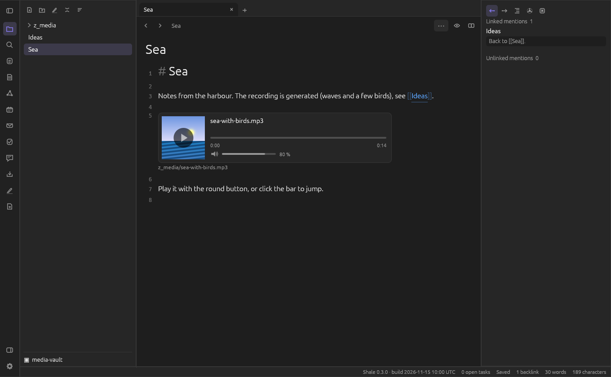

- **Video players.** `![[clip.mp4]]` (mp4, m4v, mov, webm, mkv) shows the same player with the
  first frame as its picture; the picture is wider (16:9) and the controls sit below it. While it
  plays the picture shows the video, and the sound goes through the same output as sound files.
  A click on the progress bar restarts the video at that place. Videos are decoded by the
  **ffmpeg on your computer** (`ffmpeg` and `ffprobe`; `apt install ffmpeg`, `brew install ffmpeg`,
  `winget install ffmpeg`). Without it the video shows a tile with a play mark, a click opens the
  file in your system's video player, and Settings → Appearance says that ffmpeg is missing and
  where to get it.


- Ctrl+E switches between editing and the reading view.


- Export notes and drawings to PDF (paper size, margins, fonts and more in a dialog; tables become
  real grids with the header repeated across pages, or raw text lines with "Export plain text";
  embedded pictures, drawings, PDFs, the first frame of a video and the cover of a sound are
  drawn as thumbnails with their link as the caption below, as big in proportion to the text as in
  the editor: a picture made smaller keeps its share of the width, a sound or video is drawn as its
  player card; highlights and font colours are printed as written, as are footnotes (a reference links to
  its definition), underline, sub and superscript, `<br>` in table cells and math (vector outlines); a **Contents** page after the title lists the
  `#`–`###` headings with their numbers and the pages they start on, each a link, with a checkbox to leave it
  out, and the PDF has bookmarks for its `#`–`######` headings; the title is printed once: when the note's first
  heading is a `#` that says the same as the title, the separate title is left out, PDF-008; a note's
  properties set how it is printed, see below), insert a
  new drawing, rename the note (links in other notes are updated), or move it to the trash. The
  trash keeps the original folder (`.trash/<date>/<path>`) and nothing in it is replaced or
  emptied; right-click the empty space of the file list and choose "Restore last deleted" to put
  the last item you trashed back.

  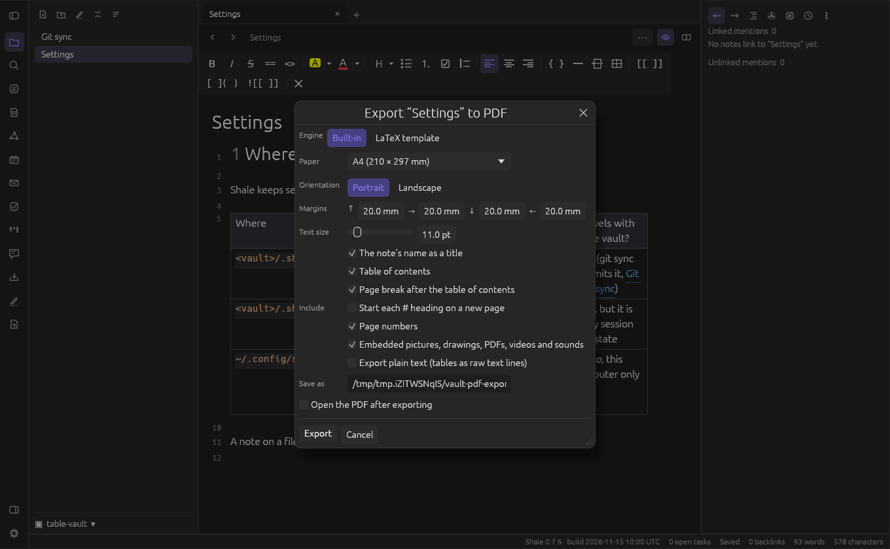

- **Print properties of a note** (#339): the front matter of a note can say how its PDF is printed; all
  keys are optional and a bad value is ignored. The export dialog opens with the note's paper, margins,
  text size, title and contents filled in (and they can be changed there); the font, the spacing, the
  alignment, the heading colour, weight and sizes are read from the note at export time. Word imports write them.
  - `print-paper`: `A4`, `A5`, `Letter`, `Legal` or `<W>x<H>mm` (a width larger than the height is landscape)
  - `print-margins`: four numbers in mm, `top right bottom left`
  - `print-font`: `serif` (Liberation Serif, Times-compatible), `sans` (Ubuntu Light) or `mono` (Hack)
  - `print-font-size`: the body text in points
  - `print-line-spacing`: a factor, 1.0 being the font's own single line height
  - `print-paragraph-spacing`: the space after a body paragraph in points
  - `print-align`: `left` or `justify`
  - `print-heading-color`: `#RRGGBB`
  - `print-heading-weight`: `normal` or `bold` (the default), the weight of headings
  - `print-heading-sizes`: six sizes in pt for the heading levels 1 to 6, such as `"16 13 12 11 11 11"` (4 to 72
    each; anything else is ignored); they replace the usual proportions
  - `print-title`: `true` or `false`, the note's name as a title
  - `print-toc`: `true` or `false`, the contents page
  - `print-break-before`: a heading level 1 to 6; every heading up to that level starts a new page
    (`1`: every `#`; the dialog has a box "Start each # heading on a new page" for it)
  - **Paper look** (#367): a note with any of these keys is printed plainly: list marks and quotes in the text
    colour (a quote indented, without a bar), inline code and code blocks in the mono font without the app's
    colours (a code block on light grey), tables with thin black lines and a bold header without fill. A
    note without any of the keys prints as before.

- **Page breaks** (#359): a line `<div style="page-break-after: always;"></div>` (the form Obsidian writes;
  `page-break-before: always`, `break-after: page` and `break-before: page` work too) is a page break:
  the built-in PDF export and the LaTeX export (`\newpage`) start a new page there, without an empty
  page when the page is empty already or the break is the last thing of the note. The editor's Markdown
  preview and the reading view draw it as a thin dashed rule labelled "Page break" (the line with the
  cursor shows the HTML). The toolbar button "Page break" (Alt+J) inserts the line.

- **Centred, right-aligned and justified paragraphs** (#340): a paragraph or heading between a line
  `<div align="center">` and a line `</div>` (also `align="right"` and `align="justify"`; the form Obsidian
  shows too) is aligned that way. The reading view, the built-in PDF export and the LaTeX export
  (`center` and `flushright`) lay it out so, and the outline still lists a heading in one; the editor shows
  the two lines dimmed. Three toolbar buttons (left, centre, right) put the paragraphs under the cursor or
  the selection into a wrapper, change it or take it off. The Word import writes the wrappers for the
  paragraphs and headings whose alignment differs from the body's.

- **A folder as one PDF, a book** (BOOK, #306): **Export to PDF…** in the menu of a folder in the file list,
  or of the vault (right-click the empty space under the tree), writes the notes of the folder and its
  subfolders as one PDF: a title page (the folder note's `title`, `subtitle`, `author`, `date`), one
  contents page (parts, chapters and the first level of headings, with numbers, a dotted leader and the
  page, each a link), every note on a new page (a box), numbered headings that continue the chapter's number,
  a small grey running header with the chapter's title, links between the chapters that go to the page
  (or the heading), and nested bookmarks. The convention needs no renaming: chapters are the notes (not
  `export: false`), a folder note (`index.md`, `README.md`, the note named like the folder, or
  `folder-note: true`) introduces a folder, the reading order is its `order:` list, else the order of its
  links, then the rest by name with numbers by value. The dialog has a folded **Reading order** to check the
  tree; the export is a background job with Cancel.
  `shale --export-pdf <folder> <file.pdf>` does it without a window, and `scripts/userguide-pdf.sh` makes the PDF of this
  user guide (BOOK-001 to BOOK-012), which every release has as `shale-userguide-<version>.pdf`.
- **A folder through a LaTeX template** (#309): the folder's export dialog has the engine choice of a note's.
  With **LaTeX template** and a kind of the article or book family (publication, report, exercise, thesis,
  PhD; slides, letters and posters are greyed) the book is one LaTeX document: in a thesis the subfolders are
  `\part`s and the notes `\chapter`s, in an article kind they start at `\section`; folder notes' text goes
  under their part, the top folder note's before the first chapter and its properties fill the fields; links
  between the chapters jump to their chapter or heading (`\hyperlink`); embeds of the same name in different folders stay
  apart. LaTeX makes the numbers, the contents and the bookmarks (BOOK-013 to BOOK-017).

- **Settings → LaTeX** finds the TeX for the LaTeX export of notes (LuaLaTeX and biber, the one on the
  computer when its kernel is from 2022-06-01 or newer, else a TeX Live that Shale installs itself):
  the page says which TeX is used or why none can be, tests it with a small document, and installs,
  updates and removes the managed TeX Live. It shows the sizes (about 100 MB to download, 330 MB on
  disk) before anything is downloaded, shows the progress, and can be cancelled; the compile that
  the export will use runs LuaLaTeX and biber in a temporary folder with a timeout and turns the log
  into readable errors (TEX-001 to TEX-004).

  

- **Template sets** (Settings → LaTeX) are the templates a LaTeX export is made with, kept in your vault
  (`templates/tex/<set>/`: the class files, one small manifest per document kind, your settings and the
  logo), so they are synced and backed up with your notes and a TeX Live update cannot change a document.
  **Import TU Darmstadt templates** downloads the tested tuda-ci (checked by its checksum) and builds the
  11 document kinds (publication, report, exercise sheet, thesis, doctoral thesis, slides, letter,
  poster, scientific poster, leaflet, announcement); the newest version from CTAN, a GitHub repository, a
  zip, a `.tar.gz` or a folder can be imported too (a set Shale has no kinds for is imported without
  kinds, which are then added by hand). Importing runs as a job with progress and Cancel and never leaves
  half a set; **Update set** keeps your settings and logo and moves the old files to the vault's trash;
  **Test page** compiles a small document of the set and opens the PDF; **Remove set…** moves it to the
  trash. The university's logo may not be redistributed: **Choose logo…** copies yours into the set, and
  until then exports use a placeholder and the set says "logo missing: exports are not CI-conformant"
  (TEX-005 to TEX-007, TEX-024 to TEX-027). A **department logo** (**Choose department logo…**, **Remove
  department logo**) is an optional second slot: documents show it below the TU logo, right-aligned and
  as high, where the class has room for it (not on exercise sheets and announcements), and the export
  dialog has a **Department logo** box for it (TEX-035).

  

- **Guided setup of the LaTeX export** (Settings → LaTeX → **Set up LaTeX export…**, and by itself the first
  time you choose **LaTeX template** in the export dialog of a vault where something is missing; the dialog's
  hints for a missing TeX, template set or logo have a **Set up…** button too) is for people who are not firm in
  TeX but want to use their university's templates. Five steps with a step indicator, Back, Next and Cancel,
  and a green tick on what is done already: **TeX** (found, or installed after you agree: about 100 MB to
  download and 330 MB on disk, with progress and Cancel; the built-in export needs nothing of this),
  **Templates** (TU Darmstadt, the tested version, the newest from CTAN, a file, a folder or GitHub, or a set
  you have), **Logo** (the university's logo may not be shipped: the step says where members get it; give it
  by **dropping the file onto the window** or by its path, or choose Later and exports carry a placeholder; an
  optional second field takes your department's logo),
  **Your details** (the accent colour as swatches `0a` to `11d`, the language, your department and name, kept in
  the set's `settings.toml`) and a **Test page** that is made with your choices and opened, or, if it fails,
  explained in words with **Save the .tex**. While the setup or Settings → LaTeX is open, files dropped on the
  window belong to it (a logo, a `.zip`, a `.tar.gz` or a folder of templates) and are not imported into the
  vault as notes (TEX-017, TEX-028).

  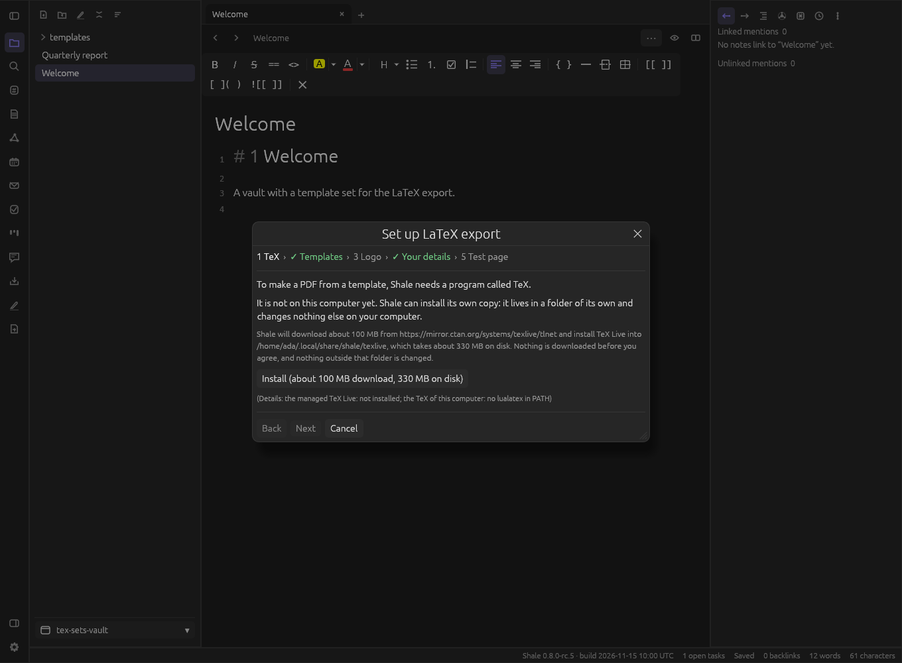

  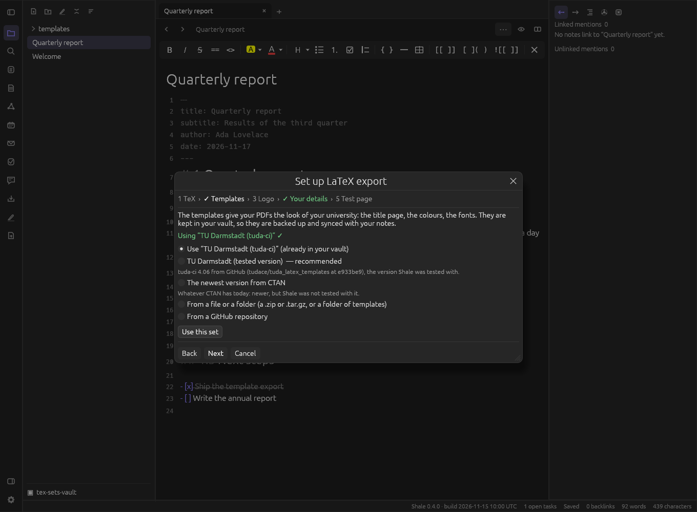

  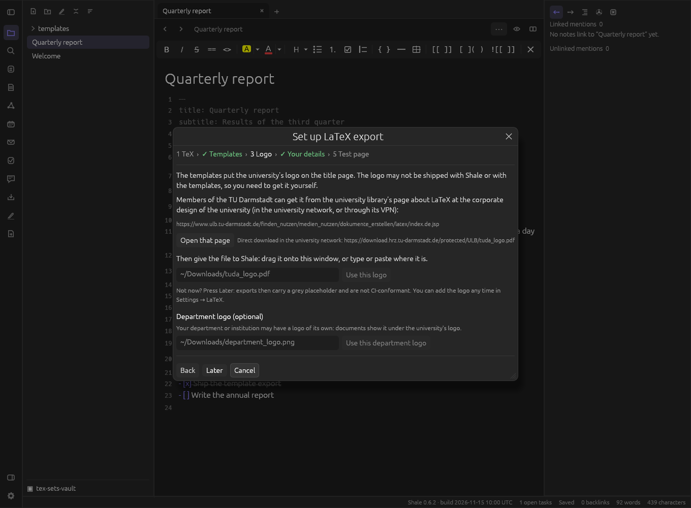

  

  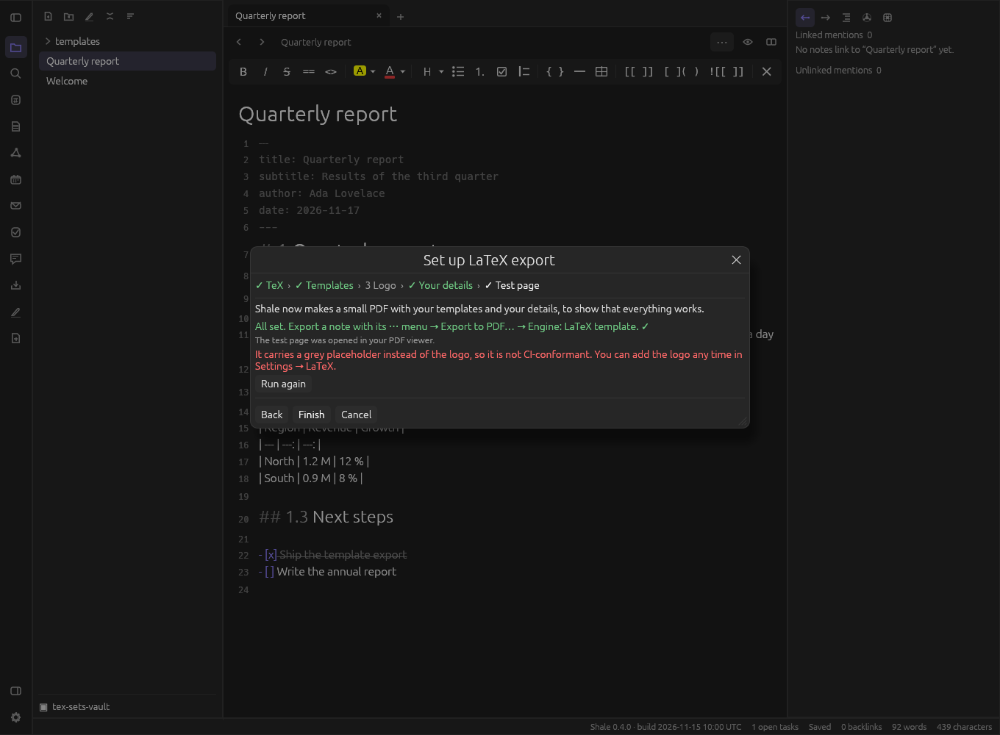

  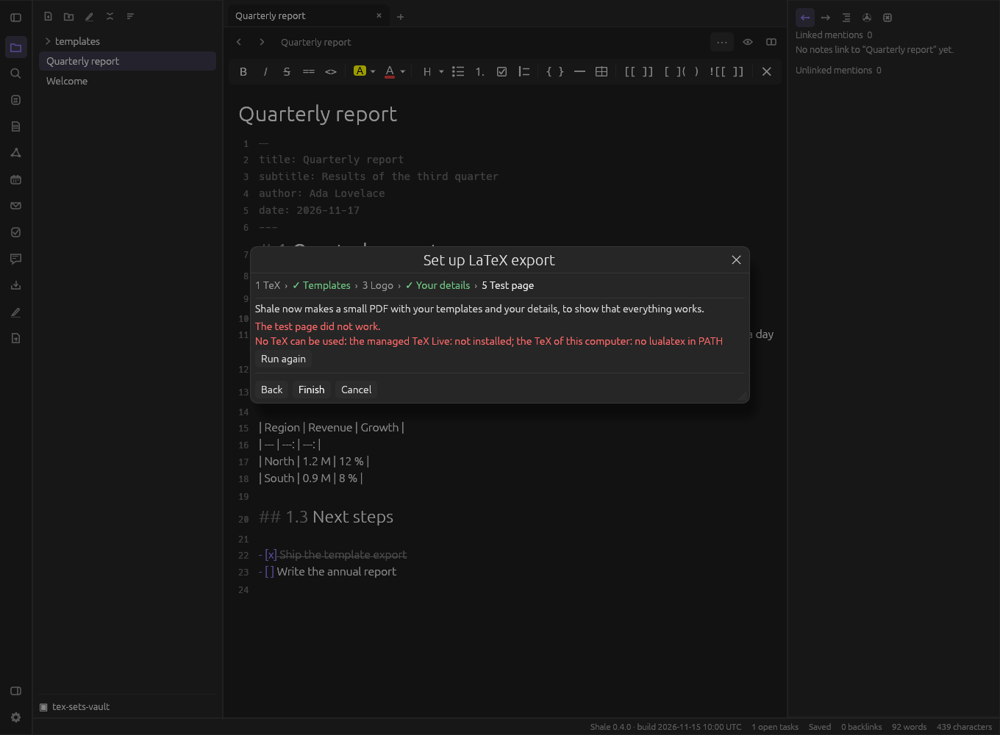

- **Export through a LaTeX template**: the PDF dialog of a note has an engine choice, **Built-in** (the
  default) or **LaTeX template**. With the template you pick a set of the vault and a kind (publication,
  report, exercise sheet, thesis, doctoral thesis, slides, letter, poster, scientific poster, leaflet,
  announcement), fill the kind's fields (taken from the note's properties, `author:`, `subtitle:`,
  `recipient:` and so on), switch the table of contents, and Export compiles the note with LuaLaTeX in
  the background (a spinner, Cancel). Headings become sections, chapters, slides or poster boxes by how
  they are nested; emphasis, code in colours, lists, tasks, tables with their column sizes, quotes,
  links, colours, pictures, drawings (as vector graphics) and PDF pages are written, with every special
  character kept as text; code sits on a light box, a picture inside a line is as high as the line, and a
  link to a heading of the note jumps there in the PDF (links to other notes are link-coloured text). A failure shows the file and line of the error or the package that is missing,
  and **Save the .tex** writes the document and its pictures into a folder for debugging with your own
  TeX. The dialog remembers the last engine, set and kind per vault, and a note can name its template
  with `latex-template: tuda/thesis`; a template the vault does not have is said in the dialog (TEX-008 to
  TEX-016, TEX-018, TEX-019, TEX-030 to TEX-033).

  

- Every dialog is a window you can move by its title bar and resize from any edge or corner.

## Tabs

- Drag a tab left or right to reorder it; a marker shows where it will land. A click without
  moving still just selects the tab, and the ✕ or a middle click closes it.
- Right-click a tab and choose **Pin tab** (or **Unpin tab**): pinned tabs move to the far left,
  show a small pin and keep their order. Drag reorders pinned tabs among themselves and the
  others among themselves, never across the border. A pinned tab can still be closed.
- The order of all open tabs (notes, drawings and Feeds tabs) and which of them are pinned come
  back at the next start.


## Panes side by side

- The middle area splits into any number of **panes** side by side, each with its own tab bar,
  tabs, open tab and back / forward history. **Ctrl+\** (or **Open in split right** in the
  right-click menu of a tab) opens the tab in a new pane to the right of the focused one.
- One pane has the focus: click into it (tab bar or content) or press **F6 / Shift+F6**.
  Its tab bar has an accent line. Opening notes and links, the quick switcher, new notes, closing
  and switching tabs, back / forward and the reading view all work on the focused pane; renaming,
  moving or deleting a file updates its tabs in every pane.
- Drag the border between two panes to resize them (neither gets narrower than 240 points).
  Closing the last tab of a pane (or **Ctrl+Shift+W**) removes the pane; the last pane stays.
- The panes, their tabs, the open tab of each, the focused pane and the widths come back at the
  next start, and each note with its cursor or selection, its scroll position and its reading view. Mail,
  Calendar, Tasks, Graph and Settings-file tabs come back too: the mail view on its folder and open message,
  the calendar on its mode and day, Tasks with its filter, the graph with its switches (an empty tab is
  not kept); the
  state is written every few seconds when something changed, and at exit. All the keys can be changed in Settings, Keybindings.

## Fonts and text sizes

- Settings → Fonts sets the font and size of six areas: dialogs and menus, the raw markdown text of
  the editor, the rendered text (markdown preview and reading view), mail, calendar and feeds.
  The raw and the rendered text of the editor can have different fonts and sizes.
- "Use the same font and size everywhere" (on by default) shows one row that applies to all areas;
  switched off, every area has a row of its own, starting from what it had.
- A font is chosen from a list of the fonts installed on the computer: a button opens a list with a
  search field (type to narrow it, ↑ ↓ and Enter to pick, Esc to close); "Default" is Shale's own
  font. Every row shows a sample text in its font and size, so all chosen fonts can be compared at
  once; while the list is open, the sample shows the font under the mouse or the arrow keys
  without picking it. Characters a chosen font lacks (emoji) are drawn with Shale's own fonts. Bold and italic text
  is drawn in the font's own bold, italic and bold-italic faces where it has them. A font that is no
  longer installed is replaced by Shale's own, with a message, and used again when it comes back.
- Changes show at once, also when you edit `[fonts]` in the settings file. The old "Text size"
  setting became the size of the editor.


## Keyboard only: sidebar, file list and vim-style editing

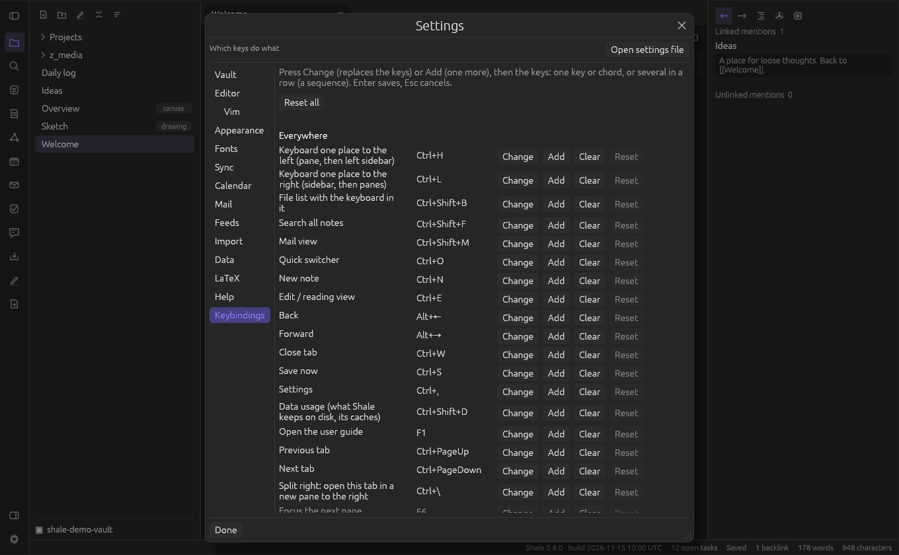

- Ctrl+H (macOS: Cmd+Shift+H) puts the keyboard one place to the left (with split panes: into the pane on the left,
  from the first pane into the left sidebar), Ctrl+L one place to the right (from the sidebar into
  the first pane, then pane by pane; it stays in the last one). Ctrl+Shift+B opens
  the file list with the open note selected: j / k go from file to file, Ctrl+J / Ctrl+K from
  folder to folder, Space opens or closes a folder, Enter opens a file.
- Every shortcut of this section can be changed in Settings → Keybindings; a key that another
  action already uses asks “Overwrite it?” (Yes takes it from that action and leaves it without a key, No
  changes nothing; Enter answers No), and a binding can be a sequence of keys. While you record, a note
  under the keys says which action they would clash with.
- Ctrl+PageUp / Ctrl+PageDown (macOS: Cmd+Opt+← / Cmd+Opt+→) switch to the previous / next tab, also from the file list and from
  mail, calendar and Feeds; after the last tab comes the first.
- In the search results j / k go from hit to hit and Ctrl+J / Ctrl+K from file to file.
- **Markdown preview** (Settings → Editor, or the eye icon in the top right of the editor;
  off by default): every line is drawn rendered, with headings at their size, bold, italic,
  strike and code without their markers, links as just their text, and only the line the cursor
  is in (and, with "Raw lines around the cursor", that many lines before and after, or all the
  lines of a selection) shows the raw markdown. The note stays editable; links still open with a
  click and task boxes still tick. A **table** away from the cursor is drawn as a real grid (also
  in the reading view): borders, a bold header row, aligned columns, formatted cell text, long
  text wrapping in its own column. Click a cell to edit it right in the grid (Tab, Enter and
  their Shift versions move between cells, so do the arrow keys at the edge of a cell's text;
  Esc leaves; one undo step), or turn that off in
  Settings ("Edit table cells in the grid") or per table (a button at the grid) to edit the raw
  rows instead. Drag the borders to resize columns and rows, the edges to resize the whole table;
  a double click on a border makes all columns (rows) the same size. Hover the grid for buttons
  that add a row or column and delete the hovered row or column. Toolbar formatting of a
  selection across cells formats each cell on its own; while a cell is edited in the grid the
  toolbar formats the cell's text (the line buttons are greyed out) and the change is part of
  the cell's undo step. **Shift+arrow keys** select a rectangular block of cells (Shift+Right then
  Shift+Up gives 2 by 2; the arrows select text first and go on to cells at the edge of the text):
  the selected cells are highlighted, the toolbar's inline buttons format all of them, Delete and
  Backspace clear them (one undo step each editing), typing goes into the block's top left cell,
  and a plain arrow key or Esc ends the block.

  

  

  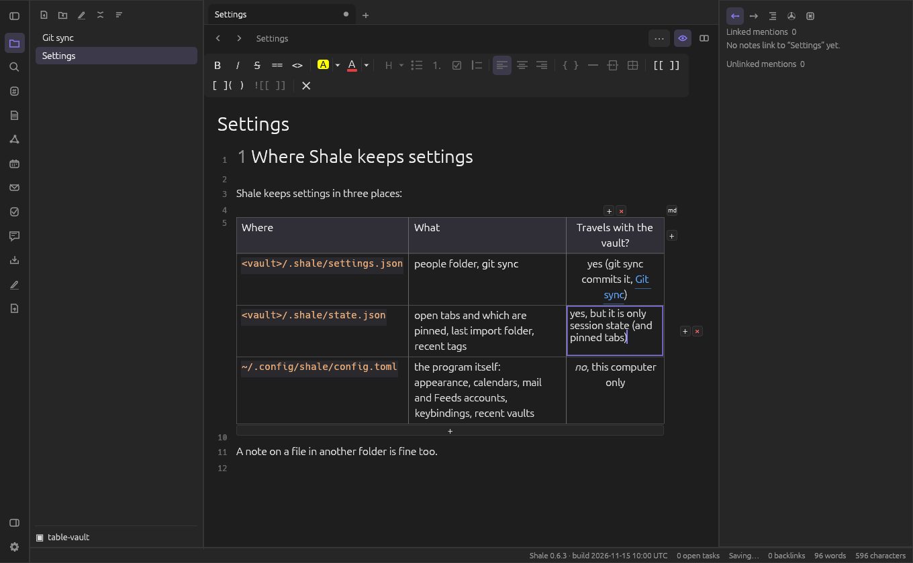

  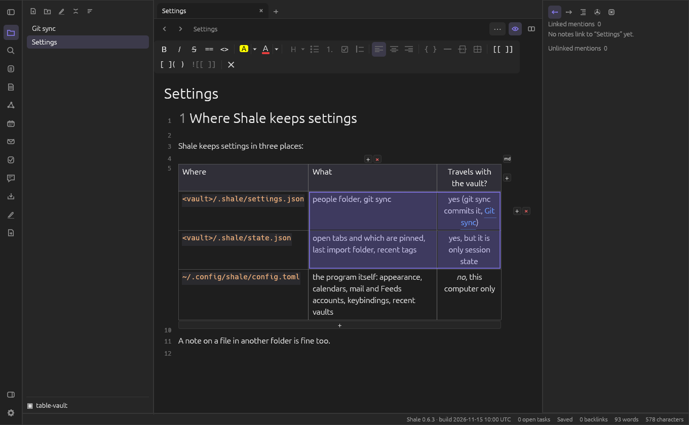

  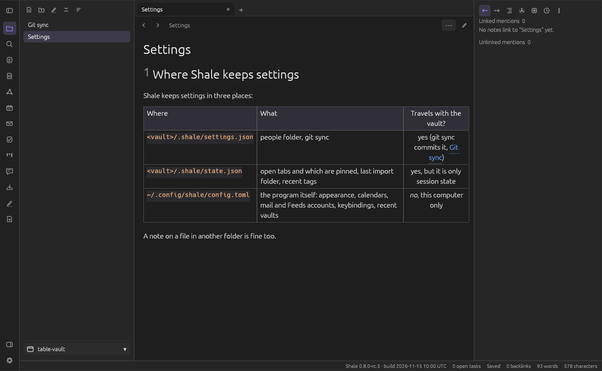

- **Vim-style editing** (Settings → Vim, off by default): notes open in normal mode. h j k l, w b,
  W B, 0 $, gg G move; `:12` jumps to line 12; `/text` searches and n / N go on; i a I A o O
  start typing, Esc stops; x deletes a character; `dd` deletes the line (onto the clipboard,
  `p` puts it back below); v and V select with the same motions, d cuts and y copies to the
  clipboard, p pastes; `gt` follows the link under the cursor like a click (a note link or a web
  address); **Shift+K** (definable, for example as Space Space) previews the link under the cursor in a floating frame like neovim's hover: a note as the reading view draws it (from the heading of the link), "Note does not exist yet" for a missing one, a picture, or for a web link the page's title, description and the start of its text, loaded in the background (https only, 30 s, 1.5 MB, kept per address while Shale runs). Moving the cursor, typing or Esc close it; Shift+K again moves the keyboard into it (j / k, ↓ / ↑, Ctrl+D / Ctrl+U, PageDown / PageUp scroll, Enter opens the link like `gt`, Ctrl+Enter opens it in a new pane on the right, Esc gives the keyboard back to the editor with the cursor where it was). The frame is 640 x 480 points at first; its four edges and corners are dragged to resize it, and the size is a setting (`link_preview_width`, `link_preview_height`, Settings → Editor, with Reset size) that every preview uses (EDIT-037). `u` undoes and Ctrl+R redoes, up to 200 steps per note (an insert session
  from i to Esc is one step; the history is shared by all tabs of the note and kept in the vault
  for 30 days by default (a setting of the undo histories cache, see Data usage), so `u` works
  after a restart too). The status bar shows NORMAL, INSERT, VISUAL or V-LINE.
- In normal mode (and in a calendar, Feeds, … tab) **Space Tab** goes back to the note or sub-app
  this tab showed just before, and again to come back, like vim's alternate file. Space is the
  leader key of its own list in the Keybindings tab; **Space f f** opens a window to find a file by its
  name (it never creates a note, unlike Ctrl+O); **Space f g** searches the text of notes, mail
  and posts in one list grouped by source (`*` and `?` are wildcards); the vim keys themselves cannot be rebound.

## Drawings


- Hand-drawn style sketches, saved as standard `.excalidraw` files.
- Drawings of the Obsidian Excalidraw plugin (`.excalidraw.md`, compressed or not) open in the
  drawing editor too, and are saved in the plugin's own format, so Obsidian keeps reading them.
  Links like `[[Drawing.excalidraw]]` and embeds `![[Drawing.excalidraw]]` find them.
- Links inside drawings: type `[[` in a label or text for note suggestions, `[[p ` for people
  and `[!` for the file picker, just like in notes. A shape or text with a link gets a small ↗
  mark; click it (or Ctrl+click the shape) to open the note, Shift for a new tab.
- Links in drawings and canvases count like links in notes: the linked note lists the drawing
  under Backlinks, and the graph shows the connection. Renaming or moving a note updates the
  links in drawings too; canvases are never changed, so the message names any canvas that still
  points to the old name.
- Pictures in drawings show up: pictures of Obsidian Excalidraw drawings (from the vault) and of
  excalidraw.com files (stored in the file), also in drawings embedded in notes and in PDF
  export.
- Tools on keys 1–0: hand, select, rectangle, diamond, ellipse, arrow, line, pen, text, eraser.
- The style panel sets stroke and fill colours, fill style, stroke width, outline pattern,
  sloppiness, corners, label font, size, colour, background and alignment, opacity, and the
  order of shapes.
- Double-click a shape to label it. Arrows snap to shapes and follow them when shapes move.
  Hold Shift to keep lines at 45° steps.
- "Auto arrange" untangles a diagram; "Spread out" and "Pull together" change the spacing.

### Obsidian canvases


- Obsidian Canvas files (`.canvas`) open in the drawing view: cards with their colours, groups,
  file and web cards (click them to follow), and the arrows between cards with their labels.
- Opening one asks whether to convert it. **Convert** makes an editable drawing
  `Name.excalidraw.md` next to it (Obsidian opens it with the Excalidraw plugin); **Open
  read-only** just shows it. The canvas file itself is never changed. Opening the canvas again
  offers the drawing made before.
- Tick "Always convert canvases when opening them" (also in Settings → Editor → Drawings) to skip the
  question.


## To-do list across all notes


- Every `- [ ] task` from every note in one list. Ticking a task off saves it in its note.
- Filter by text or `#tag`, show done tasks, or only tasks with a due date
  (`📅 2026-12-01` or `due:2026-12-01`).

## Linked notes and the graph

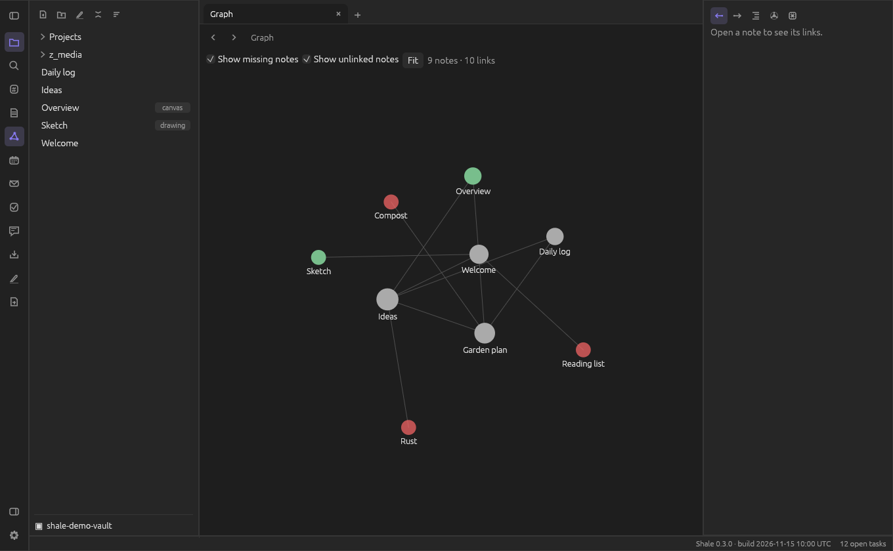

- The right sidebar shows backlinks, unlinked mentions, outgoing links, the outline (headings with their formatting and numbers, as in the editor) and a local
  graph of the open note.
- **Numbered headings** (LINK-014, CFG-042): the headings of a note show a number before their text, `#` 1, `##` 1.1, `##` 1.2, `#` 2; the note's title is the title line above
  the text (below), not a heading, so a `#` is numbered like the others. The numbers are only drawn (muted), never written into the file: in the editor, the Markdown preview, the reading view, the outline, the link preview and
  the PDF. Settings → Editor → "Number headings" (on by default) switches it for every note; a note's front matter
  `numbered-headings: true` or `false` (also `yes` / `no`) overrides it for that note.
- **Properties as a summary and a card** (EDIT-060 to EDIT-064, CFG-050 to CFG-053): the reading view draws the front matter as a card by the type of the note instead of raw
  lines: an e-mail as a mail header (sender, date, to / cc, subject, tag chips), an event with its time, place, attendees and a repeats badge, a Word import as one page chip
  (`A4 · 2.5 cm margins · 11 pt`), any other note as key and value rows. Ids and `print-*` settings are left out, a ▸ toggle shows every property, and people with a contact
  note are links. `properties::summary` gives the one line for a folded view (`email · Anna Müller · 2026-11-12 · #work #mail`). Settings → Appearance → "Properties in the editor"
  / "Properties in the reading view": folded, card or raw (defaults: folded in the editor, card in the reading view). In the editor a note's front matter starts folded to its summary line unless the setting is raw (EDIT-081, EDIT-084). Dates are not links yet: the calendar has no entry point for a day.
- **Title line and date prefix** (VAULT-025, CFG-043): above line 1 a note shows its title line, its file name without `.md` and without a
  leading date prefix `YYMMDD_` (`261117_Plan.md` shows `Plan`); editing it renames the file and keeps the prefix. Tabs and the PDF title show the name without the prefix; the file
  list, the quick switcher and links keep the full name, so the list sorts by date. Settings → Editor → "Date prefix for new notes" (on by default) names a note made by Shale
  (new note, red link, quick switcher, new drawing) `YYMMDD_<name>.md` with today's date; a red link `[[Plan]]` that makes `261117_Plan.md` is rewritten in the note to
  `[[261117_Plan|Plan]]` so it still reaches it. Imports and daily notes keep their names.
- **Portable names** (VAULT-026, VAULT-027, VAULT-028): every file and folder name Shale makes works on Linux, macOS and Windows. A name you type for a new note, folder or drawing, or
  a rename (also from the title line), never fails for its characters: `< > : " / \ | ? *` and control characters become `-`, a trailing dot is dropped, a Windows device name like `CON`
  gets `_`, and the name is cut to 200 bytes; the toast says so ("Saved as `a-b.md`: `:` is not allowed on Windows"). A red link `[[Plan: v2]]` is rewritten to the name its note got.
  Names Shale makes itself (imports, the people notes, the media folder) stay within 127 bytes. Existing files are never renamed by this. **Settings → Vault → Check names for Windows
  and macOS…** lists, from a background job, the files and folders of the vault that would break there (forbidden characters, trailing dot or space, device names, names over 200
  bytes, paths over 240 characters, names that differ only in letter case) with the portable name for each; **Rename** does one, **Rename all…** all of them after a question,
  through the usual rename, so links are rewritten, and a name that is taken gets ` 2`, ` 3`. `.git`, `.shale` and `.trash` are skipped.
- **Lift headings on paste** (EDIT-038): pasting text whose headings are all `##` or deeper opens "The pasted text has no # heading. Lift its headings?" with **Lift** and **Paste as it
  is** (Esc pastes as it is); text without headings or with a `#` is pasted at once.
- **Heading links scroll** (LINK-015): `[[Note#Heading]]`, `[[#Heading]]` and `[text](Note.md#Heading)` open the note with the heading at the top of the view, in the mode the tab is
  in: the cursor on the heading line in the editor, the reading view scrolled to it in the reading view. The heading is found ignoring case, spaces and inline markup
  (`## **Plan** v2` matches `#Plan v2`); a missing one opens the note at its top and says so. The outline's entries do the same.
  While typing `[[Note#` or `[[#`, the suggestions list that note's headings (indented by level, with their numbers, filtered by what follows the `#`) and insert the plain text of the one you pick (LINK-016).
- The vault graph shows every note. Red dots are missing notes and green ones are drawings.

## The ribbon and the sidebars

- **App icon**: three slate plates stacked on a dark square. The window shows it in the title
  bar, taskbar or Dock; the Linux download's `install.sh` puts the desktop file and icons in place for the app menu
  and the Wayland taskbar (see the README).
- The icons of the ribbon (the narrow bar on the left) can be dragged into any order. A line
  between two icons shows where the icon lands; Esc, or letting go anywhere else, cancels. The
  sidebar toggles at the top and bottom and the settings button stay where they are.
- The right sidebar is a stack of **views**. Each view has its own menubar of panel icons
  (Backlinks, Outgoing links, Outline, Graph, Calendar) and shows the panel of the selected
  icon, so several panels can be open at once.
- Drag a panel icon over the content of the right sidebar: the area lights up ("Drop to open
  this icon in a new view") and dropping makes a new view below it. Drag icons from one
  menubar to another, from a view to the ribbon (it then is a shortcut that shows the panel
  below the views) and back. Icons that are no panels (Files, Mail, …) cannot go to the right
  sidebar: the pointer shows "not allowed" and nothing changes. Taking the last icon out of a
  view removes the view. Esc cancels a drag.
- Drag the border between two views up or down to change their heights (they start equal; a
  view never gets lower than a small minimum).
- A middle click on the **Mail**, **Feeds** or **Calendar** icon opens that view in a new tab.
- Right-click an icon (in the ribbon or in a view's menubar) for a menu: **Remove from the
  ribbon** / **Remove from this view**, **Restore …** for every icon removed earlier, and
  **Reset layout** (the default icons, order, heights and sidebar widths). The last icon of the ribbon cannot
  be removed. Panel shortcuts in the ribbon have their own glyphs, not those of the Graph and
  Calendar buttons.
- The layout (icons, heights, removed icons) and the widths of the left and the right sidebar (drag their borders) are kept in the settings.
- **F1** (or Settings → Help → **Open user guide**) opens the user guide, itself a Shale vault:
  The guide is built into the program, which unpacks it once per version into its data folder (a
  copy you edited is not overwritten) and opens it at "Start here". This works in every build on
  every system; the release also has it as `shale-userguide-<version>.zip` and, to print or read
  anywhere, as one PDF, `shale-userguide-<version>.pdf`.

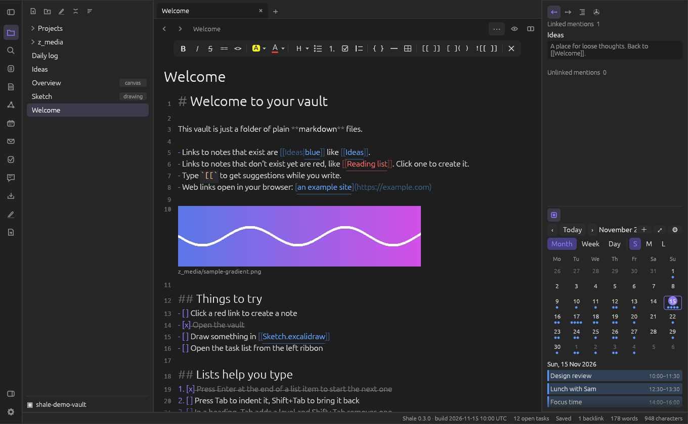

## Calendar

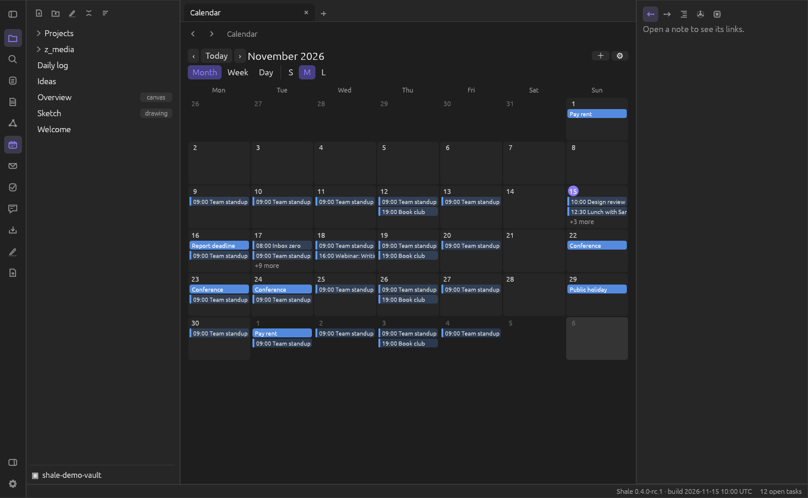

- A calendar in the right sidebar (small month) and as a big tab, with Month, Week and Day views
  in three sizes.
- Local calendars (`.ics` files, for testing; with sample events) and **CalDAV** calendars
  (for example Nextcloud). Each CalDAV calendar has its own automatic sync interval (15 minutes
  by default).


- Click an event to see its details: when, how it repeats, where, organizer, attendees,
  categories, reminders and notes. **Edit** and **Delete** work for local and CalDAV calendars. Delete asks first ("Delete
  “Title”?"), and a copy of the event is kept in `calendar-trash` in the data folder. A CalDAV
  save or delete that cannot be sure the server still has what Shale read is refused.
- A repeating event asks what you mean: **Edit this date** or **Edit all repeats**, **Delete this
  date** or **Delete all repeats**. A date you change becomes its own entry next to the series; a
  date you delete is left out of the series.
- Moving an event's start in the event dialog (typed or picked) moves its end along, so the
  event keeps its length; changing the end never moves the start.
- The event dialog sets how an event **repeats** (daily, weekly on the days you pick, monthly,
  yearly; every N; ending never, on a date or after N times), the dates it **skips**,
  **reminders** (minutes, hours or days before), its status, whether it shows as busy or free,
  categories and the time zone its times are stored in. Shale stores and edits reminders but
  does not ring itself; your phone or another calendar program does. Every date can be typed or
  picked from a small month.
- **Nothing is lost when you save.** Shale writes back every line of an event that it read and
  you did not change: reminders and repeat rules made in other programs, who accepted an
  invitation, time zones, and fields Shale has never heard of. A repeating event keeps its
  clock time over summer time in every program.


- Double-click a day or time to create an event. It starts at the next full or half hour and is
  30 minutes long.
- "Save to" chooses any calendar. When a calendar refuses the save (for example because you have
  no write permission), the error is shown in the dialog and you can pick another calendar.
  Moving an event writes it to the new calendar first and removes it from the old one only after
  that worked, so nothing is lost.


- Settings → Calendar: add local calendars or CalDAV accounts ("Find calendars" asks the
  server), choose colours, show or hide calendars, and set the sync interval per calendar. **Edit**
  on a CalDAV calendar changes its address, user name or password (empty password = keep the saved
  one); a new user name or password also goes to the other calendars of the same server and user.


## Mail

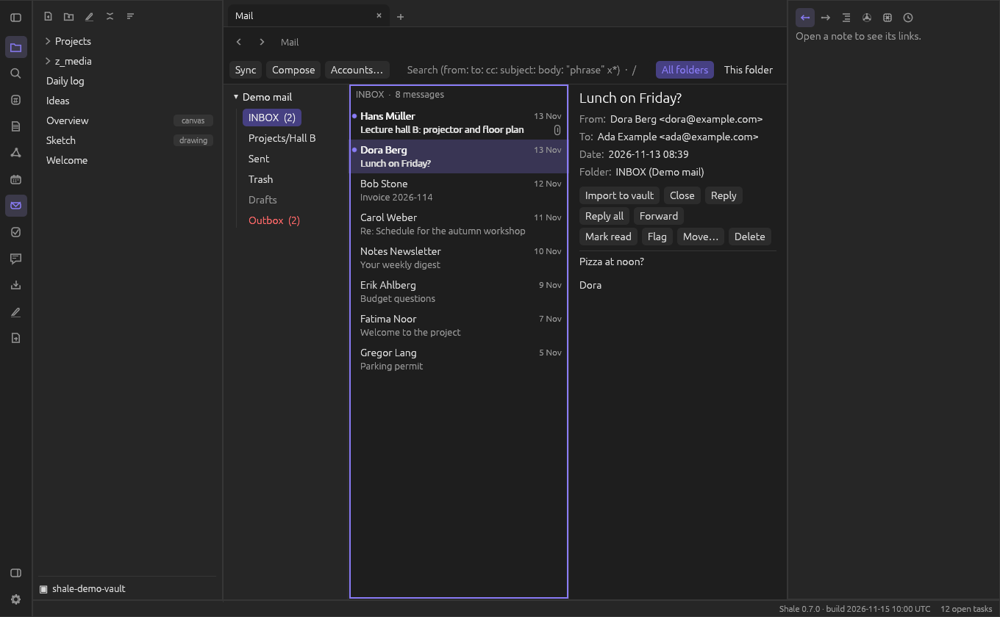

- The **Mail** button in the ribbon (or Ctrl+Shift+M) opens a three-pane view: accounts and
  folders with their unread counts, the list of messages (newest first) and the message itself
  as plain text. Shale reads your mail over IMAP and keeps a local copy next to the other
  program data (`~/.local/share/shale/mail`), so it works offline and search is instant.
- **Syncing only reads; what you do yourself is sent.** Fetching mail never changes anything on
  the server (it does not even mark mail as read). Only your own actions are written back: mark
  read or unread, flag, move to another folder, delete (to Trash) and, inside Trash, delete
  forever. Passwords are checked over a TLS connection with the system's certificate store; there
  is no unencrypted option.
- **No HTML, no tracking.** The message text comes from the plain text part, or from the HTML
  turned into text. Nothing is rendered, no pictures are fetched, no scripts run. An attachment
  is opened from a private temporary copy through your default program (never a program or
  script), or saved into the vault's media folder.
- **The local copy is not encrypted** (like Thunderbird's). Use full-disk encryption.


- **Accounts…** adds an account: server, port (993 with TLS, 143 with STARTTLS), user name and
  password. The password goes into the system keyring (the Keychain on macOS, the Credential Manager on Windows). Without a keyring Shale says so and asks
  again each time it starts, keeping it in memory only; it is never written to the settings
  file. **Test connection** checks the login and lists the folders. If you change the server or
  the user name of an account, it is another mailbox: it starts with an empty local copy, you
  enter the password (or sign in) again, and the mail copied from the old one stays on disk.
- **OAuth2 sign-in** (Google, Microsoft, or your own provider): choose "OAuth2 (in the browser)",
  the provider and your own **client ID** (Shale ships none; see below), press **Sign in in the
  browser**, and sign in on the provider's page. Shale shows who signed in, keeps only a refresh
  token in the system keyring and renews the short-lived access token by itself. If the sign-in
  expires or is revoked, the mail view and the settings say so and **Sign in again** fixes it.
  Without a keyring the sign-in lasts until Shale quits. If a renewed sign-in can't be saved in the keyring, Shale says so once.
  - *Google:* in the Google Cloud console create a project, set up the OAuth consent screen
    (External, status Testing) and add your Gmail address as a test user, create an **OAuth client
    ID of type "Desktop app"**, and enter its client ID and client secret in Shale. The scope
    `https://mail.google.com/` is "restricted": an unverified app is limited to 100 test users, and
    in Testing status Google ends the sign-in after 7 days (sign in again).
  - *Microsoft:* in the Entra admin center register an app ("Accounts in any organizational
    directory and personal Microsoft accounts"), add the platform "Mobile and desktop
    applications" with the redirect address `http://localhost`, switch on "Allow public client
    flows", add the delegated permission `IMAP.AccessAsUser.All`, and enter the Application
    (client) ID in Shale (no secret). A work account may need IMAP switched on by its admin.
  - *Custom:* any OIDC provider with an authorization-code + PKCE flow; type its authorization and
    token addresses and the scope. `http://` is accepted only for `localhost`.
- The first sync fetches the mail of the last three years, newest first, several folders at once,
  and can be stopped and resumed. **Sync** and the status bar show the progress; new mail is also
  fetched every 10 minutes (changeable, 0 = off) while Shale runs. A mail deleted on the server
  stays here, dimmed, with a note.
- **Changes in another mail program show up within seconds.** While the mail view is open, the
  folder you have open and each account's Inbox are watched over a read-only connection with IMAP
  IDLE: a flag removed, mail read, new or deleted mail in Thunderbird or on your phone appears here
  without pressing Sync (a server without IDLE is asked once a minute). Leaving the mail view
  closes the connections; a wrong password is not tried over and over.
- Choose which folders are synced with the tick boxes. **Trash, Junk and Gmail's "All Mail" are
  not synced automatically**: when you open one, its list is loaded from the server, and a
  message is downloaded when you press **Load this message**. The same button appears for a
  message over the size limit (200 MB).
- **Search** (the field above the list, or `/`): words, `"phrases"`, `from:`, `to:`, `subject:`
  and `body:`; ignores case and accents. Choose all folders or only the open one.
- **Import to vault** (button, or `i`) hands the mail to the same Import dialog as a dragged
  `.eml` file: attachments, people and tags work the same, a mail that was imported before is
  recognised, and nothing is written until you press Import. Mark several mails (Space or
  Ctrl+click) to import them together.
- **Keyboard first.** One of the three panes has the keyboard and is framed in the accent
  colour; Ctrl+H / Ctrl+L (Cmd+Shift+H / Cmd+Shift+L on macOS; the keys that go between the file list and the editor) move it between
  folders, list and message, and from the folders on into the left sidebar. The three panes keep
  a least width (170, 220 and 280 points): in a window too narrow for them the panes scroll
  sideways and the pane that has the keyboard is scrolled into view. j / k act in that pane
  only: folder, message or scroll. `/` goes to the search field (↓ or Enter there go into the
  results), Esc steps back. Everything has a key (see the Keyboard section), also syncing, the
  attachments, loading a message that is not here and switching the search scope, and all of them
  can be changed in Settings → Keybindings (Mail view). Keys do not act while you type. The row
  menu shows the key of each entry, and the tooltip of a button names its key (the buttons of an outbox mail show it on the button too); all follow what you
  set in Keybindings.
- **Read, flag, move, delete** (also with the buttons above the message, a right click on a row,
  and the buttons that appear when mails are marked). The keys work on the marked mails, else on
  the open one, else on the one under the cursor, and need no Ctrl or Shift:
  `u` marks read or unread, `s` or `f` sets or clears the flag, `d` or Delete moves to Trash (in
  Trash it asks whether to delete forever; Enter does not confirm, only the red button does), `m`
  opens the folder picker (type to find a folder, ↑ ↓, Enter; Esc leaves). Unread mail is bold,
  flagged mail has a flag, and anything the server has not confirmed yet says "saving…",
  "moving…" or "deleting…" and shows in the bar as "N changes are waiting for the server".
- **Safe by design.** A change shows at once and is sent in the background. Without a network it
  waits (also across a restart) and goes out when the server answers; if the server refuses, the
  change is undone in the list and you are told why. "Delete" is always a move to the Trash
  folder. "Delete forever" removes only the mails you chose (never the ones another program
  marked as deleted). A mail that another program moved or deleted meanwhile is left alone and
  dimmed. Shale never deletes its own local copy: files of mail that moved or were deleted go to
  `.trash/<date>/` inside the mail folder. A server without `MOVE` is handled by a verified copy
  first; a server without `UIDPLUS` cannot delete forever, and for it deleting without `MOVE` is
  refused rather than risked.
- **Mark as read when opened** (Accounts…): on by default, after 2 seconds (0 = at once). Mail
  you close before then stays unread. Off: opening never changes the "read" mark.

### Writing and sending (phase 3)

- **Compose** with `c` (or the Compose button), **Reply** `r`, **Reply all** `Shift+R`, **Forward**
  `Shift+F` (also buttons under the message, which also answer to Alt+R, Alt+A, Alt+F and, for the others, Alt+I, Alt+C, Alt+U, Alt+G, Alt+M, Alt+D (not on macOS, where you can bind them); hold Alt to see the letter underlined; `f` is still the flag key). Mail is plain text. To, Cc
  and Bcc complete from the addresses in your people notes and in the mail you already have (↑ ↓,
  Tab or a click); the subject, the text and the attachments are below. Attach a file by its path,
  a file of the vault (also from the media folder) or a **note** (its markdown, as a `.md`
  attachment). An answer quotes the mail with "On <date>, <name> wrote:" and `> `, sets
  `In-Reply-To` and `References` (the whole chain), and a forward brings the attachments along.
  Your signature goes below. **Ctrl+Enter** sends, **Esc** closes.
- **Set up sending** in the account settings, "Sending (SMTP)": server, TLS (465) or STARTTLS (587),
  your name and address, signature. The sign-in is the one of the account (the same password, or the
  same OAuth2 sign-in; Google and Microsoft fill in the server, Microsoft's permission list gets
  `SMTP.Send`). There is no unencrypted option, and with STARTTLS nothing, not even the password, goes
  before the encryption. "Test connection" also signs in to the SMTP server (it never sends a mail).
  The wait before sending ("Undo send", 10 seconds, 0 = at once) is set there too.
- **Never lost, never twice.** What you write is saved as a draft after a pause in typing and when
  you close the window (`~/.local/share/shale/mail/drafts/`, as a `.eml` any program can read, plus
  the fields and attachments); after a crash the drafts are in **Drafts**. Closing with changes asks
  "Keep draft?"; a discarded draft goes to `.trash/`, nothing is deleted. **Send** puts the mail into the
  **Outbox** (a file you can read), and for a few seconds a bar offers **Undo send**, which brings it back
  into the editor. Then it is sent, once. If the server refuses (a wrong address, no network) it stays in
  the Outbox with the server's words and you press **Retry**, **Edit** or **Discard**: nothing is retried by
  itself. If the connection ends *after* the whole mail was handed over and before the server answered,
  nobody can know whether it went out: the mail shows as "may have been sent", Shale never sends it
  again by itself, and you look in Sent and choose **Send again** or **Discard**. The same if Shale was
  closed in the middle of sending.

  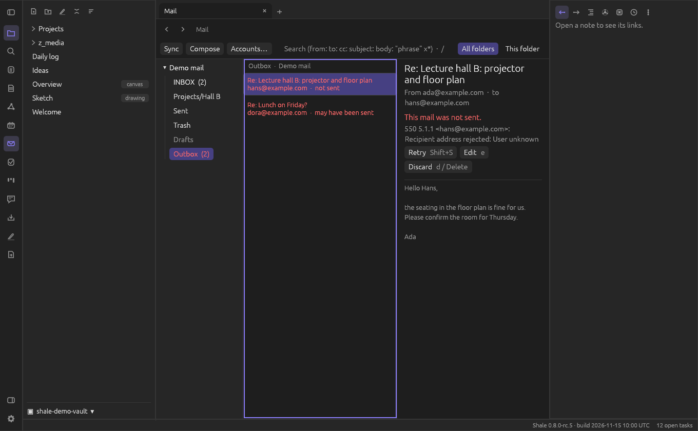
  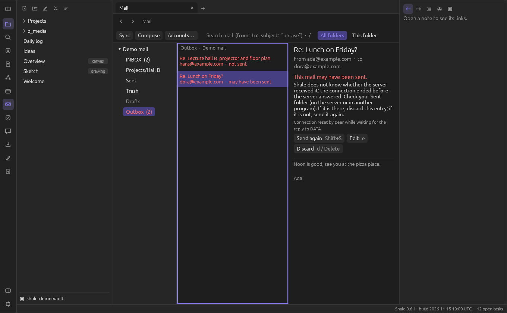

- **Questions before sending**: with no subject, with no text, and when the text says "attached" /
  "attachment" / "angehängt" / "anbei" / "Anhang" but nothing is attached. Bcc recipients get the mail
  but are never written into it; no read receipt is requested; the `User-Agent` header is off unless
  you switch it on (privacy).
- **The Sent copy**: after a send, the exact message appears in your Sent folder at once and is saved
  to the server in the background (an account that keeps sent mail itself, like Gmail, is switched off
  from that). If that save fails the mail is still sent, never sent again, and the copy is retried.

### Signed and encrypted mail (phase 4)

Shale uses the **GnuPG on your computer**: `gpg` for OpenPGP (PGP/MIME) and `gpgsm` for S/MIME, with
your own keys, smartcards and the usual passphrase dialog (`gpg-agent` / pinentry). Shale never sees a
key or a passphrase, never looks a key up on the network by itself, and tells you in words if `gpg` or
`gpgsm` is missing.

- **Reading.** A strip above the mail says what GnuPG found, in its own colours, never from anything in
  the mail: a valid signature (who, which key, how far you trust it), a **bad** one (the mail was changed
  or forged), a signer whose key you do not have, an expired or revoked key, a mail that is signed only in
  part, a signature by somebody other than the sender, and inline OpenPGP (signed text in the body), which
  is marked as weaker. Checking a signature needs no setting and stores nothing. A body text that says
  "Good signature from…" is just text and shows no strip.
- **Encrypted mail** needs one decision first. In **Accounts…, Encryption** a red banner says
  **"ENCRYPTED MAILS WILL ALWAYS BE STORED DECRYPTED LOCALLY"**: a decrypted mail is kept next to the encrypted
  original (`<number>.decrypted.eml`) and its text goes into the search index, unencrypted, in the mail folder
  (protected by the folder's permissions and your full-disk encryption). It is switched on only when you type
  `I agree to decrypted local storage` exactly. Until then an encrypted mail shows "Encrypted — enable
  encryption in the settings", and nothing is decrypted or stored. Withdrawing the consent stops decrypting; it
  deletes nothing (the copies you have stay, are shown and searched). Mails are decrypted when you open them,
  in the background; a passphrase or PIN dialog may open, and Cancel stops it.
- **Safe by construction** (EFAIL): only a mail that is encrypted as a whole is decrypted; a mail that mixes an
  encrypted part with other parts or text is not decrypted and says so; decrypted text is shown as its own
  message and never joined with anything else of the mail; there is no HTML and no link is followed or
  made clickable. Signed-and-encrypted mail works in both orders and when OpenPGP does both at once.
- **Writing.** Set the key of an account in Accounts…, the account, *Signing and encrypting* (the lists come
  from `gpg --list-secret-keys` and `gpgsm --list-secret-keys`), plus "sign new mail by default" and the
  preferred standard. In a new mail: **Sign**, **Encrypt** and (with both kinds of key) the standard. For
  every address in To, Cc and Bcc the window shows whether a key was found in your local keyring (with its
  trust) or not. Encrypting needs a key for **every** recipient, Cc and Bcc included, and always also
  encrypts for you, so the copy in Sent stays readable. OpenPGP Bcc recipients are hidden recipients; S/MIME
  lists every certificate, so with a Bcc it asks first. Signing and encrypting run in the background (the
  passphrase dialog is GnuPG's), the window stays as it is and Cancel stops it; if anything fails nothing
  goes to the Outbox and nothing you typed is lost. What is signed is exactly what is sent (quoted-printable or
  base64 for anything a mail server might rewrite). The **subject and the addresses of an encrypted mail
  are not encrypted** (protected headers are not supported).
- **Your keys and Thunderbird.** Thunderbird keeps OpenPGP keys in its own store. Export your secret key in
  Thunderbird (Account settings, End-to-End Encryption, "Backup secret key to file") and run
  `gpg --import backup.asc`; the keys of others the same way, or by hand with `gpg --locate-keys name@example.org`
  (also WKD). S/MIME: Thunderbird's certificate manager, Backup, then `gpgsm --import backup.p12` and the
  issuer's fingerprint in `~/.gnupg/trustlist.txt`. The Encryption settings say all this too.
- **Keeping the key unlocked.** Without a `gpg-agent.conf`, GnuPG forgets a passphrase after 10 minutes
  without use and after 2 hours at the latest. Accounts…, Encryption, "Keeping the key unlocked" shows the
  agent's times in words (read with `gpgconf --list-options gpg-agent`, in the background) and warns when
  `no-allow-external-cache` blocks the keyring. The choice "Ask for the passphrase again after" (8 hours, 1 day,
  1 week) and "Change with gpgconf…" show exactly what would be written (`gpg-agent.conf`, the two lines, the
  marked block gpgconf makes, nothing else) and write only after "Write with gpgconf" (then the agent is
  reloaded); Cancel writes nothing. The same lines and the reload command are shown for doing it by hand, with a
  Copy button, plus the keyring tip of the platform ("Save in password manager" on Linux, "Save in Keychain" on
  macOS; Gpg4win has none). Shale still never handles a passphrase.

## Importing e-mails, events and files (for project tracking)


- Drag e-mails from Thunderbird, events from a calendar (Shale's own or another program), `.eml`
  or `.ics` files, or any other files (plans, PDFs…) onto the window. The ribbon's Import button
  opens the same dialog.
- Pictures, PDFs, audio and video files are not made into notes: each is its own item (Image, PDF,
  Audio, Video) and is saved as a file in the media folder (`z_media/YYYY/MM/YYMMDD_name`). Dropped
  on a note, the note gets a link line for each. An image dragged out of a web browser (Wayland) is
  saved the same way, from the picture the browser hands over or downloaded from its address.
- A dropped or picked `.md` / `.markdown` file becomes a note (its text unchanged, listed as
  "Markdown note"), not an attachment (IMP-033). When it has headings but no `#`, a box "Lift headings
  (## → #, ### → ##, …)" is ticked: all headings move up so that the highest becomes `#`; code and front
  matter stay as they are (IMP-034).
- **Word files** (`.docx`) become notes through **pandoc** when you turn that on in Settings →
  Import and pandoc is installed (`sudo pacman -S pandoc-cli` / `sudo apt install pandoc`, `brew
  install pandoc`, `winget install JohnMacFarlane.Pandoc`); Shale finds it in `PATH` and the usual
  places, or you give its path (IMP-035, IMP-036). Headings, bold, italic, underline, strike-through,
  sub- and superscript, links, lists, tables (also with merged cells), quotes, footnotes, math,
  highlights and pictures with their captions come through (IMP-037). Everything one file brings
  goes into one folder, `z_media/YYYY/MM/import_docx_<name>/`: the pictures in `media/` and, when
  "Keep the original .docx" is ticked, the original, which the note names in its properties
  (IMP-038). Word's look comes along: text colours (direct, from character, paragraph and table styles, and theme colours with tint and shade) and highlight colours (yellow too) become `<span>` and `<mark>`
  colours (IMP-041), page breaks (manual, "page break before", section breaks; IMP-044), a Title and Subtitle become a heading and an italic line (IMP-042), and the
  note's properties hold the page setup (`print-paper`, `print-margins`), the body font, size,
  line and paragraph spacing, alignment, the colour, weight and sizes of the headings and, unless Heading 1 is numbered in Word, `numbered-headings: false` (`print-*`, IMP-040, IMP-045), which
  the PDF export uses (rabalyn/shale#338). Centred, right-aligned and justified paragraphs become `<div align>`
  wrappers (rabalyn/shale#340). A Word table of contents is left out (the export makes its own, IMP-043). A file pandoc cannot read leaves nothing behind and the toast says why. Off, or
  without pandoc, a `.docx` is an attachment as before; the dialog says when pandoc is missing.

  

- Choose the folder (one per project, for example) and tags. Small pictures from signatures are
  left out by default, and each attachment can be ticked on or off.
- Drop onto a folder in the file list to import into that folder, or onto a note to also add
  links to the new notes there.
- After an import of two or more items a window, **Import summary**, says what was made: the new
  notes, each with its name, a line about it (an e-mail: the sender and the date; an event: the start
  and the place; any other note: its first line) and an **Open** button, the files saved in the media
  folder, and the errors. **Open all in tabs** opens every new note in a tab of its own; Close leaves
  them closed. One item is opened right away as before (IMP-056, IMP-057).

  
- Messages that were already imported are recognised and left out unless you tick them again.
- On Wayland, Shale reads what Thunderbird hands over. When that is only a link to the message,
  Shale finds the message in Thunderbird's local copy (for IMAP accounts this needs "Keep
  messages for this account on this computer").


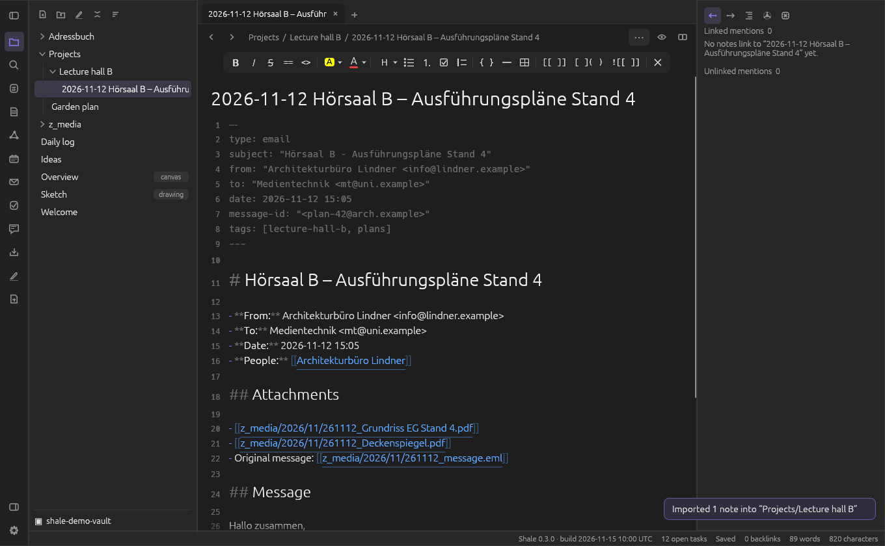

- Each e-mail becomes a note named "date subject". The sender, recipients, date, the people (as
  links to their contact notes), a link to the original message and the tags are its properties; the
  text starts with the subject as a heading, then the attachments and the message. The header is
  written once, as properties (IMP-050, IMP-051). An event is the same: start, end, place, calendar,
  repeat rule, organizer, attendees, status and link are properties, the text is its title and notes.
  The tag list counts the tags too. For programs that do not show properties, the box **Header list
  in the note body** (Import dialog; its start value is in Settings → Import) also writes the old list
  of From / To / Date / When / Where … below the title (IMP-052); a saved post gets Author / Posted /
  Source … (IMP-058).
- The text of an imported e-mail is tidied: runs of three or more blank lines become one, trailing
  spaces go, and a long tracking URL (more than 80 characters, with a query string) becomes a short
  link `[host](url)` (IMP-053). A picture among the attachments is an embed 200 points wide
  (`![[file.jpg|200]]`), other attachments stay links (IMP-054). The signature starts at a line that
  is exactly `-- ` and quoted replies are runs of `>` lines (IMP-055).

## Feeds: read Mastodon and Bluesky, save posts to the vault

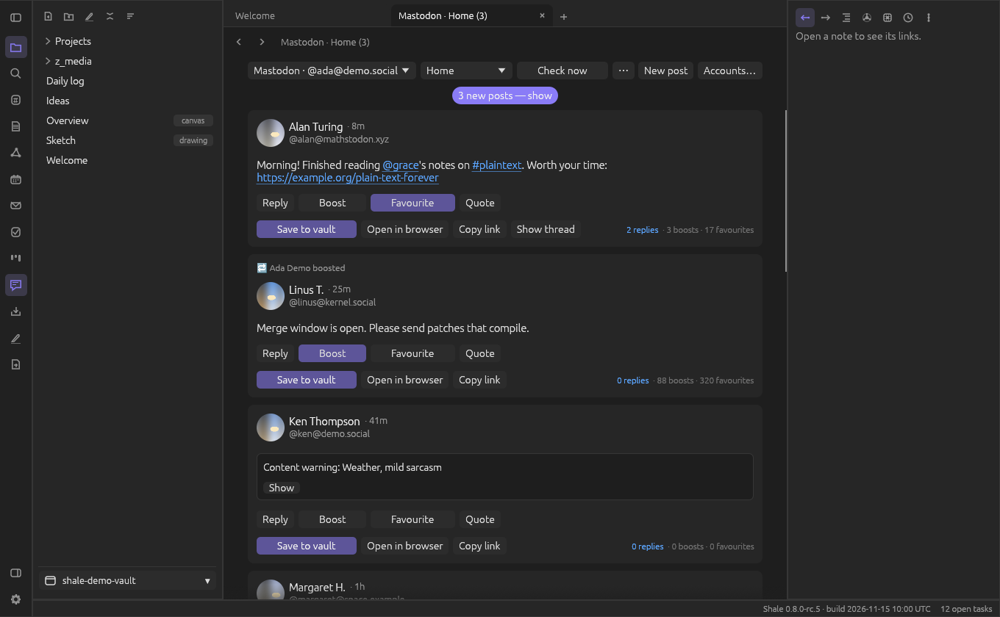

- The ribbon's speech-bubble button opens **Feeds** in a **new tab** every time (pick the account
  and feed there, so a new feed can join the tabs you have). **Accounts…** adds a Mastodon account (type
  the server, open the sign-in page in the browser, paste the code it shows; or paste an access
  token) or a Bluesky account (handle and an **app password** from Settings → Privacy and
  security → App passwords, never your main password). Secrets go to the system keyring. **Edit** next to an account signs in
  to it again (new app password or code) and replaces its secret; the account keeps its feeds and posts.
- Pick the account and the feed (Mastodon: Home and your lists; Bluesky: Following and your
  saved feeds). Posts show the avatar, name, time, "boosted by", pictures (video and GIF
  previews have a play mark), quoted posts and link cards. A content warning stays closed until
  you click Show. The next page loads when you reach the end of the list.
- **Several feeds at once**: every Feeds tab has its own feed, scroll position and back/forward
  history. Next to each feed in the picker, **New tab** (or Shift+click / middle-click on the
  entry) opens it in another tab; the same feed may be open twice. The tab is called
  "Mastodon · Home" and gets "(12)" when 12 new posts wait. Open Feeds tabs come back at the next
  start.
- **New posts wait, they do not jump in**: every 5 minutes (change it in **Accounts…**, 0 =
  never) each feed that is open in a tab, also in the background, looks for newer posts. They
  appear as a button "12 new posts — show" in a row above the list (or press `.`); the row is
  always there ("Up to date · checked 2 min ago" when nothing waits), so the list never moves
  and nothing is covered, and it does not change until you click. Then the new posts go above and the post you were reading stays
  exactly where it is, so you can scroll up slowly. **Check now** looks right away (a spinner shows inside the button while it runs);
  **⋯ → Reload from the top** replaces the list. If more than 200 posts came in on Bluesky,
  **Load more in between** fills the gap.
- **Search the posts you loaded**: every post a feed brings in is kept in a search index
  (`~/.local/share/shale/social-posts.db`, the same for every vault: text, author, date, links
  and the thread around it). The sidebar search (Ctrl+Shift+F) lists the posts that match under
  the notes; click one to open a new Feeds tab scrolled to it, also when the feed no longer has
  it. `from:ada`, `text:`, `in:` (quote, link card, the post answered, who boosted), `link:` and
  `date:2026-11` limit a word to one part. At most 10 000 posts per account and one year are
  kept; removing an account removes its posts. Posts you save to the vault (the thread and the
  replies below it) are searchable too, a reply knows the post it answers even when that arrives
  later, and a hit whose post is gone from both index and feed is fetched from the server.
  **Settings → Feeds → Post search index** shows how many posts are indexed, **Rebuild**s it
  from the posts your open feeds hold, or **Clear…**s it (after a question). (Mouse only for now.)
- **Save to vault** copies the post, and the whole thread when it is a thread by one author,
  into the Import dialog: choose the folder (default `Social`), tags and which pictures to
  bring along. **Open in browser** and **Copy link** are next to it.


- Tick **Include replies from others (N)** to add a "Replies" section with other people's
  answers, nested like a conversation (off by default; Shale remembers your choice). Their
  pictures are linked, not downloaded.
- The note has the author, the date and the link back to the post (**Source**) as properties,
  and the text (a thread: every post in order, numbered); the box **Header list in the note
  body** also writes them as a list below the title (IMP-058). The pictures are saved in `z_media/`, with their descriptions. A post
  that was saved before, also as part of a thread, is marked "Imported before".
- Try it without an account: `shale --screenshot out.png --view social` shows made-up posts.

## People (contact notes)


- Contact notes live in the **people folder** (default `Adressbuch`, changeable in Settings).
- Type `[[p ` and a name to pick a person from that folder. The link that is written is a normal
  `[[Name]]` link, so other markdown tools understand it too. "New contact" makes a contact note
  from a template (e-mail, phone, organization, notes).
- When importing, the sender, recipients, organizer and attendees are found and matched to
  contact notes (by e-mail address anywhere in the note, else by name; "Müller, Hans" = "Hans
  Müller"). Known contacts and new senders are ticked; for ticked people without a note one is
  made. The imported note gets a `people` property with links, so each contact note's backlinks show
  every mail and meeting with that person. Automatic senders like "noreply" are left out.


## Tags found automatically (no server, no AI)

- Tags of the vault that are written in the imported text are set right away
  (`#lecture-hall-b` for "Lecture Hall B", the last part of nested tags too).
- Shale also learns, from the notes in the vault, which words are typical for each tag (words in
  most notes with the tag and rarely elsewhere) and suggests those tags when an import contains
  several of these words. It is plain counting: the same notes always give the same suggestions.
  It is learned again in the background now and then and kept in `.shale/tag-words.json` in the
  vault.

## Settings that travel with the vault

- **Settings** (Ctrl+, or the ribbon button) has a tab per domain in a list on the left: Vault, Editor,
  Appearance, Fonts, Sync, Calendar, Mail, Feeds, Data, Help and Keybindings. It opens on the short Vault
  page, and later on the tab you used last.
- The settings of the program itself are one text file, `~/.config/shale/config.toml`, with a
  description above every setting. "Open settings file" (top right of Settings) opens it in a tab (no note, no
  vault file); saving applies the values at once, a change from another editor is picked up within a
  second, and text with an error is not saved (quitting puts it in the recovery folder instead of losing it). An old `config.json` is moved over at the first start.
- Each vault keeps its own settings in `.shale/settings.json` (people folder, git sync) and its
  session in `.shale/state.json` (open notes, last import folder, recent tags), so a vault
  behaves the same on every computer. The undo histories of the notes (`u` in vim-style editing)
  are kept for 30 days (a setting) in `.shale/undo/`, one file per note; that folder stays on the computer
  and is not committed by git sync. Settings of the program itself (appearance, calendars,
  recent vaults) stay in `~/.config/shale/config.toml`.
- The files carry a format version and are upgraded on load. A settings file that can't be read
  is kept as `….broken-<date>` and you are told; a file from a newer Shale is used but not
  changed.
- On the first start after the upgrade, the people folder, open notes, import folder and recent
  tags move from the old global settings into the vault you open.

## Data usage and caches

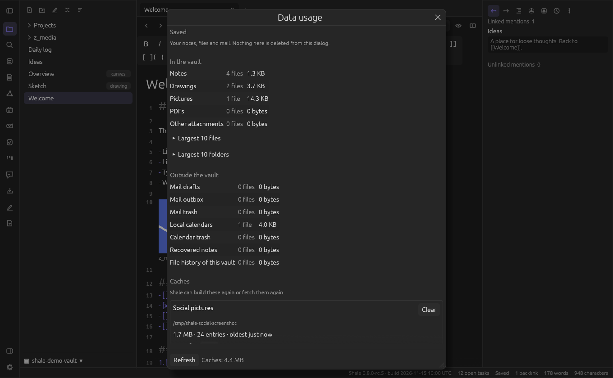

- Settings → Data and caches → **Data usage…** (or Ctrl+Shift+D) shows what Shale keeps on disk.
  **Saved**: the vault by kind (notes, drawings, pictures, PDFs, other attachments, `.shale/`,
  `.trash/`, `.git/`), its 10 largest files and folders (a click opens the file or shows the
  folder), and your data outside the vault: mail per account, drafts, outbox, mail trash, local
  calendars, calendar trash and recovered notes. Nothing in this part can be deleted here.
- **Caches** are what Shale can build or fetch again: social pictures, the social post index,
  the mail index, its daily backups, damaged copies of the mail index, the learned tag words, the
  undo histories of the notes of the open vault and the keyboard debug log. Each row shows its size, entries, oldest entry and last cleanup, and
  has a **Clear** button. The mail index is **rebuilt** from the message files instead (it asks
  first; not while mail syncs or a change waits for the server), and damaged copies are only
  deleted after you confirm; Clear on the undo histories asks first too (every `u` history of the
  vault goes, damaged copies included) and empties the histories of the open notes.
- How long each cache is kept is a setting (on its row, and in Settings under "How long caches
  are kept"): social pictures 30 days and 500 MB, social posts 365 days and 10 000 per account,
  the newest 3 mail index backups, damaged copies forever, undo histories 30 days, the debug log 10 MB. Every value can
  also be "forever" / "no limit".
- A cleanup runs in the background a minute after the start (when the last one is more than a
  day ago) and then daily, and 2 seconds after you change a setting. It never touches your notes,
  files or mail.

## Git sync

- Needs `git` installed. In Settings → Sync, enter the URL of a git repository
  (`https://…`, `ssh://…`, `git@host:notes.git` or a folder path) and press Connect (an address with a password in it, and plain `http://` or `git://` except on this computer, are refused: use a credential helper or an SSH key), or run
  `git init` in the vault folder yourself. Shale then syncs on its own: when the vault opens,
  every few minutes (default 5, changeable) and on "Sync now".
- A sync commits every change (the `.shale/` files too, so settings and open notes follow you;
  only the undo histories in `.shale/undo/` stay on the computer),
  fetches, merges and pushes. Commit messages read `Sync from <computer>: 3 file(s)`, with an
  optional prefix and suffix from the settings. Without a remote, Shale only keeps a local
  history.
- Nothing is ever lost: when a note was changed on two computers, the remote version stays and
  yours is kept next to it as `Note (conflict 2026-11-14 1530).md`; a note deleted on one side
  and changed on the other is kept. Shale never force-pushes, never writes conflict markers into
  notes, and pauses if git is in the middle of something you started (a merge, a rebase).
- Edits you type while a sync runs are never overwritten: if the sync brought a new version of
  that note, your text is saved as a conflict copy next to it.
- Passwords are git's business (credential helper or SSH key); Shale never asks for one.
- **Media in Git LFS.** Audio and video files are large, so they do not belong in the git history.
  With `git-lfs` installed, a repository Shale creates (Connect on a folder that is no repository
  yet) stores media with Git LFS from the start, and for an existing repository Settings → Sync
  has the button **Store media with Git LFS**. The settings show whether git-lfs is installed
  (and where to get it if not) and whether the repository uses it. Shale sets LFS up in this
  repository only (never your global git configuration), routes mp3, ogg, oga, opus, flac, m4a,
  aac, wav, mp4, m4v, mov, webm and mkv (any case) to it with a block in `.gitattributes` (your
  own lines there stay), and converts media already in the repository in one commit; the old
  versions stay in the history (`git lfs migrate` removes them, by hand). Every sync uploads the
  files to the remote's LFS store before it pushes. Other computers get small pointer files and
  download a file when it is needed: a sound or picture that is still a pointer shows "Not
  downloaded (12 MB) — Download" (pressing play downloads first, then plays; a spinner shows while
  it runs and a failure is said in words). Settings → Sync has "Download media files after every
  sync" (vault setting `sync.lfs_download`: `on_demand`, the default, or `always`). A conflict copy of a media file is stored in LFS too. On a
  computer without git-lfs, a vault that stores media with LFS is not synced (nothing is
  committed) and the settings say why.

## Keyboard

Ctrl is Cmd on macOS. No default key is one that the system reserves (the app menu's Cmd+H, AltGr on Windows, the workspace keys of the Linux desktops), so macOS has other keys for six actions, named in the rows below; a key you set yourself is never refused for that reason. The keys below are the defaults of the shortcuts that can be changed in **Settings → Keybindings** (Change replaces the keys of an action, Add gives it one more, Clear leaves it without a key)
(everywhere, file list, search results, mail view, note view, vim normal mode; a key that another action uses asks whether to overwrite it: Yes takes it from that action, No changes nothing).
Text editing keys and vim keys are fixed.

| Keys | Action |
|---|---|
| Ctrl+N | New note |
| Ctrl+O | Quick switcher (find or create a note) |
| Ctrl+E | Edit / reading view |
| Ctrl+, | Settings |
| Ctrl+Shift+D | Data usage: what Shale keeps on disk, and its caches |
| F1 | Open the user guide (built into Shale, unpacked into its data folder and opened as a vault) |
| Ctrl+S | Save now (notes also save automatically) |
| Ctrl+W | Close tab |
| Ctrl+Shift+F | Search all notes |
| Ctrl+H / Ctrl+L | Keyboard one place left / right: through the split panes in screen order, left of the first pane into the left sidebar, from there into the first pane (macOS: Cmd+Shift+H / Cmd+Shift+L, because Cmd+H hides the app) |
| Ctrl+PageUp / Ctrl+PageDown | Previous / next tab (from the last tab on to the first), wherever the keyboard is (macOS: Cmd+Opt+← / Cmd+Opt+→) |
| Ctrl+\ | Split right: open this tab in a new pane to the right (panes sit side by side, each with its own tabs) |
| F6 / Shift+F6 | Focus the next / previous pane |
| Ctrl+Shift+W | Close the pane with all its tabs (macOS: Cmd+Shift+W) |
| Ctrl+Shift+B | File list with the keyboard in it: j / k (or ↓ / ↑) next / previous file, Ctrl+J / Ctrl+K next / previous folder, Space opens or closes a folder, Enter opens, Esc back |
| ↓ or Enter in the search box | Browse the results: j / k (or ↓ / ↑) next / previous hit, Ctrl+J / Ctrl+K next / previous file, Enter opens the note at the hit, Esc back to the box |
| Ctrl+Shift+M | Mail view (its keys are listed below) |
| Alt+← / Alt+→ | Back / forward (macOS: Cmd+[ / Cmd+], because Option+← / → move by word in text) |
| Alt+B, Alt+I, Alt+S, Alt+H, Alt+C, Alt+Y, Alt+F, Alt+E, Alt+U, Alt+O, Alt+T, Alt+Q, Alt+K, Alt+R, Alt+J, Alt+A, Alt+L, Alt+W, Alt+M, Alt+X | The buttons of the formatting toolbar of a note, each doing what a click on it does (the keyboard stays in the text and nothing is typed): Bold, Italic, Strikethrough, Highlight, Inline code, Highlight colour and Font colour (open their palette, the ▾ part of the split button), Heading level (opens its menu), Bullet list, Numbered list, Task, Quote, Code block, Horizontal rule, Table, Link to a note, Web link, Embed, Clear formatting. A key whose button is not there (reading view) or is greyed out (in a table cell) does nothing |
| Ctrl+Shift+K / Ctrl+Shift+J | Fold / unfold the block at the cursor (a heading section, quote, list item or list; again on a folded line folds the block around it); the cursor then goes to the block's first line |
| Ctrl+Shift+O / Ctrl+Shift+I | Fold all / unfold all blocks of the note (also in the reading view) |
| Ctrl+Shift+C | Copy the code of the code block at the cursor (no fences, no newline at the end) |
| Alt+V, Alt+P, Alt+D, Alt+N | The buttons of the view header and tab bar of a note: edit / reading view, Markdown preview, the ⋯ menu (opens it), New tab |
| Alt+1, Alt+2, Alt+3, Alt+4, Alt+5, Alt+6, Alt+7, Alt+8, Alt+9, Alt+0 | The ribbon items by position: the first ten icons of the ribbon, as shown (also after you reordered or removed some) |
| Alt+, / Alt+. | Show or hide the left / right sidebar |
| Hold Alt | A small badge with its key appears at the corner of each of these buttons that has an Alt key (it follows a key you changed). On macOS, where Option+letter types characters, these actions, and the Alt keys of the open mail, have no key until you give them one in Settings → Keybindings (scope Note view, Mail view and Everywhere) |
| Ctrl+6 | Alternate view, in every view (also mail and drawings, where Space is taken): swap with the view this tab showed just before; again: back |
| Space Tab | Vim-style editing, normal mode: back to the view this tab showed just before (note, calendar, Feeds, …); again: forward to this one |
| Space … | A started key sequence (e.g. `Space f`) shows in the status bar and is dropped after 1.5 s without a key |
| Space f f | Vim-style editing, normal mode: find a file by name (↓ / ↑ or Ctrl+J / Ctrl+K select, Enter opens it in this tab, Esc closes) |
| Space f g | Vim-style editing, normal mode: search the text of notes, mail and posts (`*` and `?` are wildcards; results grouped with counts; ↓ / ↑ or Ctrl+J / Ctrl+K select, Enter opens the hit where it belongs, Esc closes) |
| Shift+K | Vim-style editing, normal mode: preview the link under the cursor (a note as in the reading view, a web page's title and text; press it again to move the keyboard into the preview: j / k or ↓ / ↑ scroll, Enter opens the link like `gt`, Ctrl+Enter opens it in a new pane on the right, Esc closes). Definable, e.g. as Space Space |
| Alt+↑ / Alt+↓ | Move the current line |
| Tab / Shift+Tab | Indent lists or change heading levels |
| Shift+arrows | In a table cell edited in the grid: select a block of cells (formatting buttons and Delete / Backspace work on all of them; typing ends it) |

### Mail view keys

In the mail view (Ctrl+Shift+M) one of the three panes (folders, message list, message) has the
keyboard; it has an accent-coloured frame. **Ctrl+H / Ctrl+L** (macOS: Cmd+Shift+H / Cmd+Shift+L) move it one pane left / right (from
the folder pane Ctrl+H goes on into the pane on the left, or the left sidebar, from there Ctrl+L comes back). Letters work
only while no text field has the keyboard. Every key can be changed in Settings → Keybindings
(scope Mail view); Enter and Esc are fixed.

| Keys | Action |
|---|---|
| j / ↓, k / ↑ | Next / previous: folder in the folder pane, message in the list, scroll in the message pane |
| Enter | Folder pane: go to the list; list: open the message (Drafts: open the draft; Outbox: show the mail) |
| Ctrl+J / Ctrl+K | Next / previous folder, from any pane |
| Space | Mark the message for a selection (list) |
| / | Search mail (Esc leaves the field, ↓ or Enter go into the results) |
| t | Search all folders or only this one |
| i | Import to vault |
| u | Mark read or unread |
| s or f | Set or clear the flag |
| d or Delete | Delete (Trash: asks first); in Drafts and Outbox discard the draft or the record |
| m | Move to a folder |
| c | Write a new mail |
| r, Shift+R, Shift+F | Reply, reply all, forward |
| Alt+I, Alt+C, Alt+R, Alt+A, Alt+F, Alt+U, Alt+G, Alt+M, Alt+D | The buttons of the open mail: Import to vault, Close, Reply, Reply all, Forward, Mark read / unread, Flag, Move…, Delete (the letter is underlined on the button while Alt is held; not on macOS, where Option+letter types characters: bind them in Settings → Keybindings) |
| Ctrl+R | Sync, or cancel the sync |
| a | Account settings |
| Shift+L | Load the open message (or the list of a folder that is not synced) from the server |
| ] | Select the next attachment (marked with ▸) |
| o, Shift+O | Open the selected attachment, save it to the vault |
| z | Take back a mail waiting in the outbox |
| e | Edit: open the draft, or take a mail of the outbox that was not sent back into the editor |
| Shift+S | Retry a mail of the outbox that was not sent (or send it again when it may have been sent) |
| Menu, Shift+F10 | Open the menu of the message or draft under the cursor (↓ / ↑ or j / k, Enter, Esc) |
| Shift+U | Show or hide the sent mails that are only on this computer (j / k, Enter = Upload again, d = Dismiss, Esc) |
| Esc | Step back: close the message, clear the search, clear the marks, dismiss a message |
