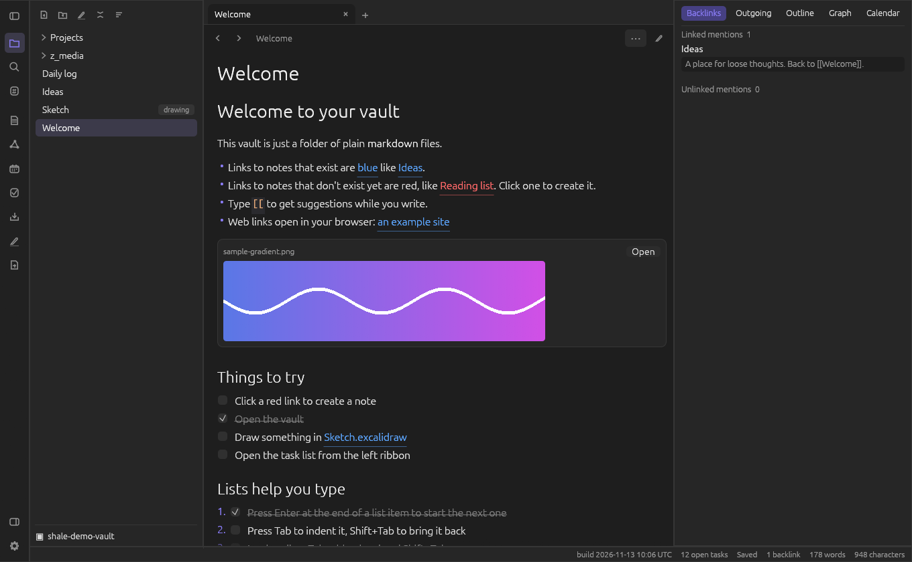
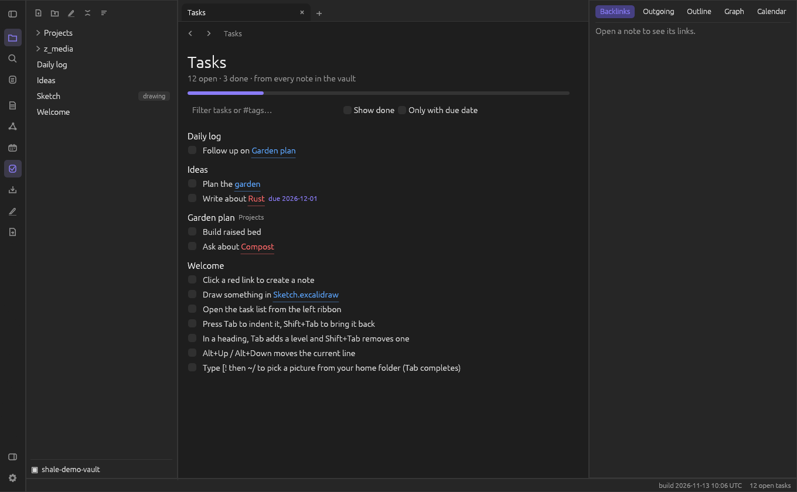
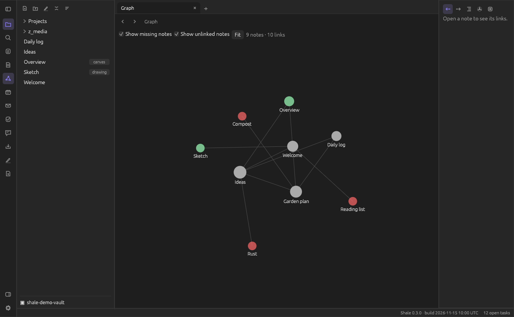
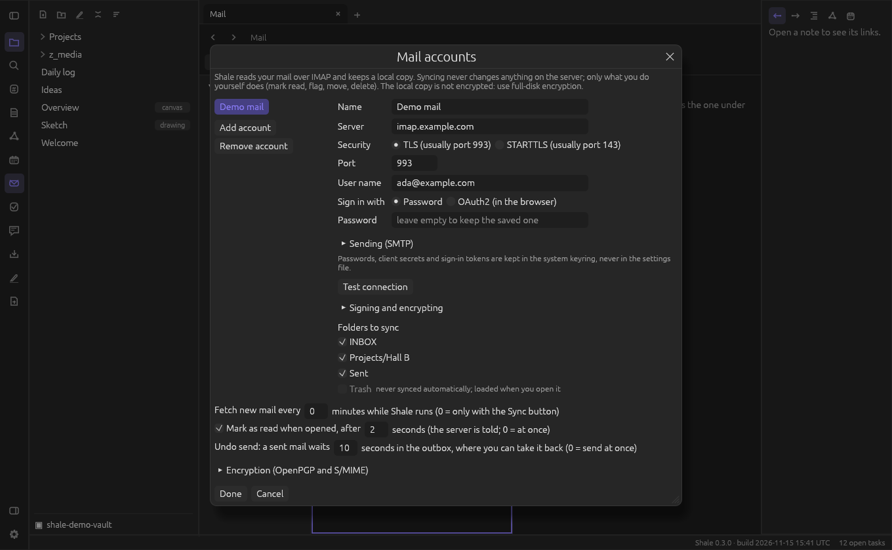
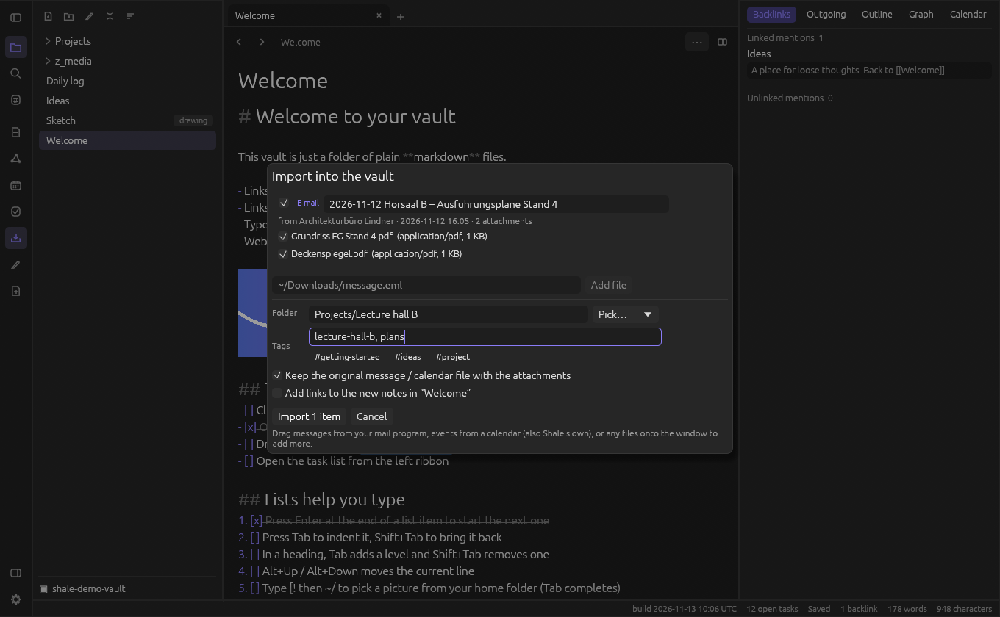
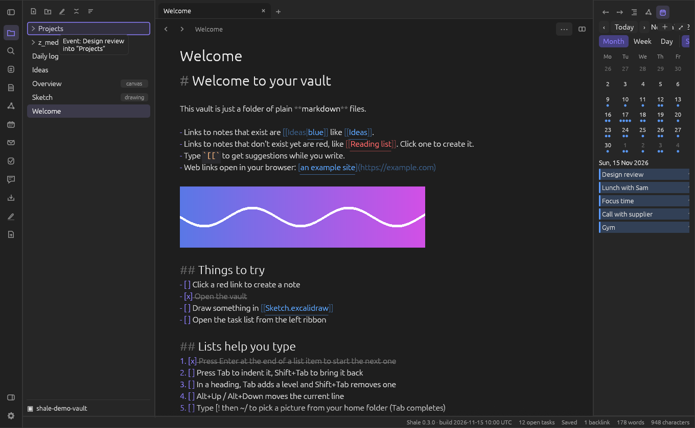

# Shale features

Shale is a notes app for the Linux desktop. Your vault is a plain folder of markdown files,
and notes link to each other with `[[wiki links]]`. The screenshots below come from the app's
built-in demo vault (`shale --screenshot out.png`).

## Notes and links

- `[[Note]]` links are **blue** when the note exists and **red** when it doesn't. Click a blue
  link to open the note, or a red one to create it.
- Pictures (`![[photo.png]]`), drawings (`![[Sketch.excalidraw]]`) and PDFs are shown inside the
  editor.
- Lists continue when you press Enter (also numbered lists and to-dos `- [ ]` / `1. [ ]`).
  Tab and Shift+Tab indent list items or change heading levels, and Alt+↑/↓ move lines.
- Web links (`[text](https://…)`) open in your browser.
- Drag notes, drawings, files and folders in the file list to move them into another folder.
  Links that point to them by path are updated.

- Back and forward with the mouse side buttons or Alt+←/→. You can sort the file list by name,
  date modified or date created.

- Type `[[` to get matching notes; the last entry creates a new note. Esc closes the list.
- Type `[!` to pick a file: `/` starts at the vault, `~/` at your home folder, and Tab completes
  like a shell. Files from outside the vault are copied to `z_media/<year>/<month>/`.

- Ctrl+E switches between editing and the reading view.

- Export notes and drawings to PDF (paper size, margins, fonts and more in a dialog), insert a
  new drawing, rename the note (links in other notes are updated), or move it to the trash.

## Keyboard only: sidebar, file list and vim-style editing

- Ctrl+H puts the keyboard into the left sidebar, Ctrl+L back into the note. Ctrl+Shift+B opens
  the file list with the open note selected: j / k go from file to file, Ctrl+J / Ctrl+K from
  folder to folder, Space opens or closes a folder, Enter opens a file.
- In the search results j / k go from hit to hit and Ctrl+J / Ctrl+K from file to file.
- **Vim-style editing** (Settings, off by default): notes open in normal mode. h j k l, w b,
  W B, 0 $, gg G move; `:12` jumps to line 12; `/text` searches and n / N go on; i a I A o O
  start typing, Esc stops; x deletes a character; v and V select with the same motions, d cuts
  and y copies to the clipboard, p pastes. The status bar shows NORMAL, INSERT, VISUAL or V-LINE.

## Drawings

- Hand-drawn style sketches, saved as standard `.excalidraw` files.
- Drawings of the Obsidian Excalidraw plugin (`.excalidraw.md`, compressed or not) open in the
  drawing editor too, and are saved in the plugin's own format, so Obsidian keeps reading them.
  Links like `[[Drawing.excalidraw]]` and embeds `![[Drawing.excalidraw]]` find them.
- Tools on keys 1–0: hand, select, rectangle, diamond, ellipse, arrow, line, pen, text, eraser.
- The style panel sets stroke and fill colours, fill style, stroke width, outline pattern,
  sloppiness, corners, label font, size, colour, background and alignment, opacity, and the
  order of shapes.
- Double-click a shape to label it. Arrows snap to shapes and follow them when shapes move.
  Hold Shift to keep lines at 45° steps.
- "Auto arrange" untangles a diagram; "Spread out" and "Pull together" change the spacing.

## To-do list across all notes

- Every `- [ ] task` from every note in one list. Ticking a task off saves it in its note.
- Filter by text or `#tag`, show done tasks, or only tasks with a due date
  (`📅 2026-12-01` or `due:2026-12-01`).

## Linked notes and the graph

- The right sidebar shows backlinks, unlinked mentions, outgoing links, the outline and a local
  graph of the open note.
- The vault graph shows every note. Red dots are missing notes and green ones are drawings.

## Calendar

- A calendar in the right sidebar (small month) and as a big tab, with Month, Week and Day views
  in three sizes.
- Local calendars (`.ics` files, for testing; with sample events) and **CalDAV** calendars
  (for example Nextcloud). Each CalDAV calendar has its own automatic sync interval (15 minutes
  by default).

- Click an event to see its details: when, how it repeats, where, organizer, attendees and
  notes. **Edit** and **Delete** work for local and CalDAV calendars.

- Double-click a day or time to create an event. It starts at the next full or half hour and is
  30 minutes long.
- "Save to" chooses any calendar. When a calendar refuses the save (for example because you have
  no write permission), the error is shown in the dialog and you can pick another calendar.
  Moving an event writes it to the new calendar first and removes it from the old one only after
  that worked, so nothing is lost.

- Settings → Calendars: add local calendars or CalDAV accounts ("Find calendars" asks the
  server), choose colours, show or hide calendars, and set the sync interval per calendar.

## Mail

- The **Mail** button in the ribbon (or Ctrl+Shift+M) opens a three-pane view: accounts and
  folders with their unread counts, the list of messages (newest first) and the message itself
  as plain text. Shale reads your mail over IMAP and keeps a local copy next to the other
  program data (`~/.local/share/shale/mail`), so it works offline and search is instant.
- **Syncing only reads; what you do yourself is sent.** Fetching mail never changes anything on
  the server (it does not even mark mail as read). Only your own actions are written back: mark
  read or unread, flag, move to another folder, delete (to Trash) and, inside Trash, delete
  forever. Passwords are checked over a TLS connection with the system's certificate store; there
  is no unencrypted option. Shale cannot send mail yet.
- **No HTML, no tracking.** The message text comes from the plain text part, or from the HTML
  turned into text. Nothing is rendered, no pictures are fetched, no scripts run. An attachment
  is opened from a private temporary copy through your default program (never a program or
  script), or saved into the vault's media folder.
- **The local copy is not encrypted** (like Thunderbird's). Use full-disk encryption.

- **Accounts…** adds an account: server, port (993 with TLS, 143 with STARTTLS), user name and
  password. The password goes into the system keyring. Without a keyring Shale says so and asks
  again each time it starts, keeping it in memory only; it is never written to the settings
  file. **Test connection** checks the login and lists the folders.
- **OAuth2 sign-in** (Google, Microsoft, or your own provider): choose "OAuth2 (in the browser)",
  the provider and your own **client ID** (Shale ships none; see below), press **Sign in in the
  browser**, and sign in on the provider's page. Shale shows who signed in, keeps only a refresh
  token in the system keyring and renews the short-lived access token by itself. If the sign-in
  expires or is revoked, the mail view and the settings say so and **Sign in again** fixes it.
  Without a keyring the sign-in lasts until Shale quits.
  - *Google:* in the Google Cloud console create a project, set up the OAuth consent screen
    (External, status Testing) and add your Gmail address as a test user, create an **OAuth client
    ID of type "Desktop app"**, and enter its client ID and client secret in Shale. The scope
    `https://mail.google.com/` is "restricted": an unverified app is limited to 100 test users, and
    in Testing status Google ends the sign-in after 7 days (sign in again).
  - *Microsoft:* in the Entra admin center register an app ("Accounts in any organizational
    directory and personal Microsoft accounts"), add the platform "Mobile and desktop
    applications" with the redirect address `http://localhost`, switch on "Allow public client
    flows", add the delegated permission `IMAP.AccessAsUser.All`, and enter the Application
    (client) ID in Shale (no secret). A work account may need IMAP switched on by its admin.
  - *Custom:* any OIDC provider with an authorization-code + PKCE flow; type its authorization and
    token addresses and the scope. `http://` is accepted only for `localhost`.
- The first sync fetches the mail of the last three years, newest first, several folders at once,
  and can be stopped and resumed. **Sync** and the status bar show the progress; new mail is also
  fetched every 10 minutes (changeable, 0 = off) while Shale runs. A mail deleted on the server
  stays here, dimmed, with a note.
- Choose which folders are synced with the tick boxes. **Trash, Junk and Gmail's "All Mail" are
  not synced automatically**: when you open one, its list is loaded from the server, and a
  message is downloaded when you press **Load this message**. The same button appears for a
  message over the size limit (200 MB).
- **Search** (the field above the list, or `/`): words, `"phrases"`, `from:`, `to:`, `subject:`
  and `body:`; ignores case and accents. Choose all folders or only the open one.
- **Import to vault** (button, or `i`) hands the mail to the same Import dialog as a dragged
  `.eml` file: attachments, people and tags work the same, a mail that was imported before is
  recognised, and nothing is written until you press Import. Mark several mails (Space or
  Ctrl+click) to import them together.
- Keys while no text field has the keyboard: j / k or ↑ / ↓ move in the list, Enter opens the
  message, Space marks it, Ctrl+J / Ctrl+K go to the next / previous folder, `/` goes to the
  search field (↓ or Enter there go into the results), `i` imports, Esc steps back (closes the
  message, then clears the search).
- **Read, flag, move, delete** (also with the buttons above the message, a right click on a row,
  and the buttons that appear when mails are marked). The keys work on the marked mails, else on
  the open one, else on the one under the cursor, and need no Ctrl or Shift:
  `u` marks read or unread, `s` or `f` sets or clears the flag, `d` or Delete moves to Trash (in
  Trash it asks whether to delete forever; Enter does not confirm, only the red button does), `m`
  opens the folder picker (type to find a folder, ↑ ↓, Enter; Esc leaves). Unread mail is bold,
  flagged mail has a flag, and anything the server has not confirmed yet says "saving…",
  "moving…" or "deleting…" and shows in the bar as "N changes are waiting for the server".
- **Safe by design.** A change shows at once and is sent in the background. Without a network it
  waits (also across a restart) and goes out when the server answers; if the server refuses, the
  change is undone in the list and you are told why. "Delete" is always a move to the Trash
  folder. "Delete forever" removes only the mails you chose (never the ones another program
  marked as deleted). A mail that another program moved or deleted meanwhile is left alone and
  dimmed. Shale never deletes its own local copy: files of mail that moved or were deleted go to
  `.trash/<date>/` inside the mail folder. A server without `MOVE` is handled by a verified copy
  first; a server without `UIDPLUS` cannot delete forever, and for it deleting without `MOVE` is
  refused rather than risked.
- **Mark as read when opened** (Accounts…): on by default, after 2 seconds (0 = at once). Mail
  you close before then stays unread. Off: opening never changes the "read" mark.

## Importing e-mails, events and files (for project tracking)

- Drag e-mails from Thunderbird, events from a calendar (Shale's own or another program), `.eml`
  or `.ics` files, or any other files (plans, PDFs…) onto the window. The ribbon's Import button
  opens the same dialog.
- Choose the folder (one per project, for example) and tags. Small pictures from signatures are
  left out by default, and each attachment can be ticked on or off.
- Drop onto a folder in the file list to import into that folder, or onto a note to also add
  links to the new notes there.
- Messages that were already imported are recognised and left out unless you tick them again.
- On Wayland, Shale reads what Thunderbird hands over. When that is only a link to the message,
  Shale finds the message in Thunderbird's local copy (for IMAP accounts this needs "Keep
  messages for this account on this computer").

- Each e-mail becomes a note named "date subject" with the sender, recipients and date, the tags
  in its properties, links to the attachments and the original message, and the text of the
  message. The tag list counts these tags too.

## People (contact notes)

- Contact notes live in the **people folder** (default `Adressbuch`, changeable in Settings).
- Type `[[p ` and a name to pick a person from that folder. The link that is written is a normal
  `[[Name]]` link, so other markdown tools understand it too. "New contact" makes a contact note
  from a template (e-mail, phone, organization, notes).
- When importing, the sender, recipients, organizer and attendees are found and matched to
  contact notes (by e-mail address anywhere in the note, else by name; "Müller, Hans" = "Hans
  Müller"). Known contacts and new senders are ticked; for ticked people without a note one is
  made. The imported note gets a "People" line with links, so each contact note's backlinks show
  every mail and meeting with that person. Automatic senders like "noreply" are left out.

## Tags found automatically (no server, no AI)

- Tags of the vault that are written in the imported text are set right away
  (`#lecture-hall-b` for "Lecture Hall B", the last part of nested tags too).
- Shale also learns, from the notes in the vault, which words are typical for each tag (words in
  most notes with the tag and rarely elsewhere) and suggests those tags when an import contains
  several of these words. It is plain counting: the same notes always give the same suggestions.
  It is learned again in the background now and then and kept in `.shale/tag-words.json` in the
  vault.

## Settings that travel with the vault

- Each vault keeps its own settings in `.shale/settings.json` (people folder, git sync) and its
  session in `.shale/state.json` (open notes, last import folder, recent tags), so a vault
  behaves the same on every computer. Settings of the program itself (appearance, calendars,
  recent vaults) stay in `~/.config/shale/config.json`.
- The files carry a format version and are upgraded on load. A settings file that can't be read
  is kept as `….broken-<date>` and you are told; a file from a newer Shale is used but not
  changed.
- On the first start after the upgrade, the people folder, open notes, import folder and recent
  tags move from the old global settings into the vault you open.

## Git sync

- Needs `git` installed. In Settings → Git sync, enter the URL of a git repository
  (`https://…`, `ssh://…`, `git@host:notes.git` or a folder path) and press Connect, or run
  `git init` in the vault folder yourself. Shale then syncs on its own: when the vault opens,
  every few minutes (default 5, changeable) and on "Sync now".
- A sync commits every change (the `.shale/` files too, so settings and open notes follow you),
  fetches, merges and pushes. Commit messages read `Sync from <computer>: 3 file(s)`, with an
  optional prefix and suffix from the settings. Without a remote, Shale only keeps a local
  history.
- Nothing is ever lost: when a note was changed on two computers, the remote version stays and
  yours is kept next to it as `Note (conflict 2026-11-14 1530).md`; a note deleted on one side
  and changed on the other is kept. Shale never force-pushes, never writes conflict markers into
  notes, and pauses if git is in the middle of something you started (a merge, a rebase).
- Edits you type while a sync runs are never overwritten: if the sync brought a new version of
  that note, your text is saved as a conflict copy next to it.
- Passwords are git's business (credential helper or SSH key); Shale never asks for one.

## Keyboard

| Keys | Action |
|---|---|
| Ctrl+N | New note |
| Ctrl+O | Quick switcher (find or create a note) |
| Ctrl+E | Edit / reading view |
| Ctrl+, | Settings |
| Ctrl+Shift+F | Search all notes |
| Ctrl+H / Ctrl+L | Keyboard into the left sidebar / back into the editor |
| Ctrl+Shift+B | File list with the keyboard in it: j / k next / previous file, Ctrl+J / Ctrl+K next / previous folder, Space opens or closes a folder, Enter opens, Esc back |
| ↓ or Enter in the search box | Browse the results: j / k next / previous hit, Ctrl+J / Ctrl+K next / previous file, Enter opens the note at the hit, Esc back to the box |
| Ctrl+Shift+M | Mail view. There, with no text field in use: j / k next / previous message, Enter opens, Space marks, Ctrl+J / Ctrl+K next / previous folder, / search, i import to vault, Esc back |
| Alt+← / Alt+→ | Back / forward |
| Alt+↑ / Alt+↓ | Move the current line |
| Tab / Shift+Tab | Indent lists or change heading levels |
