# Shale features

Shale is a notes app for the Linux desktop. Your vault is a plain folder of markdown files,
and notes link to each other with `[[wiki links]]`. The screenshots below come from the app's
built-in demo vault (`shale --screenshot out.png`).

## Notes and links

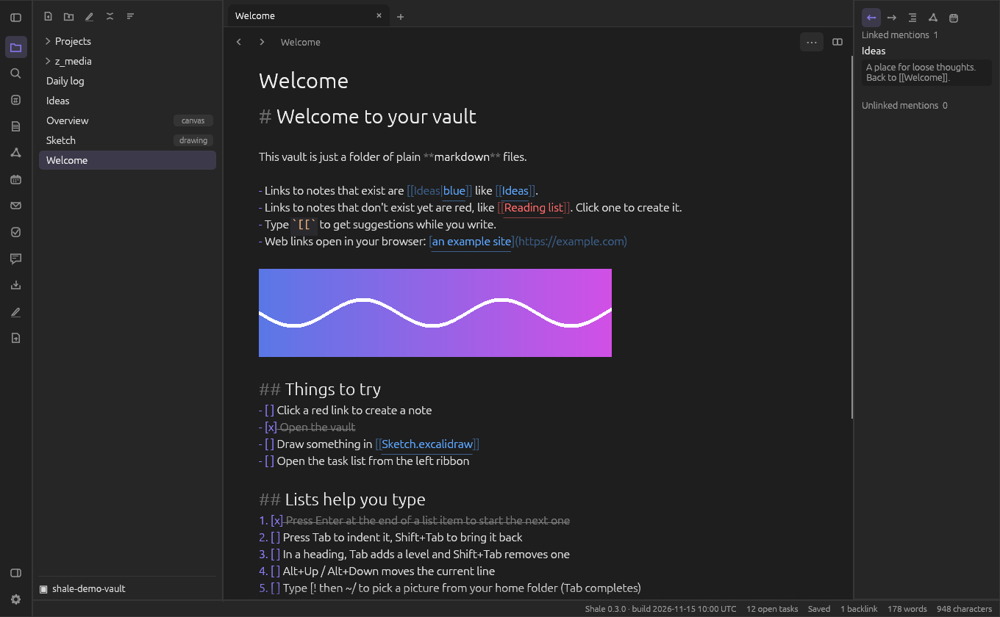

- `[[Note]]` links are **blue** when the note exists and **red** when it doesn't. Click a blue
  link to open the note, or a red one to create it.
- Pictures (`![[photo.png]]`), drawings (`![[Sketch.excalidraw]]`) and PDFs are shown inside the
  editor.
- Lists continue when you press Enter (also numbered lists and to-dos `- [ ]` / `1. [ ]`).
  Tab and Shift+Tab indent list items or change heading levels, and Alt+↑/↓ move lines.
- Web links (`[text](https://…)`) open in your browser.
- Drag notes, drawings, files and folders in the file list to move them into another folder.
  Links that point to them by path are updated.

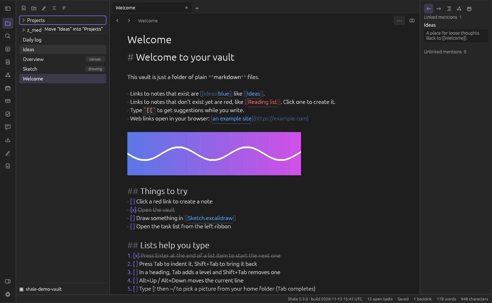

- Back and forward with the mouse side buttons or Alt+←/→. You can sort the file list by name,
  date modified or date created.

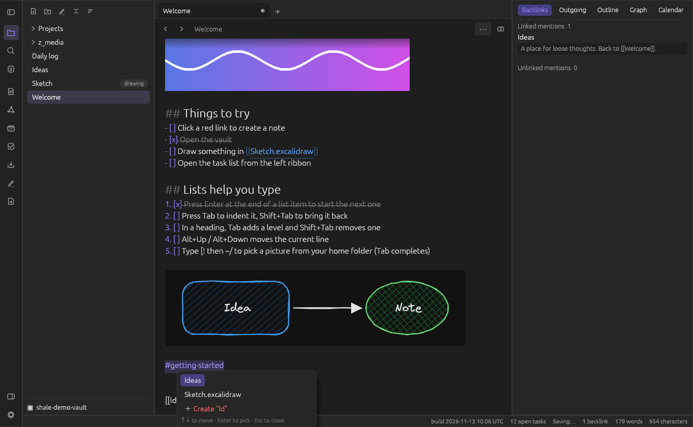

- Type `[[` to get matching notes; the last entry creates a new note. Esc closes the list.
- Type `[!` to pick a file: `/` starts at the vault, `~/` at your home folder, and Tab completes
  like a shell. Files from outside the vault are copied to `z_media/<year>/<month>/`.

- Ctrl+E switches between editing and the reading view.

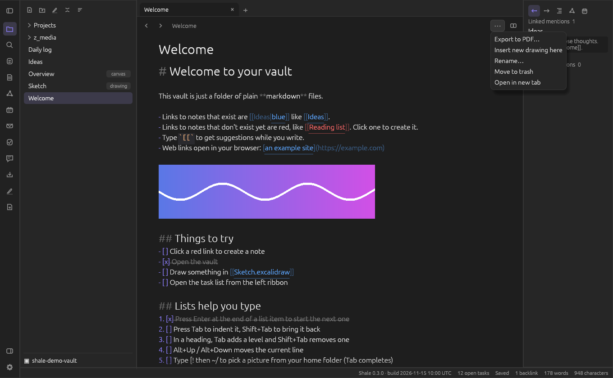

- Export notes and drawings to PDF (paper size, margins, fonts and more in a dialog), insert a
  new drawing, rename the note (links in other notes are updated), or move it to the trash. The
  trash keeps the original folder (`.trash/<date>/<path>`) and nothing in it is replaced or
  emptied; right-click the empty space of the file list and choose "Restore last deleted" to put
  the last item you trashed back.
- Every dialog is a window you can move by its title bar and resize from any edge or corner.

## Tabs

- Drag a tab left or right to reorder it; a marker shows where it will land. A click without
  moving still just selects the tab, and the ✕ or a middle click closes it.
- Right-click a tab and choose **Pin tab** (or **Unpin tab**): pinned tabs move to the far left,
  show a small pin and keep their order. Drag reorders pinned tabs among themselves and the
  others among themselves, never across the border. A pinned tab can still be closed.
- The order of the open notes and which of them are pinned come back at the next start (a pinned
  Feeds tab is not remembered as pinned).

## Keyboard only: sidebar, file list and vim-style editing

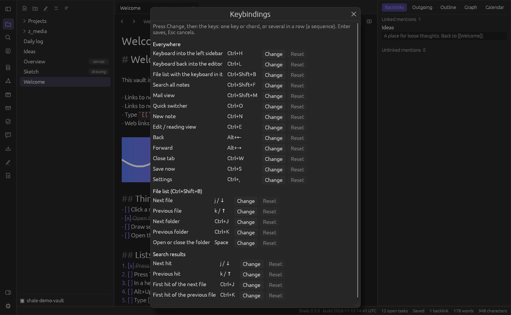

- Ctrl+H puts the keyboard into the left sidebar, Ctrl+L back into the note. Ctrl+Shift+B opens
  the file list with the open note selected: j / k go from file to file, Ctrl+J / Ctrl+K from
  folder to folder, Space opens or closes a folder, Enter opens a file.
- Every shortcut of this section can be changed in Settings → Keybindings…; a key that another
  action already uses is refused, and a binding can be a sequence of keys.
- In the search results j / k go from hit to hit and Ctrl+J / Ctrl+K from file to file.
- **Vim-style editing** (Settings, off by default): notes open in normal mode. h j k l, w b,
  W B, 0 $, gg G move; `:12` jumps to line 12; `/text` searches and n / N go on; i a I A o O
  start typing, Esc stops; x deletes a character; v and V select with the same motions, d cuts
  and y copies to the clipboard, p pastes. The status bar shows NORMAL, INSERT, VISUAL or V-LINE.

## Drawings

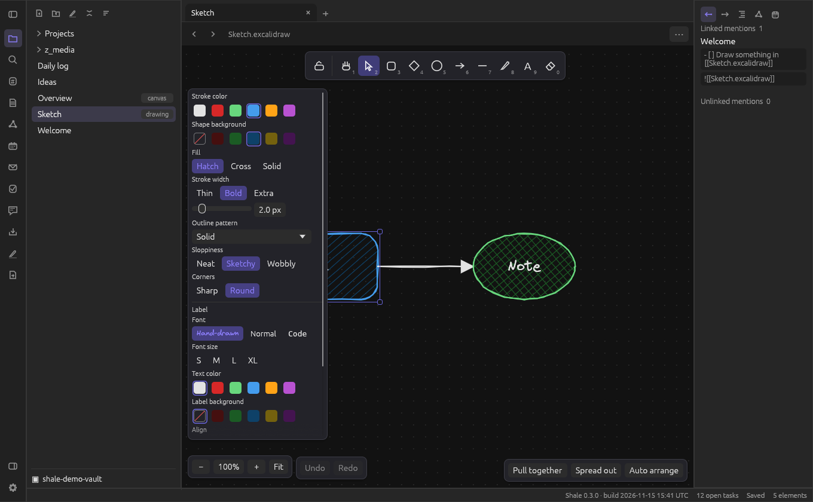

- Hand-drawn style sketches, saved as standard `.excalidraw` files.
- Drawings of the Obsidian Excalidraw plugin (`.excalidraw.md`, compressed or not) open in the
  drawing editor too, and are saved in the plugin's own format, so Obsidian keeps reading them.
  Links like `[[Drawing.excalidraw]]` and embeds `![[Drawing.excalidraw]]` find them.
- Links inside drawings: type `[[` in a label or text for note suggestions, `[[p ` for people
  and `[!` for the file picker, just like in notes. A shape or text with a link gets a small ↗
  mark; click it (or Ctrl+click the shape) to open the note, Shift for a new tab.
- Links in drawings and canvases count like links in notes: the linked note lists the drawing
  under Backlinks, and the graph shows the connection. Renaming or moving a note updates the
  links in drawings too; canvases are never changed, so the message names any canvas that still
  points to the old name.
- Pictures in drawings show up: pictures of Obsidian Excalidraw drawings (from the vault) and of
  excalidraw.com files (stored in the file), also in drawings embedded in notes and in PDF
  export.
- Tools on keys 1–0: hand, select, rectangle, diamond, ellipse, arrow, line, pen, text, eraser.
- The style panel sets stroke and fill colours, fill style, stroke width, outline pattern,
  sloppiness, corners, label font, size, colour, background and alignment, opacity, and the
  order of shapes.
- Double-click a shape to label it. Arrows snap to shapes and follow them when shapes move.
  Hold Shift to keep lines at 45° steps.
- "Auto arrange" untangles a diagram; "Spread out" and "Pull together" change the spacing.

### Obsidian canvases

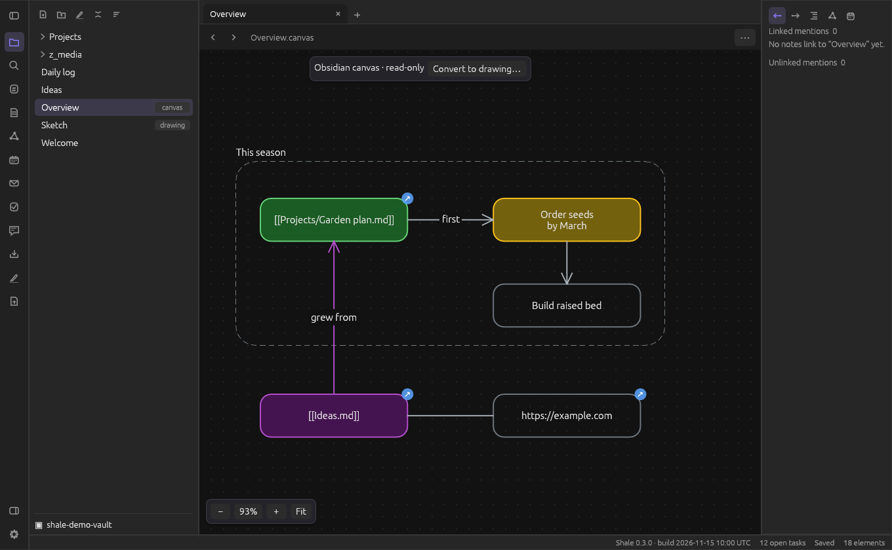

- Obsidian Canvas files (`.canvas`) open in the drawing view: cards with their colours, groups,
  file and web cards (click them to follow), and the arrows between cards with their labels.
- Opening one asks whether to convert it. **Convert** makes an editable drawing
  `Name.excalidraw.md` next to it (Obsidian opens it with the Excalidraw plugin); **Open
  read-only** just shows it. The canvas file itself is never changed. Opening the canvas again
  offers the drawing made before.
- Tick "Always convert canvases when opening them" (also in Settings → Drawings) to skip the
  question.

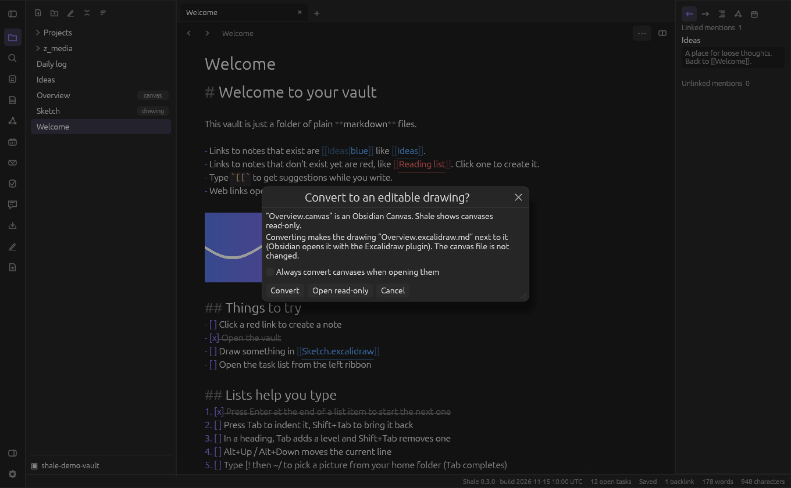

## To-do list across all notes

- Every `- [ ] task` from every note in one list. Ticking a task off saves it in its note.
- Filter by text or `#tag`, show done tasks, or only tasks with a due date
  (`📅 2026-12-01` or `due:2026-12-01`).

## Linked notes and the graph

- The right sidebar shows backlinks, unlinked mentions, outgoing links, the outline and a local
  graph of the open note.
- The vault graph shows every note. Red dots are missing notes and green ones are drawings.

## The ribbon and the sidebars

- The icons of the ribbon (the narrow bar on the left) can be dragged into any order. A line
  between two icons shows where the icon lands; Esc, or letting go anywhere else, cancels. The
  order is kept in the settings. The sidebar toggles at the top and bottom and the settings
  button stay where they are.

## Calendar

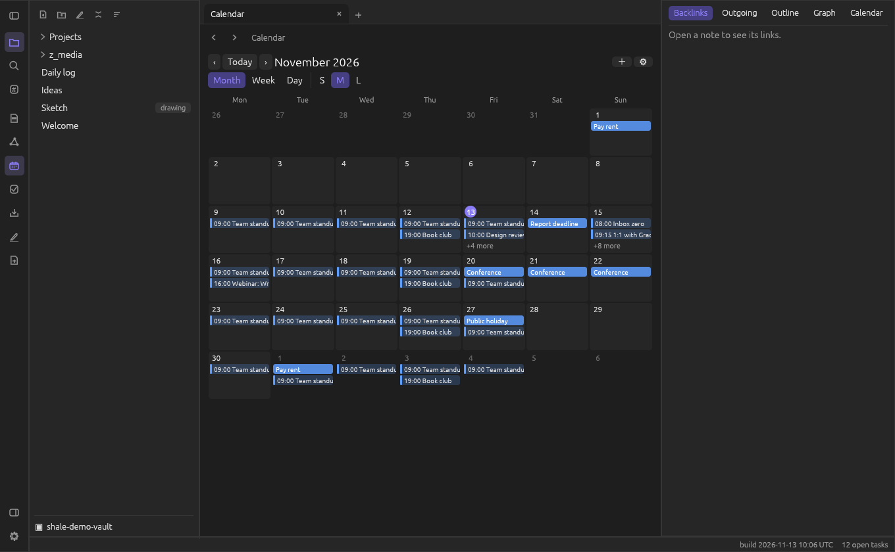

- A calendar in the right sidebar (small month) and as a big tab, with Month, Week and Day views
  in three sizes.
- Local calendars (`.ics` files, for testing; with sample events) and **CalDAV** calendars
  (for example Nextcloud). Each CalDAV calendar has its own automatic sync interval (15 minutes
  by default).

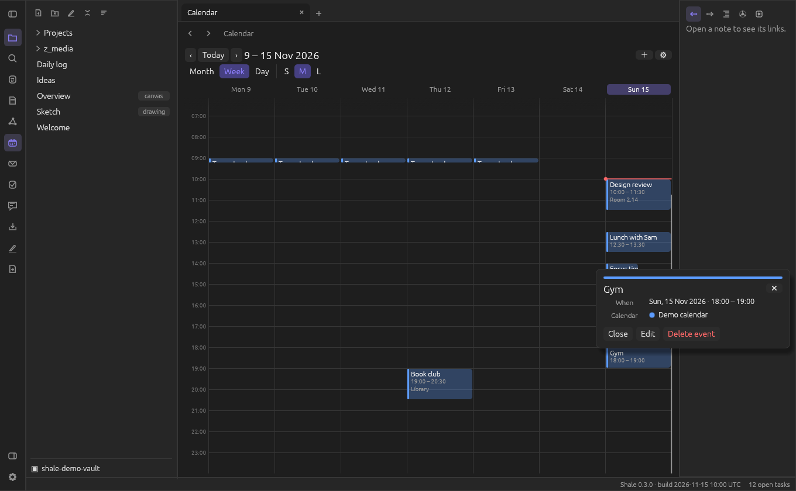

- Click an event to see its details: when, how it repeats, where, organizer, attendees,
  categories, reminders and notes. **Edit** and **Delete** work for local and CalDAV calendars. Delete asks first ("Delete
  “Title”?"), and a copy of the event is kept in `calendar-trash` in the data folder. A CalDAV
  save or delete that cannot be sure the server still has what Shale read is refused.
- A repeating event asks what you mean: **Edit this date** or **Edit all repeats**, **Delete this
  date** or **Delete all repeats**. A date you change becomes its own entry next to the series; a
  date you delete is left out of the series.
- The event dialog sets how an event **repeats** (daily, weekly on the days you pick, monthly,
  yearly; every N; ending never, on a date or after N times), the dates it **skips**,
  **reminders** (minutes, hours or days before), its status, whether it shows as busy or free,
  categories and the time zone its times are stored in. Shale stores and edits reminders but
  does not ring itself; your phone or another calendar program does. Every date can be typed or
  picked from a small month.
- **Nothing is lost when you save.** Shale writes back every line of an event that it read and
  you did not change: reminders and repeat rules made in other programs, who accepted an
  invitation, time zones, and fields Shale has never heard of. A repeating event keeps its
  clock time over summer time in every program.

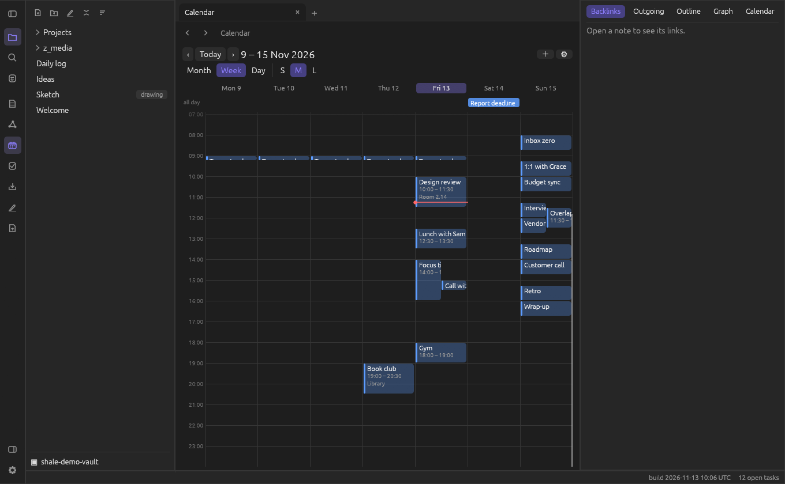

- Double-click a day or time to create an event. It starts at the next full or half hour and is
  30 minutes long.
- "Save to" chooses any calendar. When a calendar refuses the save (for example because you have
  no write permission), the error is shown in the dialog and you can pick another calendar.
  Moving an event writes it to the new calendar first and removes it from the old one only after
  that worked, so nothing is lost.

- Settings → Calendars: add local calendars or CalDAV accounts ("Find calendars" asks the
  server), choose colours, show or hide calendars, and set the sync interval per calendar.

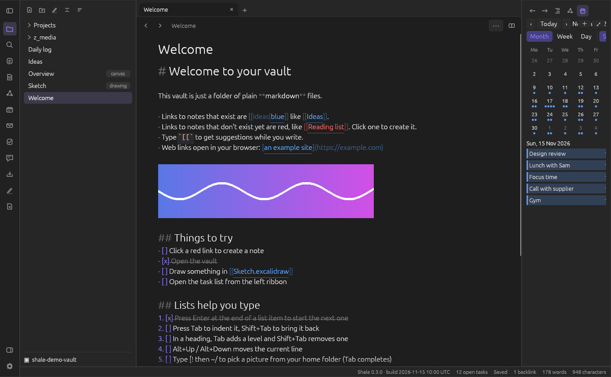

## Mail

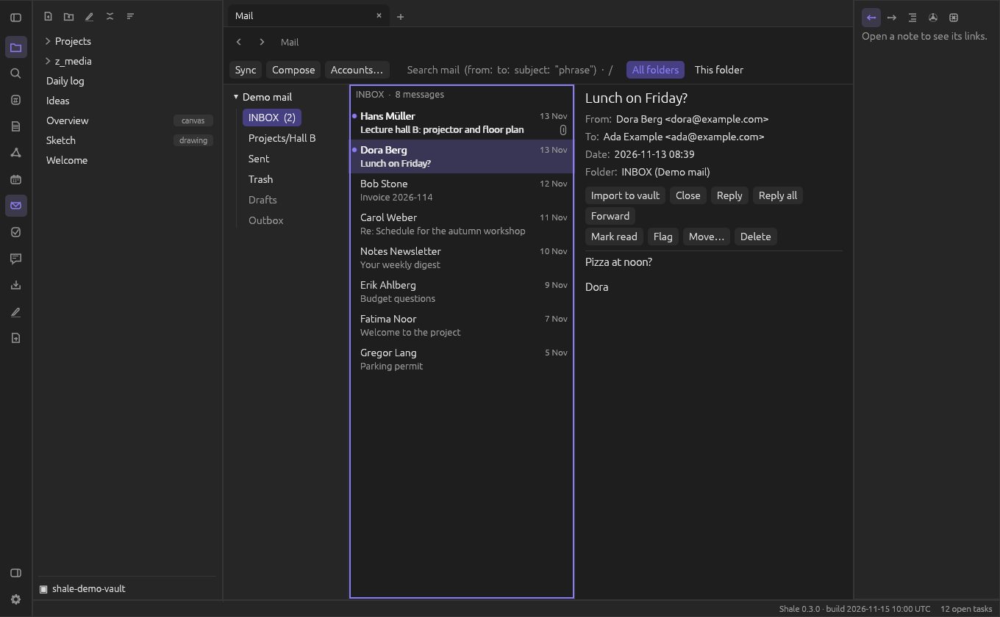

- The **Mail** button in the ribbon (or Ctrl+Shift+M) opens a three-pane view: accounts and
  folders with their unread counts, the list of messages (newest first) and the message itself
  as plain text. Shale reads your mail over IMAP and keeps a local copy next to the other
  program data (`~/.local/share/shale/mail`), so it works offline and search is instant.
- **Syncing only reads; what you do yourself is sent.** Fetching mail never changes anything on
  the server (it does not even mark mail as read). Only your own actions are written back: mark
  read or unread, flag, move to another folder, delete (to Trash) and, inside Trash, delete
  forever. Passwords are checked over a TLS connection with the system's certificate store; there
  is no unencrypted option.
- **No HTML, no tracking.** The message text comes from the plain text part, or from the HTML
  turned into text. Nothing is rendered, no pictures are fetched, no scripts run. An attachment
  is opened from a private temporary copy through your default program (never a program or
  script), or saved into the vault's media folder.
- **The local copy is not encrypted** (like Thunderbird's). Use full-disk encryption.

- **Accounts…** adds an account: server, port (993 with TLS, 143 with STARTTLS), user name and
  password. The password goes into the system keyring. Without a keyring Shale says so and asks
  again each time it starts, keeping it in memory only; it is never written to the settings
  file. **Test connection** checks the login and lists the folders. If you change the server or
  the user name of an account, it is another mailbox: it starts with an empty local copy, you
  enter the password (or sign in) again, and the mail copied from the old one stays on disk.
- **OAuth2 sign-in** (Google, Microsoft, or your own provider): choose "OAuth2 (in the browser)",
  the provider and your own **client ID** (Shale ships none; see below), press **Sign in in the
  browser**, and sign in on the provider's page. Shale shows who signed in, keeps only a refresh
  token in the system keyring and renews the short-lived access token by itself. If the sign-in
  expires or is revoked, the mail view and the settings say so and **Sign in again** fixes it.
  Without a keyring the sign-in lasts until Shale quits. If a renewed sign-in can't be saved in the keyring, Shale says so once.
  - *Google:* in the Google Cloud console create a project, set up the OAuth consent screen
    (External, status Testing) and add your Gmail address as a test user, create an **OAuth client
    ID of type "Desktop app"**, and enter its client ID and client secret in Shale. The scope
    `https://mail.google.com/` is "restricted": an unverified app is limited to 100 test users, and
    in Testing status Google ends the sign-in after 7 days (sign in again).
  - *Microsoft:* in the Entra admin center register an app ("Accounts in any organizational
    directory and personal Microsoft accounts"), add the platform "Mobile and desktop
    applications" with the redirect address `http://localhost`, switch on "Allow public client
    flows", add the delegated permission `IMAP.AccessAsUser.All`, and enter the Application
    (client) ID in Shale (no secret). A work account may need IMAP switched on by its admin.
  - *Custom:* any OIDC provider with an authorization-code + PKCE flow; type its authorization and
    token addresses and the scope. `http://` is accepted only for `localhost`.
- The first sync fetches the mail of the last three years, newest first, several folders at once,
  and can be stopped and resumed. **Sync** and the status bar show the progress; new mail is also
  fetched every 10 minutes (changeable, 0 = off) while Shale runs. A mail deleted on the server
  stays here, dimmed, with a note.
- Choose which folders are synced with the tick boxes. **Trash, Junk and Gmail's "All Mail" are
  not synced automatically**: when you open one, its list is loaded from the server, and a
  message is downloaded when you press **Load this message**. The same button appears for a
  message over the size limit (200 MB).
- **Search** (the field above the list, or `/`): words, `"phrases"`, `from:`, `to:`, `subject:`
  and `body:`; ignores case and accents. Choose all folders or only the open one.
- **Import to vault** (button, or `i`) hands the mail to the same Import dialog as a dragged
  `.eml` file: attachments, people and tags work the same, a mail that was imported before is
  recognised, and nothing is written until you press Import. Mark several mails (Space or
  Ctrl+click) to import them together.
- Keys while no text field has the keyboard: j / k or ↑ / ↓ move in the list, Enter opens the
  message, Space marks it, Ctrl+J / Ctrl+K go to the next / previous folder, `/` goes to the
  search field (↓ or Enter there go into the results), `i` imports, Esc steps back (closes the
  message, then clears the search).
- **Read, flag, move, delete** (also with the buttons above the message, a right click on a row,
  and the buttons that appear when mails are marked). The keys work on the marked mails, else on
  the open one, else on the one under the cursor, and need no Ctrl or Shift:
  `u` marks read or unread, `s` or `f` sets or clears the flag, `d` or Delete moves to Trash (in
  Trash it asks whether to delete forever; Enter does not confirm, only the red button does), `m`
  opens the folder picker (type to find a folder, ↑ ↓, Enter; Esc leaves). Unread mail is bold,
  flagged mail has a flag, and anything the server has not confirmed yet says "saving…",
  "moving…" or "deleting…" and shows in the bar as "N changes are waiting for the server".
- **Safe by design.** A change shows at once and is sent in the background. Without a network it
  waits (also across a restart) and goes out when the server answers; if the server refuses, the
  change is undone in the list and you are told why. "Delete" is always a move to the Trash
  folder. "Delete forever" removes only the mails you chose (never the ones another program
  marked as deleted). A mail that another program moved or deleted meanwhile is left alone and
  dimmed. Shale never deletes its own local copy: files of mail that moved or were deleted go to
  `.trash/<date>/` inside the mail folder. A server without `MOVE` is handled by a verified copy
  first; a server without `UIDPLUS` cannot delete forever, and for it deleting without `MOVE` is
  refused rather than risked.
- **Mark as read when opened** (Accounts…): on by default, after 2 seconds (0 = at once). Mail
  you close before then stays unread. Off: opening never changes the "read" mark.

### Writing and sending (phase 3)

- **Compose** with `c` (or the Compose button), **Reply** `r`, **Reply all** `Shift+R`, **Forward**
  `Shift+F` (also buttons under the message; `f` is still the flag key). Mail is plain text. To, Cc
  and Bcc complete from the addresses in your people notes and in the mail you already have (↑ ↓,
  Tab or a click); the subject, the text and the attachments are below. Attach a file by its path,
  a file of the vault (also from the media folder) or a **note** (its markdown, as a `.md`
  attachment). An answer quotes the mail with "On <date>, <name> wrote:" and `> `, sets
  `In-Reply-To` and `References` (the whole chain), and a forward brings the attachments along.
  Your signature goes below. **Ctrl+Enter** sends, **Esc** closes.
- **Set up sending** in the account settings, "Sending (SMTP)": server, TLS (465) or STARTTLS (587),
  your name and address, signature. The sign-in is the one of the account (the same password, or the
  same OAuth2 sign-in; Google and Microsoft fill in the server, Microsoft's permission list gets
  `SMTP.Send`). There is no unencrypted option, and with STARTTLS nothing, not even the password, goes
  before the encryption. "Test connection" also signs in to the SMTP server (it never sends a mail).
  The wait before sending ("Undo send", 10 seconds, 0 = at once) is set there too.
- **Never lost, never twice.** What you write is saved as a draft after a pause in typing and when
  you close the window (`~/.local/share/shale/mail/drafts/`, as a `.eml` any program can read, plus
  the fields and attachments); after a crash the drafts are in **Drafts**. Closing with changes asks
  "Keep draft?"; a discarded draft goes to `.trash/`, nothing is deleted. **Send** puts the mail into the
  **Outbox** (a file you can read), and for a few seconds a bar offers **Undo send**, which brings it back
  into the editor. Then it is sent, once. If the server refuses (a wrong address, no network) it stays in
  the Outbox with the server's words and you press **Retry**, **Edit** or **Discard**: nothing is retried by
  itself. If the connection ends *after* the whole mail was handed over and before the server answered,
  nobody can know whether it went out: the mail shows as "may have been sent", Shale never sends it
  again by itself, and you look in Sent and choose **Send again** or **Discard**. The same if Shale was
  closed in the middle of sending.
- **Questions before sending**: with no subject, with no text, and when the text says "attached" /
  "attachment" / "angehängt" / "anbei" / "Anhang" but nothing is attached. Bcc recipients get the mail
  but are never written into it; no read receipt is requested; the `User-Agent` header is off unless
  you switch it on (privacy).
- **The Sent copy**: after a send, the exact message appears in your Sent folder at once and is saved
  to the server in the background (an account that keeps sent mail itself, like Gmail, is switched off
  from that). If that save fails the mail is still sent, never sent again, and the copy is retried.

### Signed and encrypted mail (phase 4)

Shale uses the **GnuPG on your computer**: `gpg` for OpenPGP (PGP/MIME) and `gpgsm` for S/MIME, with
your own keys, smartcards and the usual passphrase dialog (`gpg-agent` / pinentry). Shale never sees a
key or a passphrase, never looks a key up on the network by itself, and tells you in words if `gpg` or
`gpgsm` is missing.

- **Reading.** A strip above the mail says what GnuPG found, in its own colours, never from anything in
  the mail: a valid signature (who, which key, how far you trust it), a **bad** one (the mail was changed
  or forged), a signer whose key you do not have, an expired or revoked key, a mail that is signed only in
  part, a signature by somebody other than the sender, and inline OpenPGP (signed text in the body), which
  is marked as weaker. Checking a signature needs no setting and stores nothing. A body text that says
  "Good signature from…" is just text and shows no strip.
- **Encrypted mail** needs one decision first. In **Accounts…, Encryption** a red banner says
  **"ENCRYPTED MAILS WILL ALWAYS BE STORED DECRYPTED LOCALLY"**: a decrypted mail is kept next to the encrypted
  original (`<number>.decrypted.eml`) and its text goes into the search index, unencrypted, in the mail folder
  (protected by the folder's permissions and your full-disk encryption). It is switched on only when you type
  `I agree to decrypted local storage` exactly. Until then an encrypted mail shows "Encrypted — enable
  encryption in the settings", and nothing is decrypted or stored. Withdrawing the consent stops decrypting; it
  deletes nothing (the copies you have stay, are shown and searched). Mails are decrypted when you open them,
  in the background; a passphrase or PIN dialog may open, and Cancel stops it.
- **Safe by construction** (EFAIL): only a mail that is encrypted as a whole is decrypted; a mail that mixes an
  encrypted part with other parts or text is not decrypted and says so; decrypted text is shown as its own
  message and never joined with anything else of the mail; there is no HTML and no link is followed or
  made clickable. Signed-and-encrypted mail works in both orders and when OpenPGP does both at once.
- **Writing.** Set the key of an account in Accounts…, the account, *Signing and encrypting* (the lists come
  from `gpg --list-secret-keys` and `gpgsm --list-secret-keys`), plus "sign new mail by default" and the
  preferred standard. In a new mail: **Sign**, **Encrypt** and (with both kinds of key) the standard. For
  every address in To, Cc and Bcc the window shows whether a key was found in your local keyring (with its
  trust) or not. Encrypting needs a key for **every** recipient, Cc and Bcc included, and always also
  encrypts for you, so the copy in Sent stays readable. OpenPGP Bcc recipients are hidden recipients; S/MIME
  lists every certificate, so with a Bcc it asks first. Signing and encrypting run in the background (the
  passphrase dialog is GnuPG's), the window stays as it is and Cancel stops it; if anything fails nothing
  goes to the Outbox and nothing you typed is lost. What is signed is exactly what is sent (quoted-printable or
  base64 for anything a mail server might rewrite). The **subject and the addresses of an encrypted mail
  are not encrypted** (protected headers are not supported).
- **Your keys and Thunderbird.** Thunderbird keeps OpenPGP keys in its own store. Export your secret key in
  Thunderbird (Account settings, End-to-End Encryption, "Backup secret key to file") and run
  `gpg --import backup.asc`; the keys of others the same way, or by hand with `gpg --locate-keys name@example.org`
  (also WKD). S/MIME: Thunderbird's certificate manager, Backup, then `gpgsm --import backup.p12` and the
  issuer's fingerprint in `~/.gnupg/trustlist.txt`. The Encryption settings say all this too.

## Importing e-mails, events and files (for project tracking)

- Drag e-mails from Thunderbird, events from a calendar (Shale's own or another program), `.eml`
  or `.ics` files, or any other files (plans, PDFs…) onto the window. The ribbon's Import button
  opens the same dialog.
- Choose the folder (one per project, for example) and tags. Small pictures from signatures are
  left out by default, and each attachment can be ticked on or off.
- Drop onto a folder in the file list to import into that folder, or onto a note to also add
  links to the new notes there.
- Messages that were already imported are recognised and left out unless you tick them again.
- On Wayland, Shale reads what Thunderbird hands over. When that is only a link to the message,
  Shale finds the message in Thunderbird's local copy (for IMAP accounts this needs "Keep
  messages for this account on this computer").

- Each e-mail becomes a note named "date subject" with the sender, recipients and date, the tags
  in its properties, links to the attachments and the original message, and the text of the
  message. The tag list counts these tags too.

## Feeds: read Mastodon and Bluesky, save posts to the vault

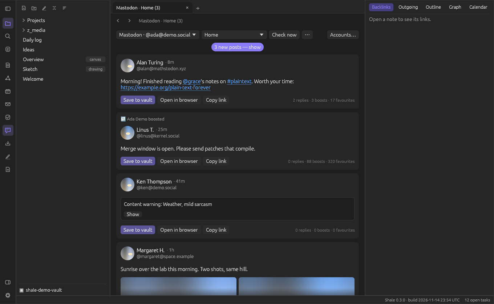

- The ribbon's speech-bubble button opens **Feeds**. **Accounts…** adds a Mastodon account (type
  the server, open the sign-in page in the browser, paste the code it shows; or paste an access
  token) or a Bluesky account (handle and an **app password** from Settings → Privacy and
  security → App passwords, never your main password). Secrets go to the system keyring.
- Pick the account and the feed (Mastodon: Home and your lists; Bluesky: Following and your
  saved feeds). Posts show the avatar, name, time, "boosted by", pictures (video and GIF
  previews have a play mark), quoted posts and link cards. A content warning stays closed until
  you click Show. The next page loads when you reach the end of the list.
- **Several feeds at once**: every Feeds tab has its own feed, scroll position and back/forward
  history. Next to each feed in the picker, **New tab** (or Shift+click / middle-click on the
  entry) opens it in another tab; the same feed may be open twice. The tab is called
  "Mastodon · Home" and gets "(12)" when 12 new posts wait. Open Feeds tabs come back at the next
  start.
- **New posts wait, they do not jump in**: every 5 minutes (change it in **Accounts…**, 0 =
  never) each feed that is open in a tab, also in the background, looks for newer posts. They
  appear as a button "12 new posts — show" in a row above the list (or press `.`); the row is
  always there ("Up to date · checked 2 min ago" when nothing waits), so the list never moves
  and nothing is covered, and it does not change until you click. Then the new posts go above and the post you were reading stays
  exactly where it is, so you can scroll up slowly. **Check now** looks right away;
  **⋯ → Reload from the top** replaces the list. If more than 200 posts came in on Bluesky,
  **Load more in between** fills the gap.
- **Save to vault** copies the post, and the whole thread when it is a thread by one author,
  into the Import dialog: choose the folder (default `Social`), tags and which pictures to
  bring along. **Open in browser** and **Copy link** are next to it.

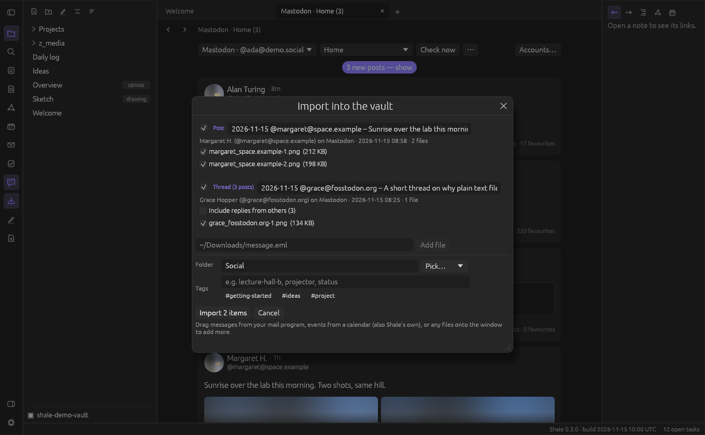

- Tick **Include replies from others (N)** to add a "Replies" section with other people's
  answers, nested like a conversation (off by default; Shale remembers your choice). Their
  pictures are linked, not downloaded.
- The note has the author, the date, a **Source** link back to the post, the text (a thread:
  every post in order, numbered), the pictures saved in `z_media/` and their descriptions. A post
  that was saved before, also as part of a thread, is marked "Imported before".
- Try it without an account: `shale --screenshot out.png --view social` shows made-up posts.

## People (contact notes)

- Contact notes live in the **people folder** (default `Adressbuch`, changeable in Settings).
- Type `[[p ` and a name to pick a person from that folder. The link that is written is a normal
  `[[Name]]` link, so other markdown tools understand it too. "New contact" makes a contact note
  from a template (e-mail, phone, organization, notes).
- When importing, the sender, recipients, organizer and attendees are found and matched to
  contact notes (by e-mail address anywhere in the note, else by name; "Müller, Hans" = "Hans
  Müller"). Known contacts and new senders are ticked; for ticked people without a note one is
  made. The imported note gets a "People" line with links, so each contact note's backlinks show
  every mail and meeting with that person. Automatic senders like "noreply" are left out.

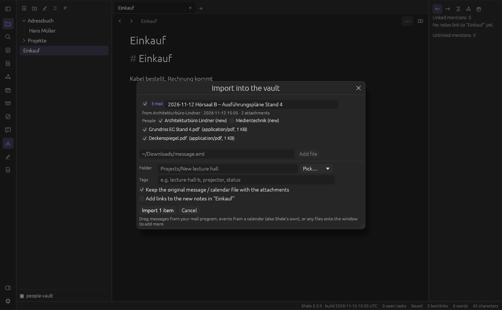

## Tags found automatically (no server, no AI)

- Tags of the vault that are written in the imported text are set right away
  (`#lecture-hall-b` for "Lecture Hall B", the last part of nested tags too).
- Shale also learns, from the notes in the vault, which words are typical for each tag (words in
  most notes with the tag and rarely elsewhere) and suggests those tags when an import contains
  several of these words. It is plain counting: the same notes always give the same suggestions.
  It is learned again in the background now and then and kept in `.shale/tag-words.json` in the
  vault.

## Settings that travel with the vault

- Each vault keeps its own settings in `.shale/settings.json` (people folder, git sync) and its
  session in `.shale/state.json` (open notes, last import folder, recent tags), so a vault
  behaves the same on every computer. Settings of the program itself (appearance, calendars,
  recent vaults) stay in `~/.config/shale/config.json`.
- The files carry a format version and are upgraded on load. A settings file that can't be read
  is kept as `….broken-<date>` and you are told; a file from a newer Shale is used but not
  changed.
- On the first start after the upgrade, the people folder, open notes, import folder and recent
  tags move from the old global settings into the vault you open.

## Git sync

- Needs `git` installed. In Settings → Git sync, enter the URL of a git repository
  (`https://…`, `ssh://…`, `git@host:notes.git` or a folder path) and press Connect (an address with a password in it, and plain `http://` or `git://` except on this computer, are refused: use a credential helper or an SSH key), or run
  `git init` in the vault folder yourself. Shale then syncs on its own: when the vault opens,
  every few minutes (default 5, changeable) and on "Sync now".
- A sync commits every change (the `.shale/` files too, so settings and open notes follow you),
  fetches, merges and pushes. Commit messages read `Sync from <computer>: 3 file(s)`, with an
  optional prefix and suffix from the settings. Without a remote, Shale only keeps a local
  history.
- Nothing is ever lost: when a note was changed on two computers, the remote version stays and
  yours is kept next to it as `Note (conflict 2026-11-14 1530).md`; a note deleted on one side
  and changed on the other is kept. Shale never force-pushes, never writes conflict markers into
  notes, and pauses if git is in the middle of something you started (a merge, a rebase).
- Edits you type while a sync runs are never overwritten: if the sync brought a new version of
  that note, your text is saved as a conflict copy next to it.
- Passwords are git's business (credential helper or SSH key); Shale never asks for one.

## Keyboard

The keys below are the defaults of the shortcuts that can be changed in **Settings → Keybindings…**
(everywhere, file list, search results; double bindings are refused). Text editing keys, vim
keys and the keys inside the mail view are fixed.

| Keys | Action |
|---|---|
| Ctrl+N | New note |
| Ctrl+O | Quick switcher (find or create a note) |
| Ctrl+E | Edit / reading view |
| Ctrl+, | Settings |
| Ctrl+S | Save now (notes also save automatically) |
| Ctrl+W | Close tab |
| Ctrl+Shift+F | Search all notes |
| Ctrl+H / Ctrl+L | Keyboard into the left sidebar / back into the editor |
| Ctrl+Shift+B | File list with the keyboard in it: j / k (or ↓ / ↑) next / previous file, Ctrl+J / Ctrl+K next / previous folder, Space opens or closes a folder, Enter opens, Esc back |
| ↓ or Enter in the search box | Browse the results: j / k (or ↓ / ↑) next / previous hit, Ctrl+J / Ctrl+K next / previous file, Enter opens the note at the hit, Esc back to the box |
| Ctrl+Shift+M | Mail view. There, with no text field in use: j / k next / previous message, Enter opens, Space marks, Ctrl+J / Ctrl+K next / previous folder, / search, i import to vault, Esc back |
| Alt+← / Alt+→ | Back / forward |
| Alt+↑ / Alt+↓ | Move the current line |
| Tab / Shift+Tab | Indent lists or change heading levels |
