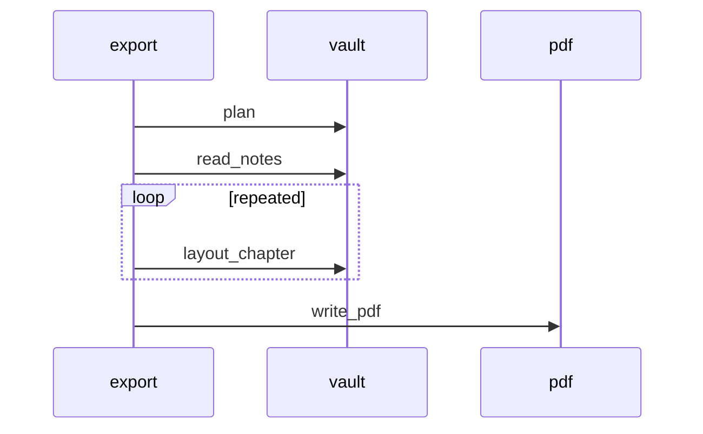

# Book export dataflow

The export of a folder as one PDF (`export_book` in `src/pdf/book_export.rs`): it reads the folder's reading order and notes from the vault, lays out each chapter and writes the PDF. The diagram is recorded from a real run of the book tests on a temporary vault.

To regenerate it after a change: `SHALE_UPDATE_DATAFLOW=1 cargo test dev_029_dataflow_of_a_book`, and commit the result.

<!-- dataflow:begin book_export -->

<!-- dataflow:end book_export -->
