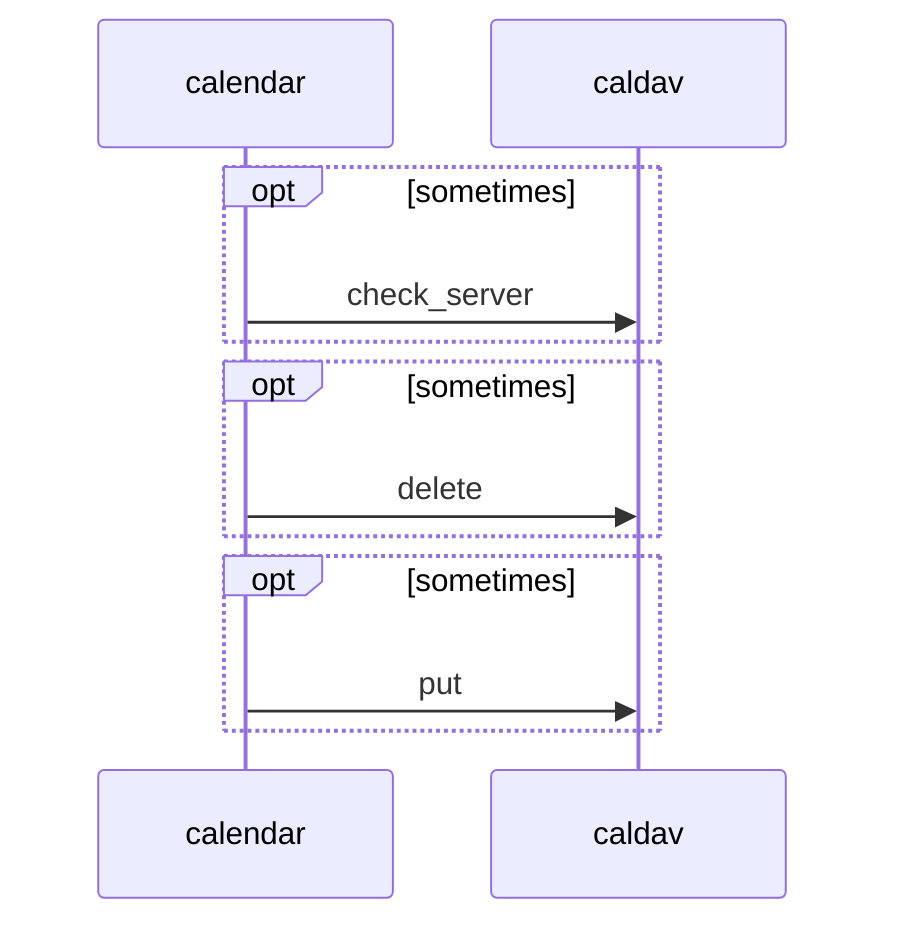
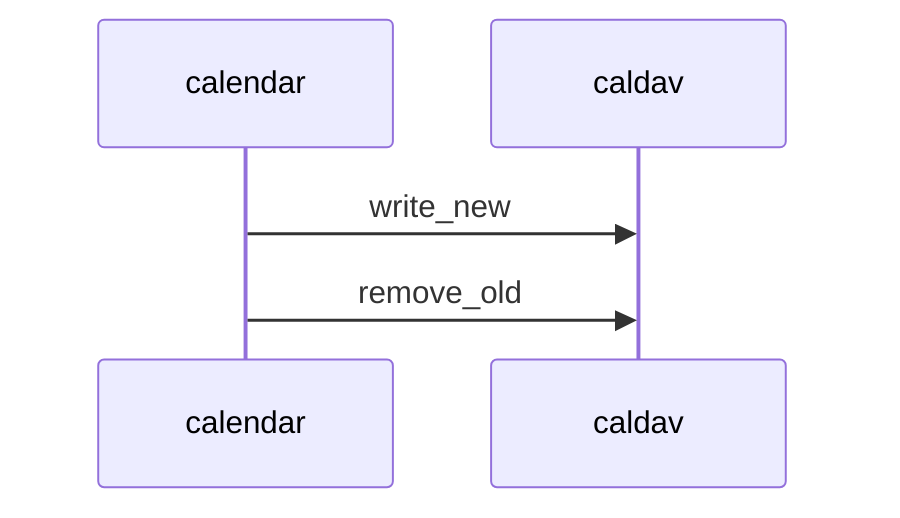

# CalDAV edit dataflow

Writing to a CalDAV calendar: creating, changing and deleting an event on the server (`put_event` and `delete_event` in `src/calendar/dav.rs`, which check the version tag or, without one, what the server still has), and moving an event to another calendar (`save_event` in `src/calendar/store.rs`: write to the new calendar first, then remove from the old one). The diagrams are not written by hand: they are recorded from real runs of the caldav-env tests against the seeded Radicale of `tests/caldav-env`, and every arrow goes from the caller to the other side of the step it names (DEV-026, DEV-028).

To regenerate them after a change: `tests/caldav-env/caldav-env.sh up`, then `SHALE_UPDATE_DATAFLOW=1 cargo test -- --ignored caldav_env_creates_edits caldav_env_moves_an_event`, and commit the result.

<!-- dataflow:begin caldav_edit -->

<!-- dataflow:end caldav_edit -->

<!-- dataflow:begin caldav_move -->

<!-- dataflow:end caldav_move -->
