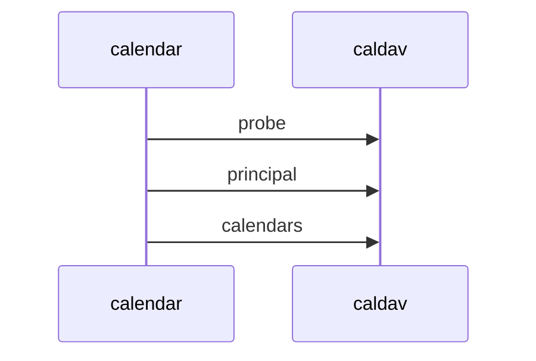
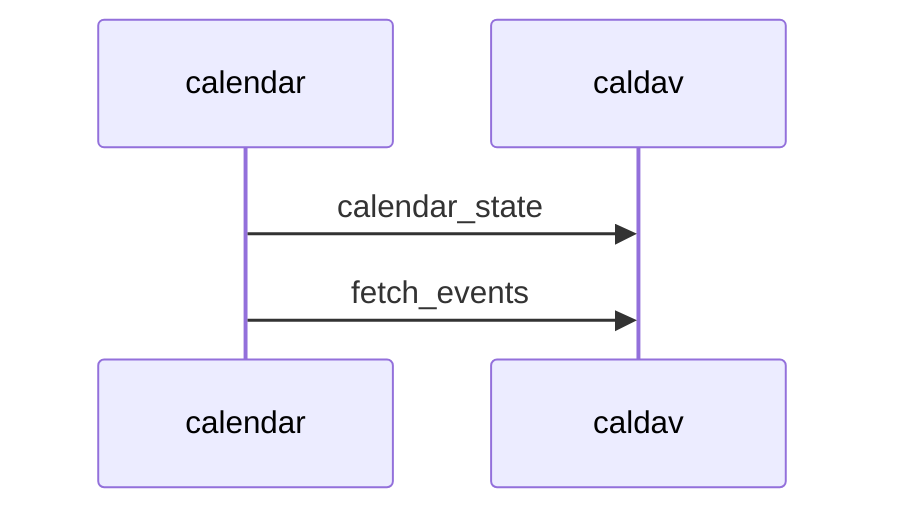

# CalDAV discovery and loading dataflow

Finding the calendars of an account from a server address (`discover` in `src/calendar/dav.rs`) and loading one calendar into the calendar store (`refresh_source` in `src/calendar/store.rs`: ask the server whether the calendar changed, fetch its events if it did). The diagrams are not written by hand: they are recorded from a real run of the caldav-env test against the seeded Radicale of `tests/caldav-env`, and every arrow goes from the caller to the other side of the step it names (DEV-026, DEV-028).

To regenerate them after a change: `tests/caldav-env/caldav-env.sh up`, then `SHALE_UPDATE_DATAFLOW=1 cargo test -- --ignored caldav_env_discovers_and_loads`, and commit the result.

<!-- dataflow:begin caldav_discover -->

<!-- dataflow:end caldav_discover -->

<!-- dataflow:begin caldav_load -->

<!-- dataflow:end caldav_load -->
