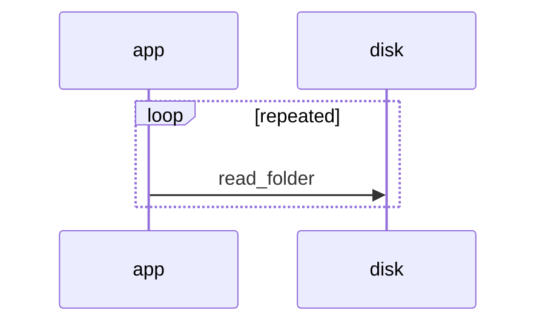
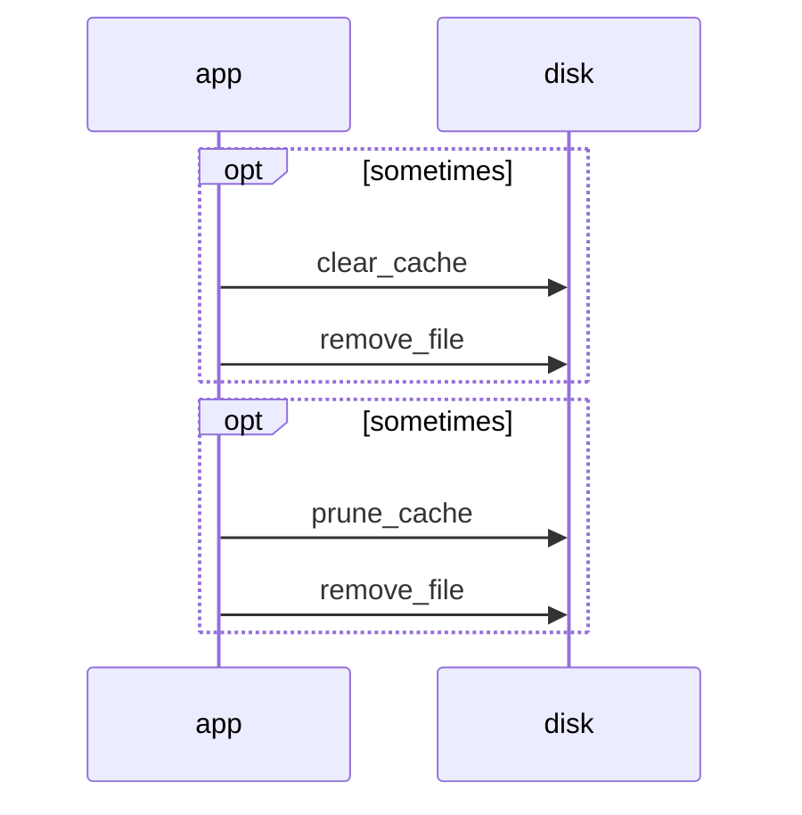

# Data usage dataflow

The scan of what is saved (`scan::saved`) and the clear and prune of the caches (`clear` and `prune` in `src/data_usage/mod.rs`). The diagrams below are recorded from real runs of the `dataflow_data_usage_scan` and `dataflow_data_usage_cleanup` tests on temporary folders, not written by hand (DEV-026, DEV-031).

To regenerate them after a change: `SHALE_UPDATE_DATAFLOW=1 cargo test dataflow_data_usage`, and commit the result.

<!-- dataflow:begin data_usage_scan -->

<!-- dataflow:end data_usage_scan -->

<!-- dataflow:begin data_usage_cleanup -->

<!-- dataflow:end data_usage_cleanup -->
