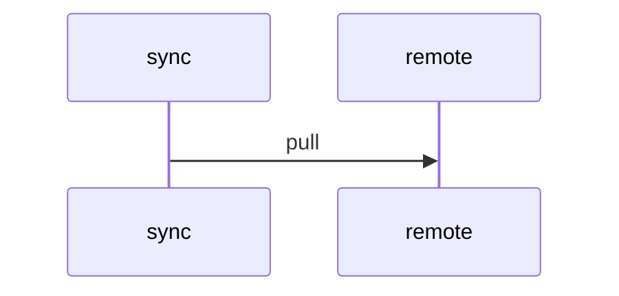

# Git LFS download dataflow

The on-demand download of one LFS file of a vault (`lfs::download` in `src/gitsync/lfs.rs`): it pulls only that file from the remote's LFS store. The diagram is recorded from a real run against real `git`, git-lfs and a local bare repository (DEV-026).

To regenerate it after a change: `SHALE_UPDATE_DATAFLOW=1 cargo test dev_029_dataflow_of_an_lfs`, and commit the result.

<!-- dataflow:begin git_lfs_download -->

<!-- dataflow:end git_lfs_download -->
