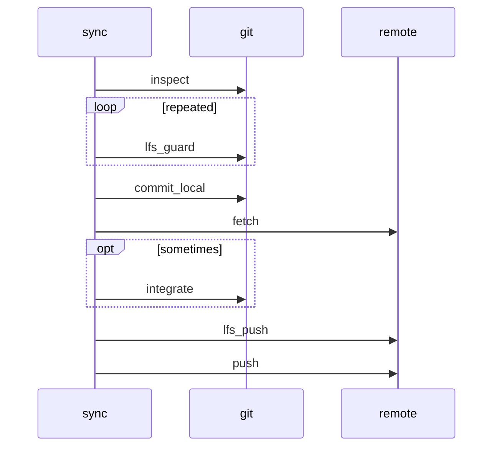

# Git sync dataflow

The git sync of a vault (`sync` in `src/gitsync.rs`): it checks the repository, commits local changes, fetches the remote, merges what the remote has and pushes, uploading LFS files first. The diagram is recorded from a real run of the tests against real `git` and local bare repositories (DEV-026).

To regenerate it after a change to the sync: `SHALE_UPDATE_DATAFLOW=1 cargo test dev_029_dataflow`, and commit the result.

## Sync: first sync, pull, incremental, LFS

<!-- dataflow:begin git_sync -->

<!-- dataflow:end git_sync -->
