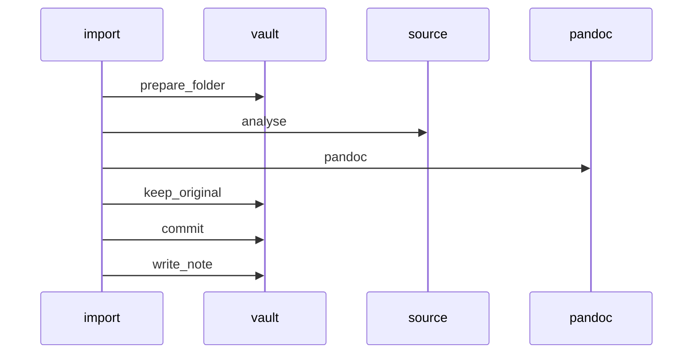

# Word import dataflow

The Word import (`import_item` in `src/import/docx.rs`): the hidden folder in the vault is made, pandoc converts the file, the original is kept, and the files and the note are put in place. The diagram below is not written by hand: it is recorded from a real run of its driving test, with a stand-in for pandoc, and every arrow goes from the import (the caller) to the other side of the step it names (DEV-030).

To regenerate it after a change to the flow, run its driving test (named in the index, `docs/dataflow/README.md`) with `SHALE_UPDATE_DATAFLOW=1` and commit the result.

<!-- dataflow:begin import_docx -->

<!-- dataflow:end import_docx -->
