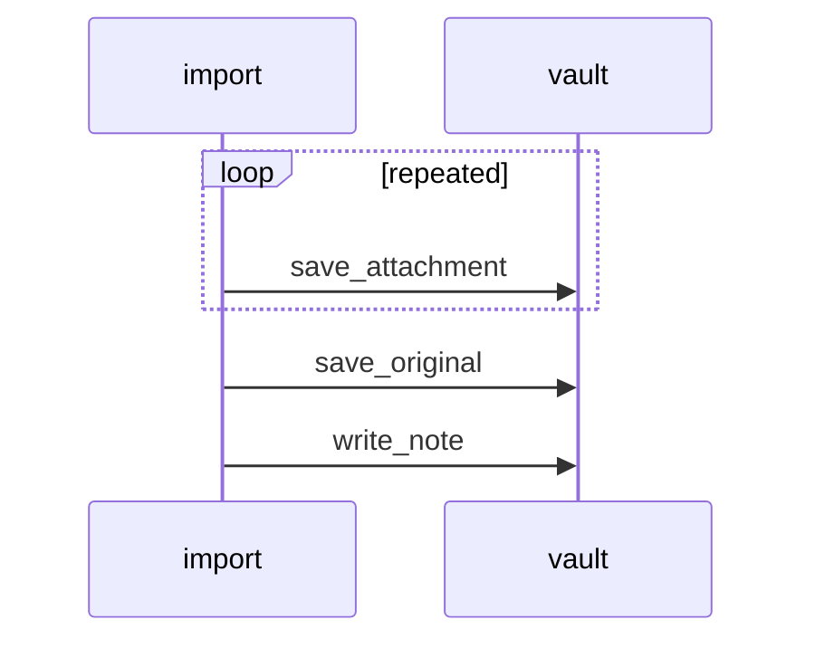

# E-mail import dataflow

Importing an e-mail as a note (`import` in `src/import.rs`): the ticked attachments and the original message are saved in the vault, the note is written. The diagram below is recorded from a real run of its driving test (DEV-030).

To regenerate it after a change to the flow, run its driving test (named in the index, `docs/dataflow/README.md`) with `SHALE_UPDATE_DATAFLOW=1` and commit the result.

<!-- dataflow:begin import_mail_text -->

<!-- dataflow:end import_mail_text -->
