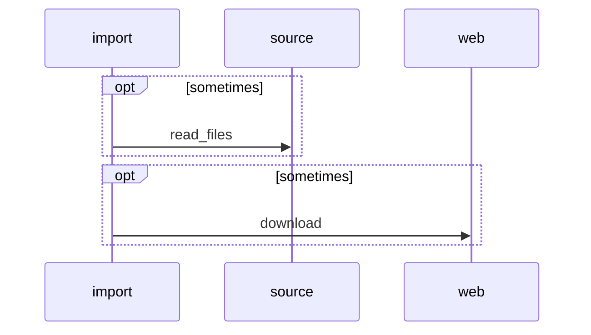

# Drop from other programs dataflow

A drop from another program (`items_from_parts_in` in `src/import/from_programs.rs`): files are read, a picture offered only as a web address is downloaded, or text is taken as it is. The diagram below is recorded from a run of its driving test with a stand-in for the download, so it shows the steps of three drops in one (DEV-030).

To regenerate it after a change to the flow, run its driving test (named in the index, `docs/dataflow/README.md`) with `SHALE_UPDATE_DATAFLOW=1` and commit the result.

<!-- dataflow:begin import_programs -->

<!-- dataflow:end import_programs -->
