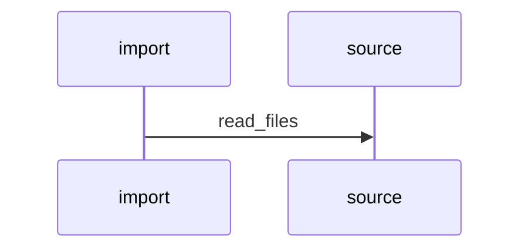
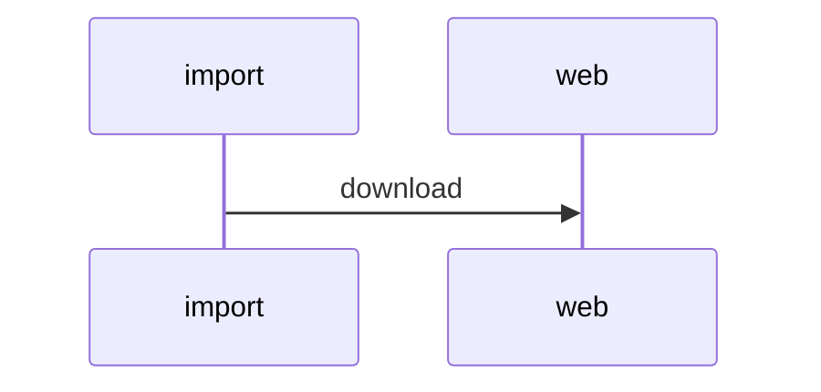

# Drop from other programs dataflow

A drop from another program (`items_from_parts_in` in `src/import/from_programs.rs`) is read in one of two ways that leave the program: dropped files are read from disk, or a picture offered only as a web address is downloaded. Dropped text and a message handed over whole cross no boundary and have no diagram. The diagrams below are recorded from a run of their driving test with a stand-in for the download (DEV-030).

To regenerate them after a change to the flow, run the driving test (named in the index, `docs/dataflow/README.md`) with `SHALE_UPDATE_DATAFLOW=1` and commit the result.

<!-- dataflow:begin import_programs_files -->

<!-- dataflow:end import_programs_files -->

<!-- dataflow:begin import_programs_web -->

<!-- dataflow:end import_programs_web -->
