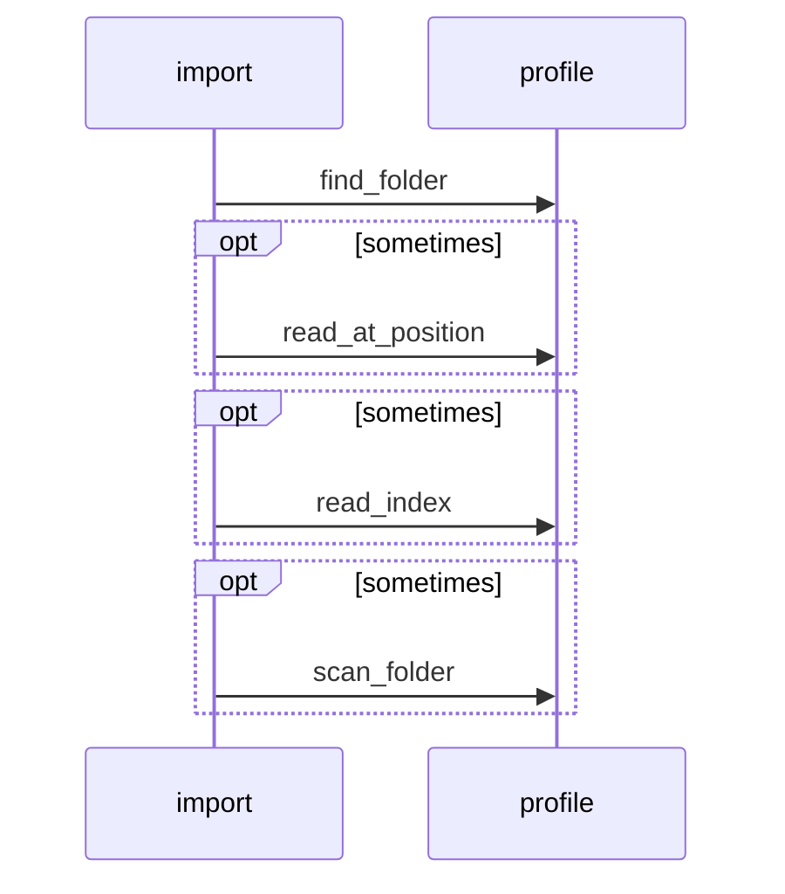

# Thunderbird store dataflow

Looking up a message that Thunderbird handed over as a link (`find_in` in `src/import/tb_store.rs`): the folder in the profile is found, then the message is read at the position of the link, by the folder's index or by its subject. The diagram below is recorded from a run of its driving test against generated profiles, so it shows the steps of the three ways in one (DEV-030).

To regenerate it after a change to the flow, run its driving test (named in the index, `docs/dataflow/README.md`) with `SHALE_UPDATE_DATAFLOW=1` and commit the result.

<!-- dataflow:begin import_thunderbird -->

<!-- dataflow:end import_thunderbird -->
