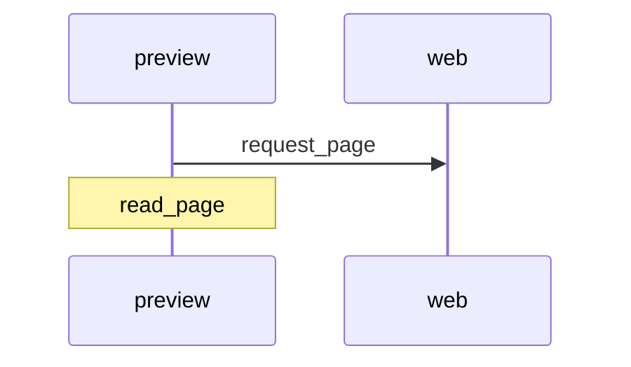

# Link preview dataflow

The fetch of a web page for the link preview (`fetch_page` in `src/link_preview.rs`): the page is requested, then read for its title and text. The diagram below is recorded from a real run of the `dataflow_link_preview` test against a pretend web server on this computer, not written by hand (DEV-026, DEV-031).

To regenerate it after a change: `SHALE_UPDATE_DATAFLOW=1 cargo test dataflow_link_preview`, and commit the result.

<!-- dataflow:begin link_preview -->

<!-- dataflow:end link_preview -->
