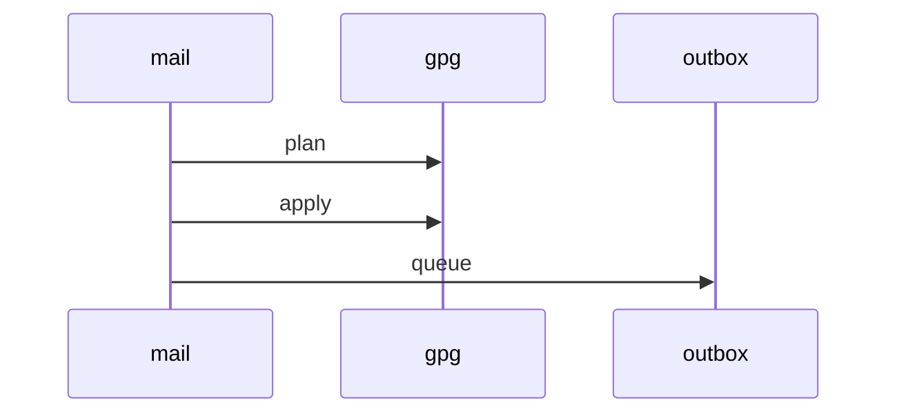
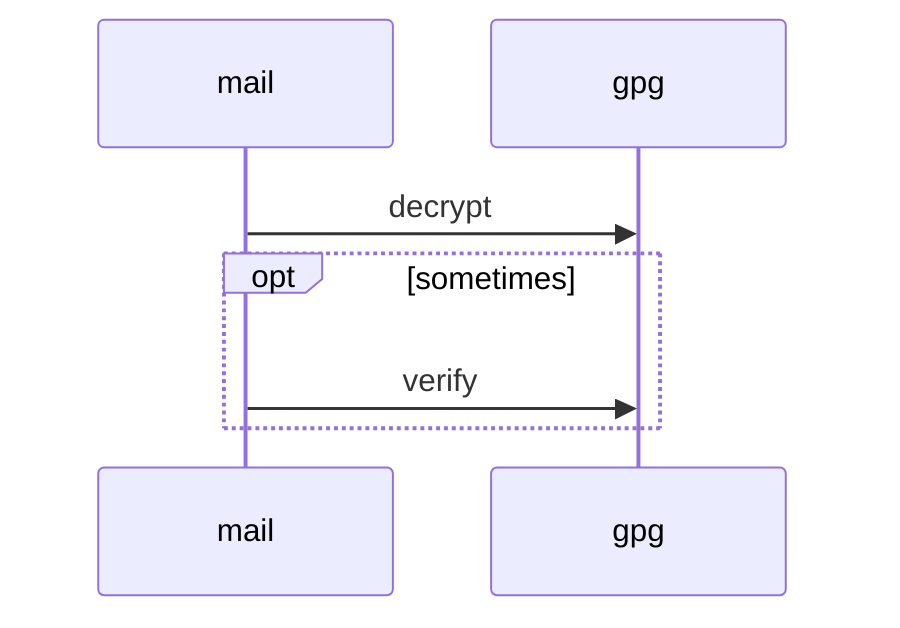

# Mail crypto dataflow

Signed and encrypted mail, OpenPGP and S/MIME, in the two directions: queueing a mail that is signed or encrypted (`queue_with` in `src/mail/send.rs`: it looks up the keys and has GnuPG sign and encrypt) and reading one (`process` in `src/mail/crypto.rs`: GnuPG verifies and decrypts). The diagrams are not written by hand: they are recorded from a real run of the mail-env test, which sends both standards through the submission service of `tests/mail-env` and reads them back, and every arrow goes from the caller to the other side of the step it names (DEV-026, DEV-028).

To regenerate them after a change: `tests/mail-env/mail-env.sh up`, then `SHALE_UPDATE_DATAFLOW=1 cargo test -- --ignored mail_env_signed_and_encrypted`, and commit the result.

<!-- dataflow:begin mail_crypto_send -->

<!-- dataflow:end mail_crypto_send -->

<!-- dataflow:begin mail_crypto_read -->

<!-- dataflow:end mail_crypto_read -->
