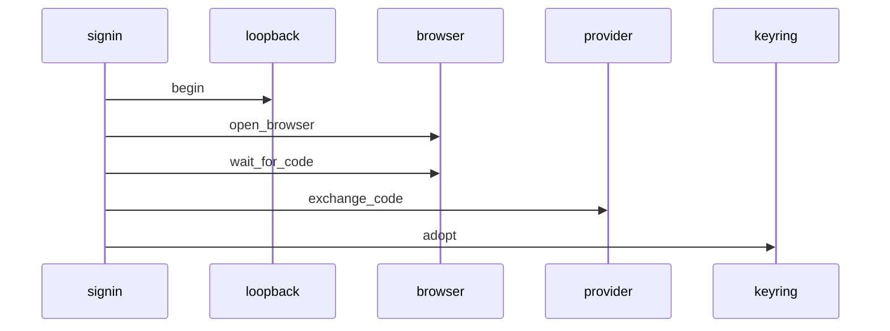
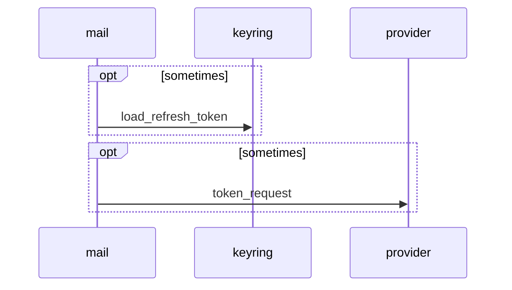

# Mail OAuth dataflow

The OAuth2 sign-in of a mail account (`sign_in` in `src/mail/oauth.rs`) and the renewal of its access token with the refresh token (`TokenSource` in the same file). The diagrams are not written by hand: they are recorded from a real run of the mail-env test against the pretend OAuth provider of `tests/mail-env`, and every arrow goes from the caller to the other side of the step it names (DEV-026, DEV-028).

To regenerate them after a change: `tests/mail-env/mail-env.sh up`, then `SHALE_UPDATE_DATAFLOW=1 cargo test -- --ignored mail_env_oauth_account`, and commit the result.

<!-- dataflow:begin mail_oauth -->

<!-- dataflow:end mail_oauth -->

<!-- dataflow:begin mail_oauth_renew -->

<!-- dataflow:end mail_oauth_renew -->
