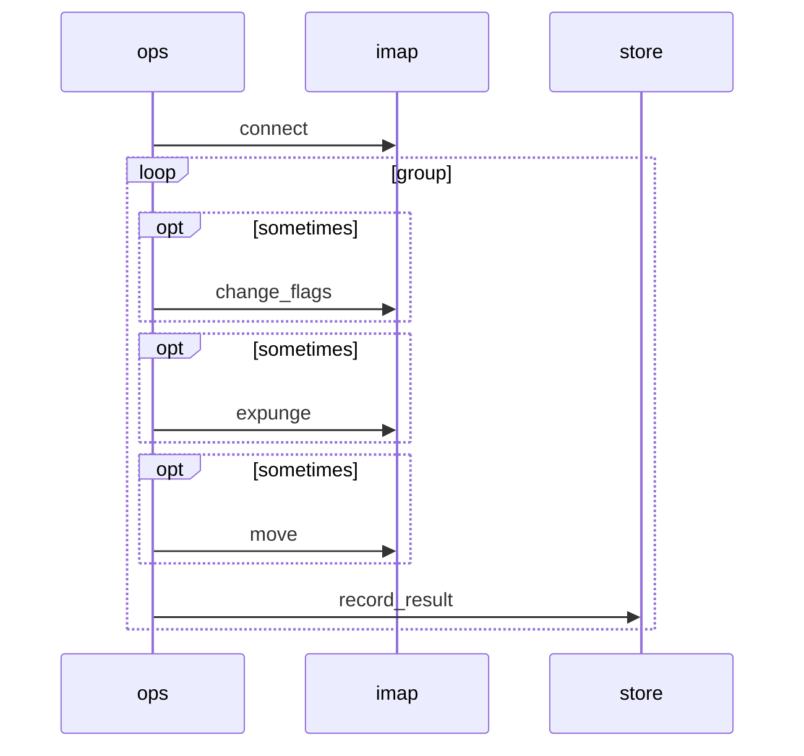

# Mail actions dataflow

Sending the recorded actions of an account to the IMAP server (`run_pending` in `src/mail/ops.rs`): flagging and unflagging, moving to another folder, deleting (a move to the Trash) and deleting for good. It connects once, then runs each group of like actions on the server and records the result in the mail index. The diagram is not written by hand: it is recorded from a real run of the mail-env test against the seeded Dovecot of `tests/mail-env`, and every arrow goes from the run (the caller) to the other side of the step it names (DEV-026, DEV-028).

To regenerate it after a change to the actions: `tests/mail-env/mail-env.sh up`, then `SHALE_UPDATE_DATAFLOW=1 cargo test -- --ignored mail_env_flag_unflag`, and commit the result.

<!-- dataflow:begin mail_ops -->

<!-- dataflow:end mail_ops -->
