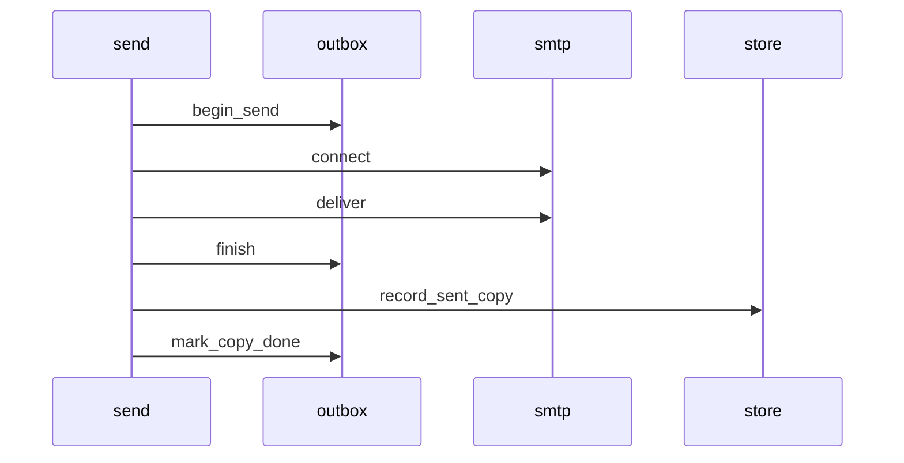

# Mail send dataflow

Sending a queued mail (`send_due` in `src/mail/send.rs`): it takes the mail out of the outbox, connects to the SMTP server, hands the message over, records the outcome and records the local copy for the Sent folder. The diagram is not written by hand: it is recorded from a real run of the mail-env test against the submission service of `tests/mail-env`, and every arrow goes from the sending (the caller) to the other side of the step it names. Appending the copy to the server's Sent folder is the `mail_ops` flow (DEV-026, DEV-028).

To regenerate it after a change to the sending: `tests/mail-env/mail-env.sh up`, then `SHALE_UPDATE_DATAFLOW=1 cargo test -- --ignored mail_env_password_and_oauth_accounts_send`, and commit the result.

<!-- dataflow:begin mail_send -->

<!-- dataflow:end mail_send -->
