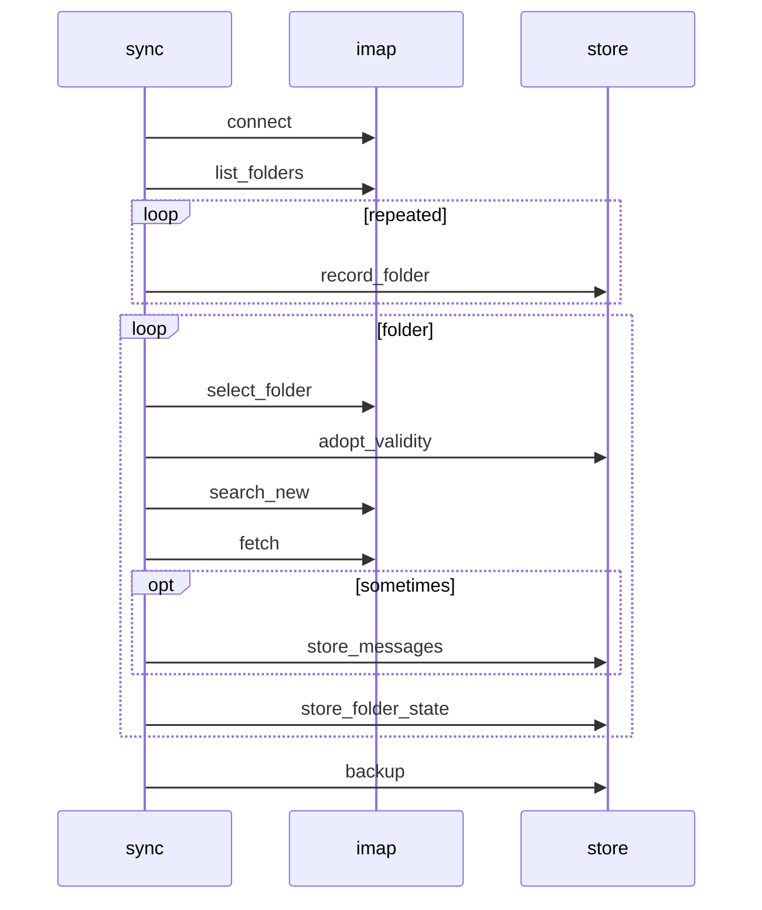

# Mail sync dataflow

The IMAP sync of an account (`sync_account` in `src/mail/imap_sync.rs`): it connects, lists and records the folders, then for each folder selects it, looks for new mail, fetches it and records what it did in the mail index. The diagram below is not written by hand: it is recorded from a real run of the mail-env test against the seeded Dovecot of `tests/mail-env`, and every arrow goes from the sync (the caller) to the other side of the step it names; the `folder` block is the work on one folder (DEV-026).

To regenerate it after a change to the sync: `tests/mail-env/mail-env.sh up`, then `SHALE_UPDATE_DATAFLOW=1 cargo test -- --ignored mail_env_password_account`, and commit the result.

<!-- dataflow:begin mail_sync -->

<!-- dataflow:end mail_sync -->
