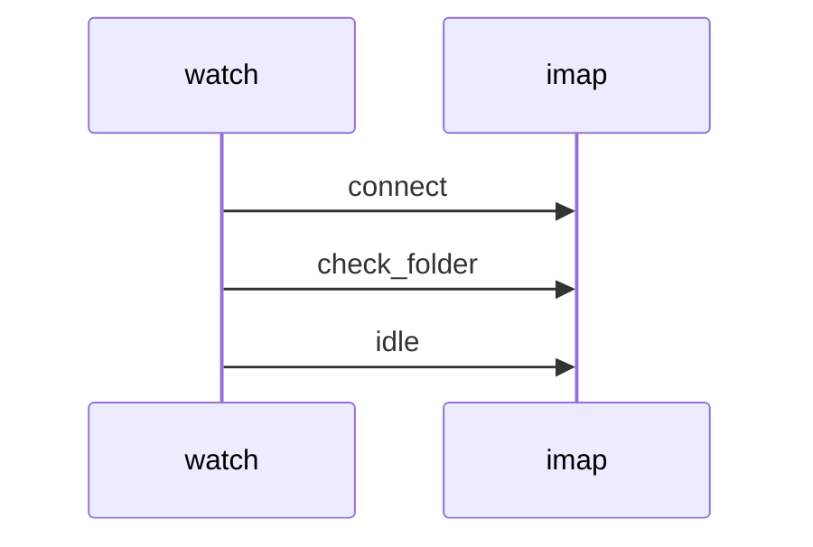

# Mail watch dataflow

The watch of one folder (`session` in `src/mail/watch.rs`): one connection that checks the folder, waits in IDLE for the server to say something changed, and checks again. A check is one step here; what it does to the folder is the `mail_sync` flow. The diagram is not written by hand: it is recorded from a real run of the mail-env test, in which another connection sets and removes a flag on the seeded Dovecot of `tests/mail-env`, and every arrow goes from the watch (the caller) to the other side of the step it names (DEV-026, DEV-028).

To regenerate it after a change to the watch: `tests/mail-env/mail-env.sh up`, then `SHALE_UPDATE_DATAFLOW=1 cargo test -- --ignored mail_env_a_flag_that_another`, and commit the result.

<!-- dataflow:begin mail_watch -->

<!-- dataflow:end mail_watch -->
