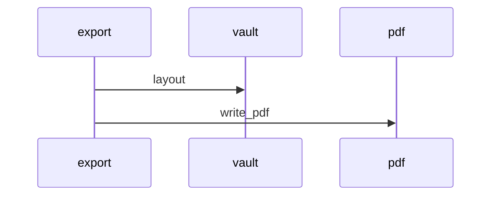

# PDF export dataflow

The export of one note as a PDF (`export_note` in `src/pdf/export.rs`): the note is laid out with what it embeds from the vault, then the PDF is written. The diagram is recorded from a real run of the export tests on a temporary vault.

To regenerate it after a change: `SHALE_UPDATE_DATAFLOW=1 cargo test dev_029_dataflow_of_a_note`, and commit the result.

<!-- dataflow:begin pdf_export -->

<!-- dataflow:end pdf_export -->
