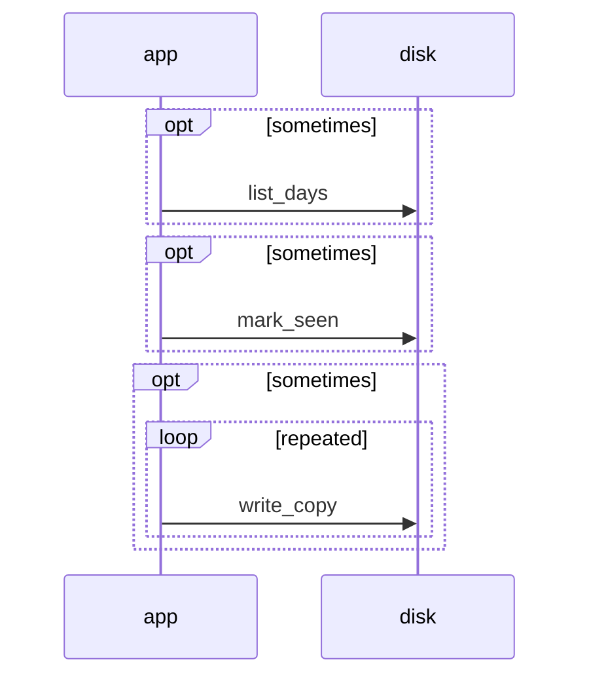

# Recovery dataflow

Text that could not be saved at exit (`src/recovery.rs`): it is written into the recovery folder, listed at the next start and marked seen when the notice is dismissed. The diagram below is recorded from a real run of the `dataflow_recovery` test, not written by hand (DEV-026, DEV-031).

To regenerate it after a change: `SHALE_UPDATE_DATAFLOW=1 cargo test dataflow_recovery`, and commit the result.

<!-- dataflow:begin recovery -->

<!-- dataflow:end recovery -->
