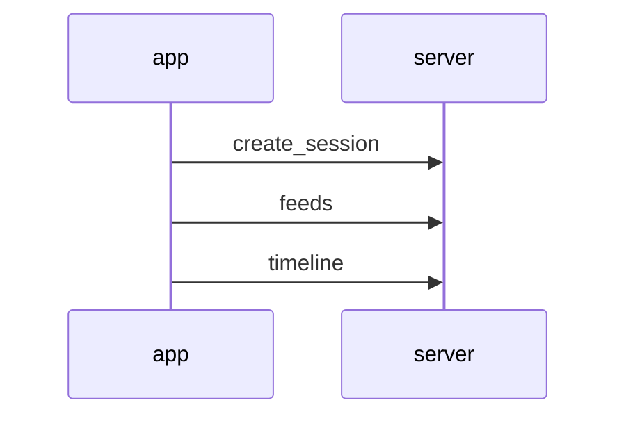

# Bluesky dataflow

The Bluesky sign-in with an app password, the feeds to choose from and the first page of a timeline (`src/social/bluesky.rs`). The diagram is recorded from a real run against the pretend server of `src/social/fake_server.rs`.

To regenerate it after a change: `SHALE_UPDATE_DATAFLOW=1 cargo test dev_029_dataflow_of_a_bluesky`, and commit the result.

<!-- dataflow:begin social_bluesky -->

<!-- dataflow:end social_bluesky -->
