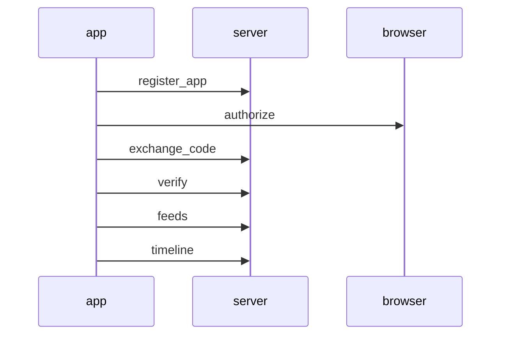

# Mastodon dataflow

The Mastodon sign-in (register the app, the person's browser shows a code, the code becomes an access token, the token is checked) and the first page of a timeline (`src/social/mastodon.rs`). The diagram is recorded from a real run against the pretend server of `src/social/fake_server.rs`.

To regenerate it after a change: `SHALE_UPDATE_DATAFLOW=1 cargo test dev_029_dataflow_of_a_mastodon`, and commit the result.

<!-- dataflow:begin social_mastodon -->

<!-- dataflow:end social_mastodon -->
