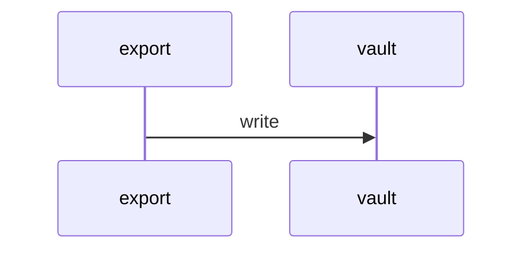

# TeX book export dataflow

Exporting a folder as one book through LaTeX: the notes of the folder are written as the parts and chapters of one TeX document (`write_book` in `src/pdf/tex/book.rs`). Compiling that document is the same step as for a single note and is drawn in the `tex_export` diagram. The diagram is not written by hand: it is recorded from a real run of the tex-env test with the real LuaLaTeX of `tests/tex-env`, and every arrow goes from the export (the caller) to the other side of the step it names (DEV-026, DEV-028).

To regenerate it after a change: `tests/tex-env/tex-env.sh build`, then `SHALE_UPDATE_DATAFLOW=1 cargo test -- --ignored tex_env_a_folder_compiles_as_a_report`, and commit the result.

<!-- dataflow:begin tex_book -->

<!-- dataflow:end tex_book -->
