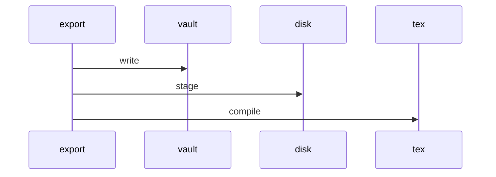

# TeX export dataflow

Exporting a note through LaTeX: the note is written as a TeX document of a kind of the template set (`write` in `src/pdf/tex/writer.rs`), its files are put into a work folder and the TeX of the container or the system compiles it (`compile_with_set` in `src/pdf/tex/sets.rs`). The diagram is not written by hand: it is recorded from real runs of the tex-env test, which exports a letter in two languages with the real LuaLaTeX of `tests/tex-env`, and every arrow goes from the export (the caller) to the other side of the step it names (DEV-026, DEV-028). The setup's test page and the book export use the same writing and compiling functions.

To regenerate it after a change to the export: `tests/tex-env/tex-env.sh build`, then `SHALE_UPDATE_DATAFLOW=1 cargo test -- --ignored tex_env_a_letter_has`, and commit the result.

<!-- dataflow:begin tex_export -->

<!-- dataflow:end tex_export -->
