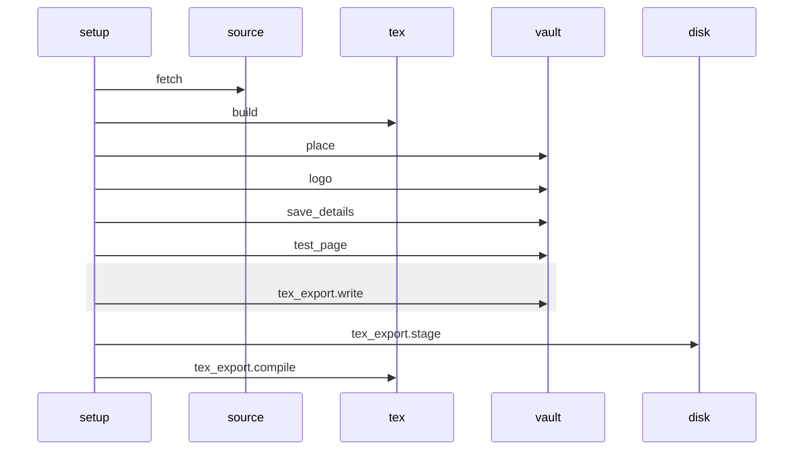

# TeX setup dataflow

The guided setup of the LaTeX export (`src/pdf/tex/setup.rs`): importing a template set into the vault (`import` in `src/pdf/tex/import.rs`: fetch the archive, build the classes with the TeX of the container, place them in the vault), putting in the logo, saving the details and writing the test page. The test page is then written and compiled like any export, so those steps show here with the name of their flow, `tex_export.<step>` (see the `tex_export` diagram). The diagram is not written by hand: it is recorded from a real run of the tex-env test with the real LuaLaTeX of `tests/tex-env`, and every arrow goes from the setup (the caller) to the other side of the step it names (DEV-026, DEV-028).

To regenerate it after a change: `tests/tex-env/tex-env.sh build`, then `SHALE_UPDATE_DATAFLOW=1 cargo test -- --ignored tex_env_the_setup_imports`, and commit the result.

<!-- dataflow:begin tex_setup -->

<!-- dataflow:end tex_setup -->
