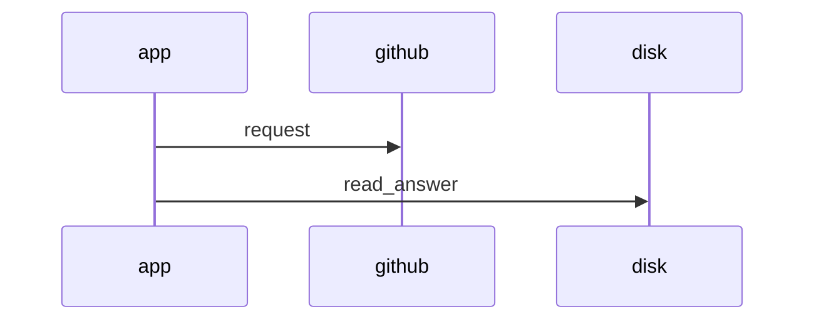
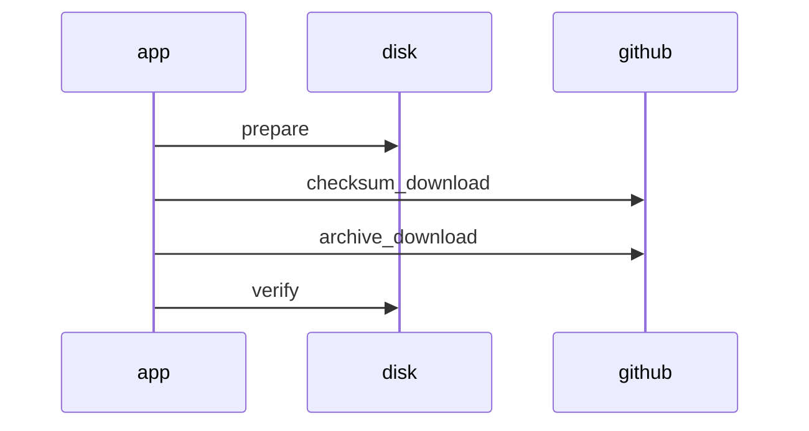
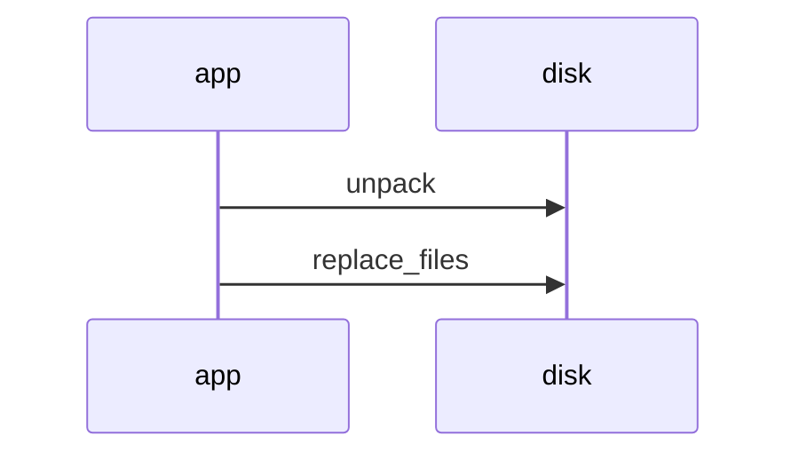
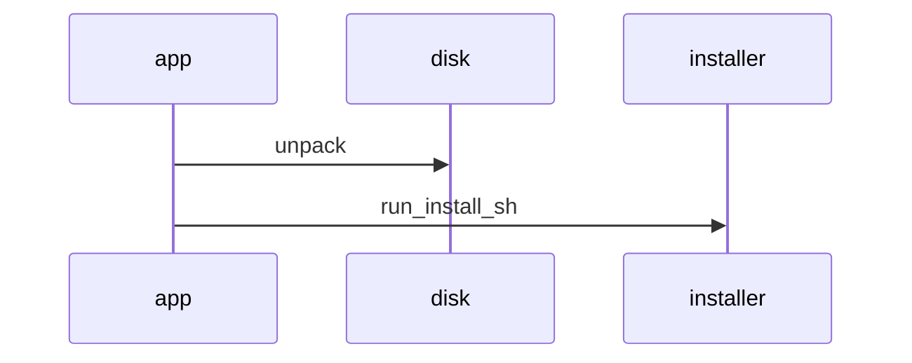

# Auto-update dataflow

The auto-update of Shale (`src/update/`, UPD): the check for a newer release at GitHub's release API, the download of the archive with its checksum, and the install of each kind that the tests run on Linux. The diagrams are recorded from real runs of the tests against the pretend GitHub of `src/update/fake_github.rs` with real `curl` (DEV-026, DEV-032).

To regenerate them after a change to the update: `SHALE_UPDATE_DATAFLOW=1 cargo test --locked -q dev_032`, and commit the result.

## Check for a newer release

<!-- dataflow:begin update_check -->

<!-- dataflow:end update_check -->

## Download and verify

<!-- dataflow:begin update_download -->

<!-- dataflow:end update_download -->

## Install into a portable folder

<!-- dataflow:begin update_install_folder -->

<!-- dataflow:end update_install_folder -->

## Install with install.sh

<!-- dataflow:begin update_install_script -->

<!-- dataflow:end update_install_script -->
