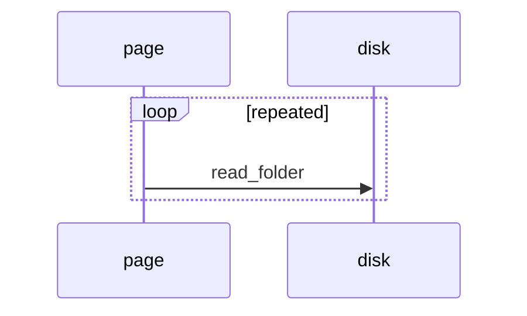

# Vault check dataflow

The vault check of Settings → Vault (`check` in `src/vault_check.rs`): it reads every folder of the vault to find names that break on other systems. The diagram below is recorded from a real run of the `dataflow_vault_check` test on a temporary vault, not written by hand (DEV-026, DEV-031).

To regenerate it after a change: `SHALE_UPDATE_DATAFLOW=1 cargo test dataflow_vault_check`, and commit the result.

<!-- dataflow:begin vault_check -->

<!-- dataflow:end vault_check -->
