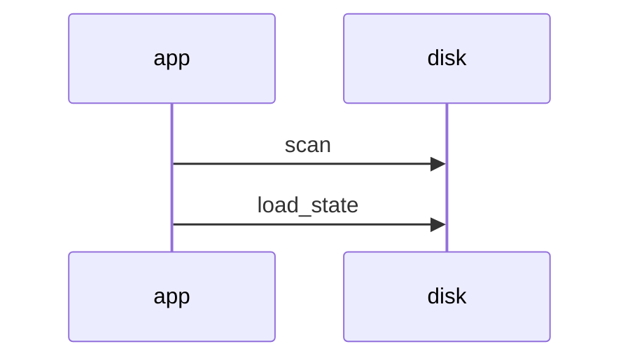

# Vault open dataflow

Opening a vault in the window (`open_vault` in `src/app.rs`): the folder is scanned and its notes read, then the vault's own settings and state files are loaded. The diagram below is recorded from a real run of the `dataflow_vault_open` test on a temporary sample vault, not written by hand (DEV-026, DEV-031).

To regenerate it after a change: `SHALE_UPDATE_DATAFLOW=1 cargo test dataflow_vault_open`, and commit the result.

<!-- dataflow:begin vault_open -->

<!-- dataflow:end vault_open -->
