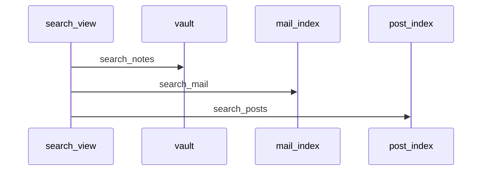

# Vault search dataflow

The search across everything Shale has indexed (`all_hits` in `src/search_all.rs`): the notes of the vault, the mail index and the post index. The diagram below is recorded from a real run of the `dataflow_vault_search` test, not written by hand (DEV-026, DEV-031).

To regenerate it after a change: `SHALE_UPDATE_DATAFLOW=1 cargo test dataflow_vault_search`, and commit the result.

<!-- dataflow:begin vault_search -->

<!-- dataflow:end vault_search -->
