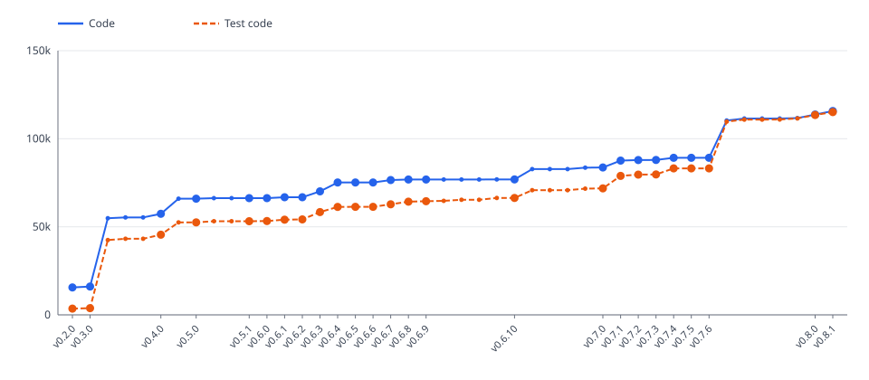

# Lines of code

Generated by `cargo run --example loc_report` (DEV-044) at commit `fcd3550a`. A line is blank, a comment (`//`, `///`, `//!`, `/* … */`) or code; code is test code inside a module declared under `#[cfg(test)]` or an item marked `#[cfg(test)]`, else production code. The test share is test code ÷ (production code + test code).

## Lines of code per tag

The picture opens the SVG file, where hovering a tag shows its counts. Code is the production code of `src/`, test code the unit tests in `src/` plus `tests/`, counted on the tree of each tag (releases `vX.Y.Z` and check tags `vX.Y.Z-rc.N`).

Numbers per tag

| Tag | Date | Code | Test code |
|---|---|---:|---:|
| v0.8.0-rc.3 | 2026-11-24 | 111466 | 110865 |
| v0.8.0-rc.2 | 2026-11-24 | 111466 | 110842 |
| v0.8.0-rc.1 | 2026-11-24 | 110346 | 109701 |
| v0.7.6 | 2026-11-23 | 89161 | 83191 |
| v0.7.5 | 2026-11-23 | 89161 | 83183 |
| v0.7.4 | 2026-11-23 | 89161 | 83147 |
| v0.7.3 | 2026-11-22 | 87950 | 79713 |
| v0.7.2 | 2026-11-22 | 87912 | 79622 |
| v0.7.1 | 2026-11-22 | 87610 | 78901 |
| v0.7.0 | 2026-11-22 | 83707 | 71834 |
| v0.7.0-rc.4 | 2026-11-22 | 83556 | 71677 |
| v0.7.0-rc.3 | 2026-11-22 | 82751 | 70809 |
| v0.7.0-rc.2 | 2026-11-22 | 82751 | 70800 |
| v0.7.0-rc.1 | 2026-11-21 | 82751 | 70804 |
| v0.6.10 | 2026-11-21 | 76875 | 66391 |
| v0.6.10-rc.4 | 2026-11-21 | 76875 | 66391 |
| v0.6.10-rc.3 | 2026-11-21 | 76874 | 65368 |
| v0.6.10-rc.2 | 2026-11-21 | 76874 | 65368 |
| v0.6.10-rc.1 | 2026-11-21 | 76831 | 64736 |
| v0.6.9 | 2026-11-19 | 76826 | 64544 |
| v0.6.8 | 2026-11-19 | 76826 | 64284 |
| v0.6.7 | 2026-11-19 | 76526 | 62772 |
| v0.6.6 | 2026-11-19 | 75163 | 61330 |
| v0.6.5 | 2026-11-19 | 75161 | 61329 |
| v0.6.4 | 2026-11-19 | 75130 | 61281 |
| v0.6.3 | 2026-11-19 | 70130 | 58355 |
| v0.6.2 | 2026-11-18 | 66793 | 54219 |
| v0.6.1 | 2026-11-18 | 66779 | 54056 |
| v0.6.0 | 2026-11-18 | 66281 | 53246 |
| v0.5.1 | 2026-11-18 | 66281 | 53172 |
| v0.5.1-rc.2 | 2026-11-18 | 66281 | 53172 |
| v0.5.1-rc.1 | 2026-11-17 | 66281 | 53173 |
| v0.5.0 | 2026-11-17 | 65940 | 52488 |
| v0.4.1-rc.1 | 2026-11-17 | 65940 | 52488 |
| v0.4.0 | 2026-11-17 | 57364 | 45499 |
| v0.4.0-rc.3 | 2026-11-17 | 55336 | 43181 |
| v0.4.0-rc.2 | 2026-11-17 | 55336 | 43181 |
| v0.4.0-rc.1 | 2026-11-17 | 54875 | 42474 |
| v0.3.0 | 2026-11-13 | 16082 | 3807 |
| v0.2.0 | 2026-11-13 | 15570 | 3564 |

## Summary

| | Lines |
|---|---:|
| Production code | 111466 |
| Test code (unit tests, in `src/`) | 107279 |
| Integration tests (`tests/`) | 3616 |
| Tooling (shell scripts) | 5479 |
| Comments | 31219 |
| Blank lines | 17897 |
| **Total lines** | **276956** |
| Test share (unit and integration tests ÷ all Rust code) | 50% |

## Featuresets

The sets of `tools/loc-report/featuresets.toml`, biggest first, then the code no set lists and the test modules that belong to no feature.

| Featureset | Files | Production | Tests | Comments | Blank | Total | Test share |
|---|---:|---:|---:|---:|---:|---:|---:|
| Import & export | 127 | 17903 | 19922 | 5395 | 3087 | 46307 | 53% |
| Settings, themes & UI shell | 94 | 17427 | 17482 | 4604 | 2399 | 41912 | 50% |
| Mail | 37 | 15755 | 15469 | 3785 | 2256 | 37265 | 50% |
| Editor & Markdown | 65 | 16279 | 13242 | 4125 | 2281 | 35927 | 45% |
| Social | 38 | 8345 | 6871 | 2005 | 1054 | 18275 | 45% |
| Drawing & media | 30 | 7223 | 5387 | 1577 | 1020 | 15207 | 43% |
| Sync & sharing | 48 | 6456 | 5838 | 1722 | 1093 | 15109 | 47% |
| Vault & files | 22 | 4765 | 4421 | 1452 | 782 | 11420 | 48% |
| Calendar | 14 | 4860 | 4165 | 1073 | 618 | 10716 | 46% |
| Search & navigation | 18 | 3977 | 3649 | 1130 | 681 | 9437 | 48% |
| Background jobs & platform | 20 | 2683 | 3686 | 941 | 619 | 7929 | 58% |
| Boards | 16 | 2462 | 2567 | 781 | 456 | 6266 | 51% |
| Developer tooling | 20 | 3331 | 1179 | 497 | 444 | 5451 | 26% |
| Shared test support | 19 | 0 | 3401 | 479 | 317 | 4197 | 100% |
| **Total** | **568** | **111466** | **107279** | **29566** | **17107** | **265418** | **49%** |

## Features by featureset

### Import & export

| Feature | Files | Production | Tests | Comments | Blank | Total | Test share |
|---|---:|---:|---:|---:|---:|---:|---:|
| pdf | 57 | 9764 | 10634 | 2959 | 1630 | 24987 | 52% |
| import | 23 | 4748 | 3990 | 1162 | 675 | 10575 | 46% |
| site_export | 31 | 2047 | 2875 | 717 | 441 | 6080 | 58% |
| docx_export | 9 | 954 | 1556 | 326 | 218 | 3054 | 62% |
| thread | 3 | 271 | 696 | 171 | 92 | 1230 | 72% |
| pandoc_limit | 2 | 50 | 124 | 36 | 20 | 230 | 71% |
| xml_limits | 2 | 69 | 47 | 24 | 11 | 151 | 41% |
| **Total** | **127** | **17903** | **19922** | **5395** | **3087** | **46307** | **53%** |

### Settings, themes & UI shell

| Feature | Files | Production | Tests | Comments | Blank | Total | Test share |
|---|---:|---:|---:|---:|---:|---:|---:|
| app | 41 | 7754 | 6283 | 1837 | 962 | 16836 | 45% |
| panels | 3 | 1278 | 2508 | 388 | 174 | 4348 | 66% |
| fonts | 11 | 1378 | 1598 | 412 | 271 | 3659 | 54% |
| settings | 19 | 2065 | 680 | 293 | 193 | 3231 | 25% |
| sidebar | 2 | 371 | 1890 | 350 | 164 | 2775 | 84% |
| keys_ui | 1 | 272 | 1525 | 219 | 109 | 2125 | 85% |
| config | 2 | 891 | 710 | 272 | 120 | 1993 | 44% |
| keys | 1 | 569 | 719 | 217 | 96 | 1601 | 56% |
| layout | 1 | 1124 | 13 | 52 | 27 | 1216 | 1% |
| themes | 3 | 326 | 452 | 113 | 72 | 963 | 58% |
| dialog | 1 | 173 | 451 | 112 | 49 | 785 | 72% |
| settings_file | 2 | 193 | 300 | 73 | 37 | 603 | 61% |
| theme | 1 | 329 | 158 | 98 | 44 | 629 | 32% |
| sidebar_ui | 1 | 441 | 0 | 63 | 24 | 528 | 0% |
| userguide | 2 | 58 | 114 | 36 | 23 | 231 | 66% |
| font_list | 1 | 132 | 38 | 39 | 21 | 230 | 22% |
| virtual_list | 1 | 47 | 43 | 20 | 8 | 118 | 48% |
| key_badges | 1 | 26 | 0 | 10 | 5 | 41 | 0% |
| **Total** | **94** | **17427** | **17482** | **4604** | **2399** | **41912** | **50%** |

### Mail

| Feature | Files | Production | Tests | Comments | Blank | Total | Test share |
|---|---:|---:|---:|---:|---:|---:|---:|
| mail | 32 | 15061 | 14795 | 3495 | 2088 | 35439 | 50% |
| secrets | 4 | 412 | 439 | 190 | 102 | 1143 | 52% |
| secret | 1 | 282 | 235 | 100 | 66 | 683 | 45% |
| **Total** | **37** | **15755** | **15469** | **3785** | **2256** | **37265** | **50%** |

### Editor & Markdown

| Feature | Files | Production | Tests | Comments | Blank | Total | Test share |
|---|---:|---:|---:|---:|---:|---:|---:|
| editor | 4 | 2742 | 3421 | 805 | 324 | 7292 | 56% |
| markdown | 4 | 1733 | 1403 | 478 | 268 | 3882 | 45% |
| math | 8 | 1862 | 838 | 271 | 188 | 3159 | 31% |
| reader | 3 | 1289 | 557 | 233 | 124 | 2203 | 30% |
| fold_ui | 2 | 406 | 1173 | 243 | 119 | 1941 | 74% |
| format_bar | 2 | 455 | 1119 | 186 | 127 | 1887 | 71% |
| format | 1 | 893 | 352 | 138 | 87 | 1470 | 28% |
| link_preview | 2 | 607 | 564 | 150 | 76 | 1397 | 48% |
| table | 2 | 593 | 549 | 174 | 102 | 1418 | 48% |
| bibliography | 8 | 587 | 479 | 180 | 113 | 1359 | 45% |
| undo | 3 | 422 | 604 | 168 | 108 | 1302 | 59% |
| vim | 1 | 501 | 299 | 101 | 59 | 960 | 37% |
| link_assist | 1 | 672 | 18 | 94 | 31 | 815 | 3% |
| syntax | 1 | 357 | 240 | 96 | 66 | 759 | 40% |
| fold | 1 | 343 | 236 | 128 | 64 | 771 | 41% |
| lists | 1 | 408 | 116 | 59 | 28 | 611 | 22% |
| table_grid | 1 | 452 | 33 | 80 | 32 | 597 | 7% |
| properties_ui | 2 | 219 | 187 | 31 | 36 | 473 | 46% |
| thesis | 2 | 240 | 113 | 61 | 43 | 457 | 32% |
| tag_assist | 1 | 259 | 71 | 55 | 30 | 415 | 22% |
| colour_tags | 1 | 193 | 120 | 48 | 30 | 391 | 38% |
| note_props | 1 | 181 | 125 | 57 | 32 | 395 | 41% |
| heading_levels | 2 | 87 | 171 | 31 | 30 | 319 | 66% |
| properties | 1 | 126 | 98 | 53 | 32 | 309 | 44% |
| code_box | 1 | 160 | 36 | 31 | 17 | 244 | 18% |
| editor_cache | 1 | 90 | 84 | 34 | 17 | 225 | 48% |
| cite_assist | 1 | 98 | 45 | 25 | 19 | 187 | 31% |
| task_box | 1 | 103 | 25 | 30 | 16 | 174 | 20% |
| cursor_style | 1 | 59 | 32 | 19 | 16 | 126 | 35% |
| caption | 1 | 39 | 33 | 15 | 11 | 98 | 46% |
| galley_index | 1 | 32 | 32 | 14 | 9 | 87 | 50% |
| table_select | 1 | 35 | 28 | 11 | 11 | 85 | 44% |
| embed_size | 1 | 27 | 27 | 20 | 11 | 85 | 50% |
| editor_preview | 1 | 9 | 14 | 6 | 5 | 34 | 61% |
| **Total** | **65** | **16279** | **13242** | **4125** | **2281** | **35927** | **45%** |

### Social

| Feature | Files | Production | Tests | Comments | Blank | Total | Test share |
|---|---:|---:|---:|---:|---:|---:|---:|
| social | 38 | 8345 | 6871 | 2005 | 1054 | 18275 | 45% |
| **Total** | **38** | **8345** | **6871** | **2005** | **1054** | **18275** | **45%** |

### Drawing & media

| Feature | Files | Production | Tests | Comments | Blank | Total | Test share |
|---|---:|---:|---:|---:|---:|---:|---:|
| media | 21 | 3184 | 3739 | 1086 | 655 | 8664 | 54% |
| drawing | 9 | 4039 | 1648 | 491 | 365 | 6543 | 29% |
| **Total** | **30** | **7223** | **5387** | **1577** | **1020** | **15207** | **43%** |

### Sync & sharing

| Feature | Files | Production | Tests | Comments | Blank | Total | Test share |
|---|---:|---:|---:|---:|---:|---:|---:|
| gitsync | 36 | 4946 | 5025 | 1465 | 915 | 12351 | 50% |
| history | 11 | 1397 | 751 | 236 | 160 | 2544 | 35% |
| conflict | 1 | 113 | 62 | 21 | 18 | 214 | 35% |
| **Total** | **48** | **6456** | **5838** | **1722** | **1093** | **15109** | **47%** |

### Vault & files

| Feature | Files | Production | Tests | Comments | Blank | Total | Test share |
|---|---:|---:|---:|---:|---:|---:|---:|
| vault | 1 | 1344 | 1225 | 408 | 203 | 3180 | 48% |
| data_usage | 7 | 971 | 707 | 201 | 140 | 2019 | 42% |
| fsutil | 2 | 625 | 813 | 282 | 112 | 1832 | 57% |
| vault_menu | 2 | 441 | 506 | 93 | 71 | 1111 | 53% |
| vault_state | 1 | 525 | 301 | 168 | 77 | 1071 | 36% |
| vault_check | 2 | 303 | 357 | 108 | 55 | 823 | 54% |
| device_local | 1 | 114 | 145 | 47 | 23 | 329 | 56% |
| known_vaults | 1 | 140 | 118 | 38 | 31 | 327 | 46% |
| vault_path | 2 | 88 | 128 | 43 | 29 | 288 | 59% |
| recovery | 1 | 63 | 66 | 25 | 17 | 171 | 51% |
| tree_rows | 1 | 97 | 6 | 20 | 10 | 133 | 6% |
| vault_cache | 1 | 54 | 49 | 19 | 14 | 136 | 48% |
| **Total** | **22** | **4765** | **4421** | **1452** | **782** | **11420** | **48%** |

### Calendar

| Feature | Files | Production | Tests | Comments | Blank | Total | Test share |
|---|---:|---:|---:|---:|---:|---:|---:|
| calendar | 13 | 4822 | 4096 | 1052 | 607 | 10577 | 46% |
| download | 1 | 38 | 69 | 21 | 11 | 139 | 64% |
| **Total** | **14** | **4860** | **4165** | **1073** | **618** | **10716** | **46%** |

### Search & navigation

| Feature | Files | Production | Tests | Comments | Blank | Total | Test share |
|---|---:|---:|---:|---:|---:|---:|---:|
| search_all | 6 | 1558 | 1281 | 490 | 282 | 3611 | 45% |
| search_form | 6 | 924 | 1236 | 280 | 187 | 2627 | 57% |
| graph | 1 | 337 | 264 | 40 | 45 | 686 | 44% |
| search_panel | 1 | 258 | 322 | 73 | 20 | 673 | 56% |
| picker | 1 | 288 | 185 | 74 | 36 | 583 | 39% |
| search_sources | 1 | 306 | 166 | 90 | 61 | 623 | 35% |
| search_render | 1 | 154 | 134 | 50 | 25 | 363 | 47% |
| graph_tree | 1 | 152 | 61 | 33 | 25 | 271 | 29% |
| **Total** | **18** | **3977** | **3649** | **1130** | **681** | **9437** | **48%** |

### Background jobs & platform

| Feature | Files | Production | Tests | Comments | Blank | Total | Test share |
|---|---:|---:|---:|---:|---:|---:|---:|
| update | 9 | 1534 | 2098 | 469 | 338 | 4439 | 58% |
| opener | 1 | 313 | 600 | 150 | 78 | 1141 | 66% |
| busy | 4 | 281 | 483 | 116 | 85 | 965 | 63% |
| main | 1 | 300 | 250 | 72 | 40 | 662 | 45% |
| instance | 1 | 133 | 155 | 57 | 38 | 383 | 54% |
| program | 1 | 58 | 33 | 25 | 16 | 132 | 36% |
| jobs | 1 | 25 | 28 | 14 | 9 | 76 | 53% |
| finder_path | 1 | 19 | 21 | 18 | 9 | 67 | 53% |
| console | 1 | 20 | 18 | 20 | 6 | 64 | 47% |
| **Total** | **20** | **2683** | **3686** | **941** | **619** | **7929** | **58%** |

### Boards

| Feature | Files | Production | Tests | Comments | Blank | Total | Test share |
|---|---:|---:|---:|---:|---:|---:|---:|
| board | 16 | 2462 | 2567 | 781 | 456 | 6266 | 51% |
| **Total** | **16** | **2462** | **2567** | **781** | **456** | **6266** | **51%** |

### Developer tooling

| Feature | Files | Production | Tests | Comments | Blank | Total | Test share |
|---|---:|---:|---:|---:|---:|---:|---:|
| bench | 15 | 3029 | 724 | 366 | 365 | 4484 | 19% |
| script | 1 | 179 | 225 | 68 | 40 | 512 | 56% |
| recorder | 1 | 123 | 77 | 22 | 21 | 243 | 39% |
| env_lock | 3 | 0 | 153 | 41 | 18 | 212 | 100% |
| **Total** | **20** | **3331** | **1179** | **497** | **444** | **5451** | **26%** |

## Shared test support

Test modules of no feature (`ui_test_support`, a `…_tests` module without a module of that name), by top-level module.

| Module | Files | Production | Tests | Comments | Blank | Total | Test share |
|---|---:|---:|---:|---:|---:|---:|---:|
| panes_ui_tests | 1 | 0 | 644 | 78 | 51 | 773 | 100% |
| netshare_env_tests | 1 | 0 | 433 | 77 | 41 | 551 | 100% |
| notes_vault_tests | 1 | 0 | 311 | 29 | 14 | 354 | 100% |
| dataflow | 1 | 0 | 274 | 55 | 29 | 358 | 100% |
| dataflow_tests | 1 | 0 | 267 | 31 | 28 | 326 | 100% |
| tab_order_tests | 1 | 0 | 252 | 33 | 24 | 309 | 100% |
| tab_keys_ui_tests | 1 | 0 | 151 | 15 | 13 | 179 | 100% |
| start_dialog_tests | 1 | 0 | 150 | 15 | 17 | 182 | 100% |
| page_break_ui_tests | 1 | 0 | 130 | 15 | 14 | 159 | 100% |
| inline_picture_ui_tests | 1 | 0 | 120 | 20 | 10 | 150 | 100% |
| ui_test_support | 1 | 0 | 118 | 34 | 21 | 173 | 100% |
| cursor_ui_tests | 1 | 0 | 114 | 14 | 10 | 138 | 100% |
| utf8_tests | 1 | 0 | 102 | 6 | 5 | 113 | 100% |
| modal_keys_ui_tests | 1 | 0 | 99 | 5 | 11 | 115 | 100% |
| property_test_support | 1 | 0 | 84 | 19 | 11 | 114 | 100% |
| test_exec_tests | 1 | 0 | 62 | 5 | 5 | 72 | 100% |
| test_exec | 1 | 0 | 33 | 18 | 4 | 55 | 100% |
| preview_ui_tests | 1 | 0 | 32 | 3 | 5 | 40 | 100% |
| align_ui_tests | 1 | 0 | 25 | 7 | 4 | 36 | 100% |
| **Total** | **19** | **0** | **3401** | **479** | **317** | **4197** | **100%** |

## Integration tests

`tests/x.rs` and `tests/x/` are one row, `x`. All of it is test code.

| Test | Files | Code | Comments | Blank | Total |
|---|---:|---:|---:|---:|---:|
| spec_refs | 1 | 539 | 74 | 50 | 663 |
| advisory_report | 1 | 412 | 27 | 47 | 486 |
| release_downloads | 1 | 334 | 36 | 18 | 388 |
| bench_scripts | 1 | 294 | 36 | 21 | 351 |
| aur_package | 1 | 239 | 26 | 23 | 288 |
| userguide | 1 | 215 | 22 | 16 | 253 |
| install_script | 1 | 195 | 23 | 20 | 238 |
| release_scripts | 1 | 151 | 29 | 20 | 200 |
| no_console_window | 1 | 145 | 17 | 10 | 172 |
| dataflow_docs | 1 | 118 | 14 | 10 | 142 |
| no_shell | 1 | 107 | 13 | 13 | 133 |
| server_recipe | 1 | 102 | 14 | 9 | 125 |
| userguide_delivery | 1 | 99 | 16 | 8 | 123 |
| export_site_cli | 1 | 91 | 10 | 9 | 110 |
| askpass | 1 | 84 | 12 | 11 | 107 |
| docx_corpus_script | 1 | 74 | 6 | 4 | 84 |
| secret_fields | 1 | 57 | 10 | 9 | 76 |
| modules | 1 | 56 | 6 | 5 | 67 |
| community_files | 1 | 54 | 4 | 10 | 68 |
| cli_start | 1 | 50 | 7 | 6 | 63 |
| export_pdf_cli | 1 | 47 | 6 | 5 | 58 |
| cross_check | 1 | 38 | 5 | 4 | 47 |
| install_tools_script | 1 | 38 | 4 | 7 | 49 |
| regen_script | 1 | 35 | 5 | 5 | 45 |
| gnupg_in_tests | 1 | 25 | 2 | 3 | 30 |
| dev_profile | 1 | 17 | 3 | 3 | 23 |
| **Total** | **26** | **3616** | **427** | **346** | **4389** |

## Tooling

Shell scripts of `scripts/`, `.forgejo/scripts/`, `tests/` and `tools/`, by folder; `#` lines are comments.

| Folder | Files | Code | Comments | Blank | Total |
|---|---:|---:|---:|---:|---:|
| scripts | 36 | 4107 | 839 | 315 | 5261 |
| .forgejo/scripts | 7 | 601 | 164 | 53 | 818 |
| tests/tex-env | 2 | 166 | 52 | 17 | 235 |
| tests/mail-env/seed | 1 | 105 | 15 | 6 | 126 |
| tests/smb-env | 1 | 100 | 40 | 15 | 155 |
| tests/syncthing-env | 1 | 93 | 18 | 12 | 123 |
| tests/mail-env | 2 | 81 | 20 | 5 | 106 |
| tests/forgejo-env | 1 | 69 | 20 | 5 | 94 |
| tests/nfs-env | 1 | 59 | 17 | 11 | 87 |
| tests/caldav-env | 2 | 58 | 14 | 4 | 76 |
| tests | 1 | 22 | 23 | 1 | 46 |
| tests/caldav-env/seed | 1 | 18 | 4 | 0 | 22 |
| **Total** | **56** | **5479** | **1226** | **444** | **7149** |
