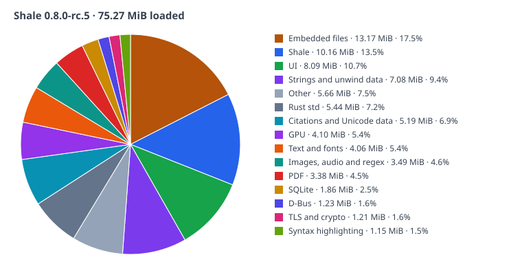
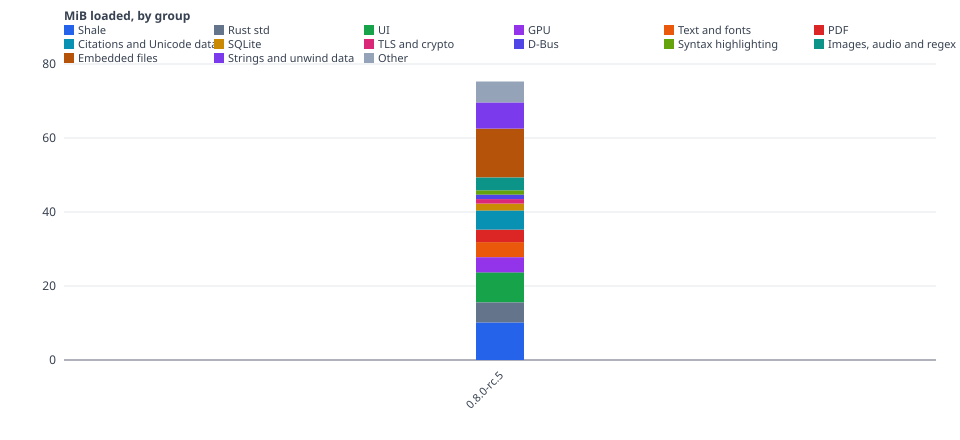

# Binary size report

What occupies the Linux x86-64 release binary of Shale **0.8.0-rc.5** (2026-11-25): **75.27 MiB** loaded (`78 928 522` bytes). This is the build of the profile `size-report`, which keeps the symbols and has no LTO, so that every byte can be attributed to a crate (see [how it is made](#how-it-is-made-and-what-to-keep-in-mind)). The file is 99.50 MiB, 75.26 MiB stripped. The binary that is shipped (profile `dist`: fat LTO, stripped) is smaller than this.

The picture opens the SVG file, where hovering a slice shows its size.

## By group

| Group | Size | Share |
|---|---:|---:|
| Embedded files | 13.17 MiB | 17.5% |
| Shale | 10.16 MiB | 13.5% |
| UI | 8.09 MiB | 10.7% |
| Strings and unwind data | 7.08 MiB | 9.4% |
| Other | 5.66 MiB | 7.5% |
| Rust std | 5.44 MiB | 7.2% |
| Citations and Unicode data | 5.19 MiB | 6.9% |
| GPU | 4.10 MiB | 5.4% |
| Text and fonts | 4.06 MiB | 5.4% |
| Images, audio and regex | 3.49 MiB | 4.6% |
| PDF | 3.38 MiB | 4.5% |
| SQLite | 1.86 MiB | 2.5% |
| D-Bus | 1.23 MiB | 1.6% |
| TLS and crypto | 1.21 MiB | 1.6% |
| Syntax highlighting | 1.15 MiB | 1.5% |

## The 25 biggest crates

Names in brackets are no crates: what the linker makes (`[linker tables]`, `[merged strings]`), the unwind tables, files that are embedded, padding to the alignment of a section.

| Crate | Size | Share | Group |
|---|---:|---:|---|
| `[embedded files]` | 13.17 MiB | 17.5% | Embedded files |
| `shale` | 10.16 MiB | 13.5% | Shale |
| `[unwind data]` | 6.57 MiB | 8.7% | Strings and unwind data |
| `hayagriva` | 3.60 MiB | 4.8% | Citations and Unicode data |
| `core` | 2.45 MiB | 3.2% | Rust std |
| `[linker tables]` | 2.36 MiB | 3.1% | Other |
| `egui` | 1.83 MiB | 2.4% | UI |
| `libsqlite3_sys` | 1.81 MiB | 2.4% | SQLite |
| `naga` | 1.61 MiB | 2.1% | GPU |
| `std` | 1.50 MiB | 2.0% | Rust std |
| `wgpu_core` | 1.40 MiB | 1.9% | GPU |
| `accesskit_unix` | 1.36 MiB | 1.8% | UI |
| `epaint` | 1.17 MiB | 1.6% | UI |
| `icu_collator` | 1.14 MiB | 1.5% | Citations and Unicode data |
| `skrifa` | 1.09 MiB | 1.5% | Text and fonts |
| `alloc` | 1.07 MiB | 1.4% | Rust std |
| `vello_cpu` | 1.06 MiB | 1.4% | Text and fonts |
| `zbus` | 1.02 MiB | 1.4% | D-Bus |
| `two_face` | 959.0 KiB | 1.2% | Syntax highlighting |
| `hayro_font` | 917.0 KiB | 1.2% | PDF |
| `winit` | 815.4 KiB | 1.1% | UI |
| `eframe` | 749.9 KiB | 1.0% | UI |
| `regex_syntax` | 632.7 KiB | 0.8% | Images, audio and regex |
| `serde_json` | 609.6 KiB | 0.8% | Other |
| `wgpu_hal` | 606.8 KiB | 0.8% | GPU |

## By section of the file

| Section | Size | Share |
|---|---:|---:|
| `.text` | 40.73 MiB | 54.1% |
| `.rodata` | 23.83 MiB | 31.7% |
| `.eh_frame` | 3.81 MiB | 5.1% |
| `.rela.dyn` | 2.27 MiB | 3.0% |
| `.gcc_except_table` | 2.27 MiB | 3.0% |
| `.data.rel.ro` | 1.71 MiB | 2.3% |
| `.eh_frame_hdr` | 508.7 KiB | 0.7% |
| `.got` | 76.5 KiB | 0.1% |
| `.data` | 48.2 KiB | 0.1% |
| `.bss` | 9.1 KiB | 0.0% |
| `.dynsym` | 7.2 KiB | 0.0% |
| `.dynstr` | 4.6 KiB | 0.0% |
| `.relro_padding` | 3.5 KiB | 0.0% |
| `.tdata` | 2.5 KiB | 0.0% |
| `.rela.plt` | 1.0 KiB | 0.0% |

## History

One column per version (a check tag `X.Y.Z-rc.N` or a release), stacked by group; the numbers are in `size-history.tsv`. A version is measured when its tag is made, so the report of a tag is in the tag's own commit.

Numbers per version

| Version | Date | Total | Shale | Rust std | UI | GPU | Text and fonts | PDF | Citations and Unicode data | SQLite | TLS and crypto | D-Bus | Syntax highlighting | Images, audio and regex | Embedded files | Strings and unwind data | Other |
|---|---|---:|---:|---:|---:|---:|---:|---:|---:|---:|---:|---:|---:|---:|---:|---:|---:|
| 0.8.0-rc.5 | 2026-11-25 | 75.27 MiB | 10.16 MiB | 5.44 MiB | 8.09 MiB | 4.10 MiB | 4.06 MiB | 3.38 MiB | 5.19 MiB | 1.86 MiB | 1.21 MiB | 1.23 MiB | 1.15 MiB | 3.49 MiB | 13.17 MiB | 7.08 MiB | 5.66 MiB |

## How it is made and what to keep in mind

`scripts/size-report.sh` builds `cargo rustc --profile size-report --locked --bin shale -- -C link-arg=-Wl,-Map=…` and `examples/size_report.rs` reads the map of the linker (lld). `scripts/make-tag.sh` and `scripts/make-release.sh` run it for every tag (not for every landing), before the version commit.

- **Only what is loaded counts**: the sections that are in memory when the program runs (`.text`, `.rodata`, `.eh_frame`, …). The symbol table, the string table and debug sections take room in the file only, and are left out.
- **Linux only, no LTO.** The size of macOS and Windows builds is not measured. With fat LTO all crates become one object and nothing can be told apart, so this is the build without it, with the symbols; the shipped binary is smaller. The shares are what to look at, not the sizes.
- **Generic code is moved to the crate it comes from.** The objects of `shale` hold 30.68 MiB of the loaded bytes, 7.35 MiB of which are code of other crates that was monomorphised for Shale's types (`Vec<shale::X>::push`, `drop_glue`): a section is named after its symbol, and the crate of the symbol's path gets it. Where a symbol does not tell (an impl on a type of Shale), the code stays with `shale`.
- **Embedded files** are the user guide (`docs/userguide`, bundled by `build.rs`) and the targets of `include_bytes!`: a `.rodata` section of `shale` that has exactly the size of such a file (from 1.0 KiB on). A file that is embedded twice is counted twice.
- **Strings**: most string literals of Rust sit in sections of their own and belong to their crate. `[merged strings]` are what the linker merged (strings of C code, constants).
- **Unwind data** (`.eh_frame`, `.eh_frame_hdr`, `.gcc_except_table`) is one slice, not split by crate.
- The padding that the linker adds between sections for their alignment is `[alignment padding]`.
